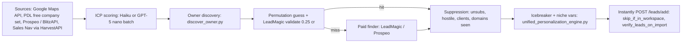
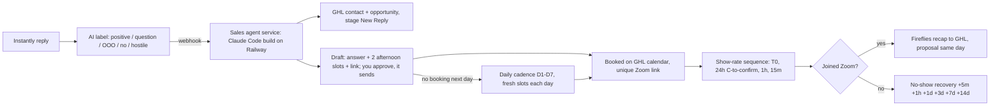

# Revenue Automation Blueprint — AdveroSolutions

As of 2026-09-21 · Prepared for Lorenzo Villarreal · Living copy: https://claude.ai/code/artifact/d35f2f88-e76b-4749-9881-a43dfbf32c5d

> Purpose of this file: a Claude Code-readable copy of the plan. Each build item has an ID (M#, S#, F#, O#). Section 7 turns them into sub-agent briefs you can hand out verbatim. Section 2 is the evidence base (live data pulled Sept 21, 2026).

---

## 1. How to read this plan

The money is in two places: (1) your cold email already produces about one positive reply per 200 contacts, but every reply, booking, reminder and no-show is handled by hand, so the funnel leaks and caps at your personal hours; (2) on Oct 11 your sending capacity goes from 300 to roughly 1,100 emails a day, which will produce 3–4× the replies and break the manual process completely unless the Sales tier is automated first. Upwork is the second engine and needs a response-time system more than more proposals.

**Money math (today vs. Oct 11, same conversion rates):** 300 sends/day → ~6 positives and ~3 booked calls per 10 days. 1,100 sends/day → ~22 positives and ~11 booked calls per 10 days. Every automation below is judged on one question: does it raise sends, positive-reply rate, booking rate, show rate, close rate, or price per client?

| Tier | Owns | Why it is ranked here |
| --- | --- | --- |
| Tier 2 — Sales (build first) | Reply triage, follow-up cadence, booking, show-rate sequence, no-show recovery, proposal + close | Volume triples in 3 weeks; unanswered positives are the most expensive leak you have |
| Tier 1 — Marketing | Deliverability monitoring, insurance inboxes, spintax, list factory, offer/campaign strategy, Upwork left manual | Feeds the funnel; most items are scheduled jobs Claude Code can run for you |
| Tier 3 — Fulfillment | Onboarding, delivery kits, reporting, retention | Light for now; built so the first wins become case studies and retainers |

**How it runs in Claude Code:** three collective agents own the three tiers (Sales, Marketing, Fulfillment) plus a small Ops agent for the cadence jobs. Every build item has an ID (M1…, S1…, F1…, O1…); Section 7 gives the agent files, the model and effort per agent, the guardrails, and one brief per build item with inputs, tools, outputs and a definition of done. IDs marked "Phase 0" are same-day fixes to do before anything else.

**Evidence base:** every number in the audit comes from live Instantly, GHL, Upwork, Google Calendar, Gmail and Drive data pulled on Sept 21, 2026, plus the laptop folders. External benchmarks are cited inline and listed in Section 8.

---

## 2. Current-state audit (Sept 21, 2026)

You have a working top-of-funnel engine and a well-written playbook, but the middle of the funnel runs on your keyboard: Instantly has no webhooks, no subsequences, no lead labels and no CRM sync, so every one of the ~17 replies in the last 11 days was read, classified, answered, scheduled and calendared by hand. The automation layer your own January SOP describes (reply monitor, auto-responder, non-booker sequence, no-show recovery) was designed but never deployed.

### What the cold email numbers say

| Campaign (launched Sept 10) | Leads | Contacted | Sent | Replies (unique) | Auto-replies | Bounces | Positives seen | Opportunities |
| --- | --- | --- | --- | --- | --- | --- | --- | --- |
| Cleaning — Client Reactivation | 482 | 197 | 300 | 4 | 3 | 5 | Ilmi (booked), Rob (booked) | 1 |
| Cleaning — Trigger Outbound | 466 | 199 | 300 | 5 | 3 | 5 | Tiffany ("upfront cost?"), Ignacio | 2 |
| Bookkeeping — Client Reactivation | 676 | 199 | 300 | 1 | 4 | 1 | Sopio (booked) | 1 |
| Bookkeeping — Trigger Outbound | 658 | 199 | 300 | 1 | 6 | 3 | none | 0 |
| Recruiting — Client Reactivation | 664 | 200 | 300 | 3 | 3 | 3 | none; 3 hostile | 0 |
| Recruiting — Outbound (specialty roles) | 648 | 196 | 300 | 3 | 3 | 3 | none; 3 not-interested | 0 |
| **Total** | **3,594** | **1,190** | **1,800** | **17 (1.4%)** | **22** | **20 (1.1%)** | **~6 (0.5%)** | **4** |

Read: cleaning is the winner (about 1% positive rate, 4 of 6 positives; all 3 booked calls came from cleaning + bookkeeping reactivation). Recruiting has produced zero positives and the harshest replies in 400 contacts. No campaign has reached the 1,000-send verdict line yet. Three discovery calls this week (Rob/CJS Global held Sept 18, Ilmi/Shining Armor rescheduled to Sept 23, Sopio/Taxfo Sept 24), all booked by hand with manual Zoom links.

### Sending infrastructure

| Item | State |
| --- | --- |
| Instantly plan | Hyper Growth (subsequences, webhooks, AI labels, Reply Agent all available) |
| Active inboxes | 12 (4 domains × 3 personas), 25/day each = 300/day, fully consumed by 6 campaigns at 50/day |
| Warming inboxes | 33 on 11 new domains, added Sept 20; calendar says go-live Oct 11 |
| Capacity on Oct 11 | 45 × 25 = 1,125/day (× 3.75). Zero insurance inboxes today |
| Sequence | 2 steps (day 0, +3), one variant, one subject, no spintax, text-only, open/click tracking off (correct) |
| Reply handling | Manual in Unibox. Auto-tag interest on by default; OOO smart-pause status not verified; opportunity value left at $1,000 default |
| Retired domains | 9 *adverosolutions.com variants used for HVAC/roofing/electrical in Dec 2025–Mar 2026 |

### Sales tooling

| Tool | State |
| --- | --- |
| GHL (AdveroSolutions) | "Sales" pipeline: New Reply/Lead → Call Booked → Proposal Sent → Won → Lost → Follow Up Later. "Discovery Call" calendar (advero-discovery-call, 15 min, Google Meet, Mon–Fri) exists but is not used in replies. Published workflow "Deal Won → ClickUp project + client tag"; draft "Proposal Follow-up Sequence"; 13 empty drafts and two client-demo workflows created Sept 21 |
| Calendar / Zoom / Fireflies | Manual Zoom meetings on Google Calendar; Fireflies records and sends prep + recap emails; nothing flows into GHL |
| ClickUp | Created Sept 17; Client Work › Active Clients, Internal/Admin; empty |
| Upwork | Rising Talent (Sept 20). Rate $23.78/hr. 27 proposals, 2 hires, $754 billed. 1,804 connects on hand. Most proposals boosted at 34–114 connects (~$5–17 each) |

Upwork leaks found today: a client invitation (ClosePoint USA, GHL expert) unanswered since Sept 16; a call request from RoutVox Consulting unanswered since Aug 27; both finished clients (Treasure Labs, Jennifer L.) waiting on your last message.

Browser check (Dia, your active browser): pinned tabs are Vollna, Skool, Upwork, MillionVerifier, PandaDoc, Instantly, ClickUp, GHL, Google Docs/Sheets and Discord; installed apps add Loom, Fireflies, Fathom, Zoom, Wispr Flow, Rize/Timing, ChatGPT, Telegram and WhatsApp. Gmail receipts show D7 Lead Finder and Calendly were paid for earlier; neither is in use now.

### What is already built on the laptop

| Asset | Where | What it is | Status |
| --- | --- | --- | --- |
| Agentic Workflows | Desktop/AdveroSolutions | ~70 Python scripts: Google Maps + Modal cloud scrapers, owner discovery, email pattern guessing, bulk verification, AnymailFinder merge, Claude icebreaker/pain-point generators, Instantly API client + campaign builder + lead sync, Sheets CRM, ntfy push alerts, Skool scraper/tone tools, LinkedIn content generator | Lead-gen half works; the "24/7 automated" reply/no-show layer in INDEX.md was never written (no modal_webhook.py, claude_response.py, self_heal.py) |
| Master SOP v2.0 | same folder | Lead stages, 3–4 email campaigns, 60-second positive-reply templates, non-booker (D3/5/8/12), no-show (5 min/24h/48h), triage, one-call-close script, objections, post-call sequences, monitoring thresholds | Written for the HVAC/roofing era and $297–997/mo pricing; skeletons reusable |
| Cold Email Sequences v2 | Drive · "Month 1 Day 16" | 3 niches × 2 offers, guarantees, proof rules, compliance checklist | Live copy diverged from it (rewrites drop the low-friction "send me your list" CTA) |
| Demo Library | Desktop/Projects/library | 10 pre-built n8n + Make systems with a paste-and-record Upwork video loop (CLAUDE.md, July 30) | Built; slots 011+ empty |
| Bid & Follow-Up System | Downloads (01–05 n8n JSON + sheets) | 8-touch email/SMS follow-up engine delivered to Jennifer L. for $528.64 | Productizable |
| Client deliverables this month | Downloads, Aysha Delivery | Mike (Man Transformed) $2,000/30-day content & lead system, signed Sept 17; Atlantic Labs cold-email runbook; Bid system | Fulfillment running by hand |
| Daily Metrics tracker | Drive | Maker School daily-update generator (Upwork, email, DMs, pipeline, revenue) | Last logged Aug 12; streak 0 |
| Skool MCP | ~/.config/skool-mcp | Cookie-authenticated Skool connector | Can post daily updates automatically |

### Where the hours go

Replying to interested leads (pricing answers, proposing times, sending invites), building each Zoom meeting by hand, reading Fireflies recaps, writing Upwork proposals and Looms, copying job posts into Google Docs, building lead lists per campaign, and Mike's onboarding. None of it is tracked; Rize daily summaries exist but are not read back into the retro.

---

## 3. Tier 1 — Marketing (top of funnel)

Goal: 1,100+ clean sends a day from Oct 11 without burning inboxes, feeding a list factory that never runs dry, on offers that have already proven they get replies (cleaning first). Everything here is a scheduled Claude Code job against the Instantly API, not a new SaaS.

### M1 — Five-level deliverability monitor

| Level | Check | Threshold / rule | Action when it fails | Instantly endpoint | Runs |
| --- | --- | --- | --- | --- | --- |
| 1 | Warm-up health per inbox | Score < 98% (Eric: remove at 98; never send below 90) | `POST /accounts/{email}/pause`, swap an insurance inbox into the campaign `email_list`, Slack alert | `POST /api/v2/accounts/warmup-analytics` (≤100 emails/call), `POST /api/v2/accounts/test/vitals` (SPF/DKIM/DMARC/MX) | Daily 07:00 |
| 2 | Inbox placement (seed) test | < 85% inbox on Google or Microsoft seeds | Pause the failing inboxes; re-test after 48 h | `POST /api/v2/inbox-placement-tests` (type 2 automated, schedule + `placement_goes_below` automation), `POST /inbox-placement-analytics/stats-by-test-id` | Weekly, Mon |
| 3 | Reply rate per inbox and per domain | ≥100 sent in 7 d or 14 d and < 1% real replies (exclude auto-replies and OOO); bounce > 2% | Remove from campaign `email_list` (`PATCH /campaigns/{id}`), retire the domain if all its inboxes fail, promote insurance | `GET /api/v2/accounts/analytics/daily?emails=` (sent, replies, replies_automatic, bounced) | Friday audit |
| 4 | Auto-responder canary | One email from each inbox to your harvested list of unmonitored/auto-reply addresses; expect ≥ 80% auto-responses; < 60% = kill | Same as level 3 | Harvest from `GET /api/v2/emails?email_type=received` where subject matches "Automatic reply", "no longer monitored", "Out of Office" (20+ already in Unibox: RBG Janitorial, goforward.com, Charter Financial, Sienna Consulting, Summerville Tax…) | Saturday |
| 5 | Positive-behaviour baseline campaign | Permanently-on campaign that should get high reply rates (partner/referral outreach to automation freelancers and Maker School peers); per-inbox reply rate is the canary | Inbox whose canary rate halves → level 3 action | Ordinary campaign analytics per account | Always on, reviewed Friday |
| Alert | Sudden drop | Any inbox/domain whose 7-day reply rate falls below 50% of its 4-week average (e.g. 1.5% → 0.2%) | Pause immediately, pull last 24 h bounces (`FILTER_VAL_BOUNCED`), look for 550 / "reported as spam", check blacklists via placement report | Daily, with level 1 |

Real vs. borrowed: Eric's published numbers are the 98% warm-up cut-off, bounce > 2% removal, daily reply-rate check below 1%, Friday domain audit, insurance capacity ≥ 50%, and "never try to heal a domain". The 5-level framing, Saturday auto-responder list and 1.5% → 0.2% alert come from the video transcript; treat those as his practice, not a published spec.

### M2 — Capacity and insurance plan for Oct 11

| Date | Active inboxes | Sends/day (25 each) | Insurance warming | Action |
| --- | --- | --- | --- | --- |
| Today | 12 | 300 | 33 (warming since Sept 20) | Nothing to add; warm-up runs 21 days |
| Oct 11 | 45 | 1,125 | 0 | Buy 8 more domains and 23 inboxes now so they are warm by Oct 11 (50% insurance rule); Google inboxes via Zapmail ~$3.00–3.50 or Instantly DFY $5/mo; domains ~$12–15/yr |
| Nov 1 | 45 + swaps | 1,125–1,350 | 23 | Raise daily limit to 30 only on inboxes with ≥ 2% reply rate |

Rules: never more than 3 inboxes per domain; keep warm-up on forever; add Microsoft (Hypertide Entra, ~$25/domain incl. 25 inboxes) once Gmail inboxes are 3+ weeks old, then turn on Instantly `match_lead_esp`; keep `open_tracking` and `link_tracking` off (Eric's test: 4.8% reply with pixel off vs 0.8% on).

### M3 — Copy hygiene and spintax (Phase 0)

1. Fix defects before new inboxes go live: `{{personaliztion}}` typo (two drafts), "run outreach outreach", "ill shoot", and the stray note-to-self inside a signature in the Cold Email Creation doc.
2. Word-level spintax in Instantly syntax `{{RANDOM | option A | option B | option C}}` (variables may sit inside options; preview before launch). Spin greeting, opener, CTA line, sign-off, opt-out line: 3–5 spin points per email, never the merge variables. Write 12 human variants per segment first, then spin.
3. Second variant on every step (live A/B); judge at ≥ 500 sends per variant.
4. Step 3 on day 7–11 as a new thread with a different proof point ("lost bids" / "last tax season" subjects); best copy stays in email 1.
5. Standardise proof: the roofer is "$6M in 6 months" in reactivation copy and "$180K in 90 days" in outbound copy. One per campaign, identical across email, Upwork profile and proposals.

### M4 — Campaign strategy and the verdict rule

No verdict before 1,000 sends; with ≥1 positive at 1,000, run to 3,000 before deciding.

| Campaign | Sends today | Verdict point | Recommendation |
| --- | --- | --- | --- |
| Cleaning — Reactivation | 300 | 1,000 (≈ Oct 5) | Scale first; 2 of 3 booked calls. Largest share of the 45 inboxes |
| Cleaning — Trigger Outbound | 300 | 1,000 | Scale; add {{buildingType}} and {{metro}} so the sentence changes per lead |
| Bookkeeping — Reactivation | 300 | 1,000 | Keep; build the Q4 "year-end cleanup" variant now |
| Bookkeeping — Trigger Outbound | 300 | 1,000 | Keep to 1,000, then decide |
| Recruiting — both | 300 each | 1,000 | Run to 1,000 only; zero positives and hostile replies. If still zero, retire and reuse the inboxes |

Offer checks (Eric's five: make-money shape, unknown mechanism, easy next step, segmentation that changes the sentence, relevant proof). Two tests: (a) A/B the reply-yes-for-a-call CTA against "send me your list of lost bids and I'll show you which ones are worth chasing" (lower friction, self-qualifying); (b) replace the compliment icebreaker with the 10-minute-research standard (service area + building types + a lost-bid hypothesis) and test a no-icebreaker variant; test a whole sentence, not a word.

Next verticals after cleaning is proven (recurring-contract B2B services, avoiding the trades): commercial landscaping, commercial pest control, security-guard companies, medical billing firms, commercial insurance agencies. One reactivation campaign each, 1,000 sends.

### M5 — The list factory

At 1,100+ sends/day on a 2–3 step sequence you need ~500 new verified leads/day (~3,300/week). Current stock (3,594 uploaded, 1,190 contacted) lasts about five days at that rate.



Rules: ≤ $0.02 per contact all-in (LeadMagic validation ~$0.002–0.005, MillionVerifier $0.0015–0.004, Google Maps via RapidAPI $0.001–0.004/business, company data free from People Data Labs); guess `first@`, `first.last@`, `flast@`, `firstlast@` before paying a finder; ICP scoring must answer "do they actually do commercial cleaning?"; Google Maps for cleaning, LinkedIn/Sales Navigator for recruiting and bookkeeping; score every source by replies per 1,000 sends; tag trigger signals (job posts for account managers, new locations, business formations) so trigger campaigns are trigger-based for your own prospects too.

### M6 — Upwork stays manual (your call)

The application flow (job selection, the Demo Library paste-and-record loop, the Loom, the proposal, boosting) does not change: it is working and the video is why it works. Nothing in this plan automates or alters it. Only two things touch Upwork, both read-only and outside the application flow:

| Item | What | Why |
| --- | --- | --- |
| Rooms SLA check (O2) | Twice a day the Ops agent lists Upwork rooms with `awaiting_reply_from: you` and pings you; nothing is drafted or sent | Today: ClosePoint invitation unanswered 5 days, RoutVox call request 25 days, two finished clients waiting on a last message |
| Post-contract asks | A reminder 48 h after a contract closes: review, testimonial, maintenance-retainer offer, written by you | Each finished contract is a case study and a Top Rated step (you are at $754 of the $1,000 threshold) |

For reference only, not a build: Upwork's own rate pages put n8n experts at $40–100/hr and marketing automation at $40–90/hr; your profile shows $23.78/hr. Change it only if you want to.

### M7 — Other channels (light)

- Maker School: post the daily update automatically through the Skool MCP (O4); last logged day was Aug 12.
- Referral/partner campaign: level-5 canary and a revenue line (agencies/freelancers who need cold-email infrastructure — the $199 Atlantic Labs build, sellable at $750+).
- Proof engine: every client build becomes a same-industry case study within 30 days.

---

## 4. Tier 2 — Sales (reply to revenue)

Goal: every positive reply gets a correct answer within 5 minutes, two concrete times plus a booking link, a reminder sequence that pushes show rate above 90%, and a recovery sequence that starts the minute someone does not join. This is the system the January SOP specifies (60-second reply, non-booker D3/5/8/12, no-show 5 min/24 h/48 h), built on Instantly webhooks + GHL instead of the Sheets CRM that never shipped.



### S1 — Reply engine: classify, route, draft, alert

| Piece | Spec |
| --- | --- |
| Classification | Native auto-tagging + custom AI lead labels (`POST /api/v2/lead-labels`, `use_with_ai: true`): positive_interested, positive_question (pricing / percentage / "send info"), positive_referral, neutral_question, negative_notnow, negative_notfit, negative_hostile, unsubscribe, ooo, wrong_person, auto_reply_unmonitored (feeds M1 level 4). Enable OOO Smart Pause (uncheck "stop on auto reply" per campaign) |
| Transport | One Instantly webhook per event: `reply_received`, `lead_interested`, `custom_label_any_positive`, `lead_not_interested`, `lead_unsubscribed`, `email_bounced` → the Sales agent's webhook service (FastAPI on Railway, built in Claude Code; n8n is the fallback). Payload carries reply_text, campaign, lead fields, unibox_url |
| Routing | Upsert GHL contact (email, company, niche tag, campaign tag, Instantly lead id) and create/move the opportunity in "Sales": positive → New Reply/Lead; not interested → Lost with reason; unsubscribe/hostile → Instantly blocklist + GHL DND same day; referral → task "ask for intro" |
| First-reply draft (Eric's framework) | The draft does three things in order: answers whatever they asked (pricing → 20–30% of first-year fees, smaller cut on bigger lists, $0 if nothing closes; "send info" → one-line mechanism + one-pager), then offers two specific afternoon slots pulled live from your GHL calendar (never before 12:00 CT, ≥ 4 h out, within the next 5 business days, not already offered to anyone), then adds the booking link: "or if it's easier, grab a time here". Both the times and the link, every time |
| Approval and SLA | Rule (2026-09-22): a first reply (or counter-proposal, or booking confirmation) is sent automatically only when its text is exactly a template you approved with jobs/approve_templates.py and unchanged since, the template kill switch is off, and every send check passes; anything else is yours to approve: a text and Slack card with the draft, one tap to send, edits allowed; goal under 5 minutes in business hours (replies sitting 24 h lose about half their booking potential). Outside hours the draft waits for 07:00 (an auto-sent one too). Once you approve, the daily cadence in S2 arms itself; any new inbound reply pauses the cadence and produces a fresh draft for approval |
| Sending and threading | Every reply goes out through Instantly (`POST /api/v2/emails/reply`) from the same inbox and thread the cold email came from; the engine sets the lead to Interested / Meeting Booked via `leads/update-interest-status` |
| Why not Instantly's AI Reply Agent | It can only auto-book into Calendly and cannot pull slots from GHL or apply your no-mornings rule; keep it off. The own-built service is a two-day build and becomes the product you sell as the follow-up system |

### S2 — Daily follow-up cadence for positive replies (Eric's framework, extended to 7 days)

Eric's reply framework (from the $50K-in-30-days video): first reply answers the question and offers two times plus a link; a day later "I lost both of those times" plus two new times and the link; the third touch looks up their business and gives a specific reason to take the call; the fourth repeats the lost-times move; then a warm caller. He stopped after four because it was a sprint and said you could keep going. His other material adds a matching case study, a piece of free work, and a calendar invite sent pre-marked as free. Your call is to run it daily for a full week, so the cadence below is his four steps extended to seven with his own escalations filling days 5–7. Every touch is generated by the engine with fresh afternoon slots from your calendar, sent in the same thread; a booking or any reply stops it. Instantly's static subsequences cannot insert fresh times, so they are only the fallback if the service is down.

| Day | Send | Message | Approval |
| --- | --- | --- | --- |
| 0 | ASAP after their reply | Answer the question + two afternoon slots + link | You approve |
| 1 | Next business day, 10:00 CT, if no booking | "I lost both of those times" + two new slots + link (status alignment, not "just following up") | Auto-send; 30-minute veto window on your phone |
| 2 | 10:00 CT | Researched line about their business and why the call is worth 15 minutes (their site, reviews, Maps footprint) + two slots | Auto-send |
| 3 | 10:00 CT | "Those times went too" + two new slots + link | Auto-send |
| 4 | 10:00 CT | Matching case study (roofer bid follow-up for reactivation offers; consultancy +35% for outbound) + two slots | Auto-send |
| 5 | 10:00 CT | Free work: "I pulled 15 lost-bid candidates from your reviews and Maps footprint, want the list?" + two slots | Auto-send |
| 6 | 10:00 CT + second channel | Calendar invite for one of the slots, marked free so it does not block their day, + SMS or LinkedIn note if you have the number | Auto-send; the invite needs your one-tap OK |
| 7 | 10:00 CT | Yes/no close: "should I close your file, or is a different week better?" | Auto-send |
| 14 / 30 | GHL Follow Up Later | One re-touch each with two slots, then into the reactivation-of-your-own-list campaign | Auto-send |

Rules the engine enforces: slots are 12:00–18:00 CT Mon–Fri only, at least 4 hours ahead, inside the next 5 business days, never a slot already offered to another lead that day; stop on booking, on any reply (back to draft-for-approval), on unsubscribe; skip weekends; one touch per day maximum; a lead who says "not now" goes to Follow Up Later with a date instead of continuing the cadence. Expected result from Eric's run: about 62% of positive replies booked (373 positives → 231 meetings).

### S3 — Booking without your hands

1. Connect Zoom to your GHL user (Profile › Calendar Settings › Video Conferencing) so "Discovery Call" bookings generate unique Zoom links; keep Fireflies on the invite. (Calendar is set to Google Meet today.)
2. Calendar rules: next 5 business days only (show ~81% for day-1 bookings, ~60% at day 14), 15-min slots + 15-min buffer, phone required, auto-confirm, reschedule/cancel links, invite title "Lorenzo <> {{contact.company}}: 15-min reactivation plan".
3. Two-times proposal: engine reads free slots from GHL (free-slots endpoint) and writes "Tue 2:00 or Thu 10:30 CT? Or grab any slot here". If the lead replies with a time, the engine books via the GHL appointments API.
4. Status sync: booking → `POST /api/v2/leads/update-interest-status` Meeting Booked (2); held → Meeting Completed (3); close → Closed (4).

### S4 — Show-rate sequence (target no-show < 10%)

Register A2P 10DLC in GHL on day one (Low-Volume Standard $24.50 one-time, 3–7 business days); until it clears, run email legs only. Cold-sourced calls typically no-show 25–35% without this; automated reminders cut no-shows ~28%; a 1-hour SMS is the single highest-leverage message.

| When | Channel | Message |
| --- | --- | --- |
| T+0 | Email + SMS | Confirmation with 3-bullet agenda, calendar invite, 60-second Loom (generic per niche; personalized for deals > $5k) |
| T+15 min | Email | One-page pre-read for their niche |
| 24 h before | SMS + email | "Reply C to confirm" → GHL Customer Replied → Update Appointment Status = Confirmed |
| 4 h before, if no C | Task | Personal text or call from you |
| 1 h before | SMS | Zoom link |
| 15 min before | SMS | "Hopping on now" |

One GHL workflow on Customer Booked Appointment (calendar = Discovery Call): Wait → Before appointment 24 h / 1 h / 15 m, past-time fallback = skip, 1-minute wait before the first message so the Zoom link populates, Allow Re-entry for reschedules.

### S5 — No-show detection and recovery (target 35–50% rebooked)

Detection: GHL never marks no-shows by itself. Zoom webhooks `meeting.participant_joined` / `meeting.ended` (host-side) → n8n; non-host join → `PUT /calendars/events/appointments/{id}` status showed; no non-host join by start + 10 min → no-show. Fallback: Fireflies recap with empty transcript. GHL trigger Appointment Status = No-show (Modified By API) starts the sequence.

| When | Channel | Message |
| --- | --- | --- |
| +5 min | SMS + email | "Still on? I'll stay on for 10 more minutes" + link |
| +10 min | Call + voicemail | 30-second voicemail |
| +1 h | Email | "No worries, grab a new time" with `{{appointment.reschedule_link}}` + two slots |
| +1 day | Other channel | SMS/LinkedIn, two slots |
| +3 days | Email | Value add + re-ask |
| +7 days | Email | Yes/no question |
| +14 days | Email | Breakup → Follow Up Later |

Repeat no-show policy (SOP-005): full sequence on the first, two touches on the second, one on the third then Lost.

### S6 — Pre-call brief and the call

60 min before each call the engine posts a brief to Slack and GHL notes: company facts, campaign + reply thread, niche offer, guarantee numbers, likely objections, allowed proof points. Run Nick's skeleton (rapport → set the schedule → why me/why now → solution with temperature checks → proposal). One-call close applies to performance deals: the agreement is simple enough to sign on the call.

### S7 — Proposal and close

| Step | Automation |
| --- | --- |
| Recap + proposal same day | Fireflies transcript → Claude drafts the proposal from the offer sheet into GHL Documents or PandaDoc; you review; sent within 2 hours; 50% deposit |
| Proposal Follow-up Sequence (finish the GHL draft) | D1 "any questions?", D3 Loom walkthrough, D7 case study, D14 decision ask, D21 close-out → Follow Up Later |
| Verbal commit | Payment link within 1 hour, D1 and D3 nudges (SOP-009), Stripe/GHL invoice |
| Won | "Deal Won → ClickUp project + client tag" + onboarding kit (F1) |

### S8 — Pipeline hygiene

GHL "Sales" is the single source of truth; Instantly statuses mirror it nightly. Real opportunity values per offer (reactivation ≈ 20–30% of first-year fees on a 60–100 contact list; outbound retainer $2,500–5,000/mo). Weekly sweep: positive reply with no reply from you in 24 h; booked call without confirmation; proposal older than 7 days with no touch.

### S9 — Upwork conversations use the same machine

Same 1-hour SLA, same drafted replies, same booking flow (keep messaging on-platform). Post-contract: review request, testimonial ask, maintenance-retainer offer within 48 hours of completion.

---

## 5. Tier 3 — Fulfillment (deliver, prove, retain)

Goal: every client build becomes a kit you can redeploy in a day and a case study you can cite in cold email within 30 days.

### F1 — Onboarding kit

Extend "Deal Won → ClickUp project + client tag": Drive client folder from template (Raw / Review / Approved), kickoff form (accounts, logins via password manager, lists, voice file, calendar access, do-not-say list), kickoff call on a separate GHL calendar, Stripe invoice for the first installment, ClickUp task template per product. The Mike onboarding checklist is the content.

### F2 — Three products, three kits

| Product | Already built | Kit to package | Price reference |
| --- | --- | --- | --- |
| Reactivation system | Instantly campaign builder, personalization engine, GHL sequences | Campaign templates timed to renewals/tax season, lead import script, attribution tracker (reactivated contact → deal within 6 months), monthly report | 20–30% of first-year fees, $0 up front |
| Bid / sales-request follow-up system | 5 n8n workflows + Sheets + Twilio (Jennifer, $528.64); GHL drafts "Your Bid Follow-Up System", "Your Sales Request Follow-Up System" | GHL snapshot + n8n JSON + SOP + 3-minute Loom; same engine as Tier 2 | $1,500–2,500 setup, $300–500/mo maintenance |
| Cold-email infrastructure setup | Atlantic Labs runbook | Runbook template + Claude Code setup script (domain list, DNS records, Instantly account creation via API) | $750–1,500 |

The Demo Library (10 systems, n8n + Make) is the fourth asset: add the Tier 2 engine as system 011.

### F3 — Reporting that sells the renewal

Weekly client scorecard from the same Instantly/GHL pulls you run for yourself: sent, replies, positives, booked, held, closed, revenue attributed, next week's plan; Nick's agenda (wins, next steps, open questions) as the body. For performance deals the scorecard is the invoice basis.

### F4 — Retention and proof

| When | Action |
| --- | --- |
| Day 7 | Check-in + fix window (5-business-day fixes already promised) |
| Day 21 | Results snapshot → draft case study → client approval |
| Day 25 | Renewal / maintenance offer (Mike's 30-day term ends around Oct 17) |
| Day 30 | Referral ask + review request |

### F5 — Capacity protection

Calls only 12:00–18:00 Mon–Fri (calendar already enforces), Upwork radar responses in two 20-minute windows plus alerts, retro reads Rize time data so fulfillment hours vs sales hours are visible weekly.

---

## 6. Operating cadence (the jobs that run without you)

### Daily

| Time (CT) | Job | ID | Output |
| --- | --- | --- | --- |
| 07:00 | Deliverability level 1 + vitals + sudden-drop check across all 45 inboxes; auto-pause failures, promote insurance | O1 | Slack card: inboxes paused/promoted, bounce codes, campaigns at risk |
| Continuous | Reply engine (S1) with its 5-minute SLA timer; Upwork rooms SLA check (M6, read-only) at 09:00 and 15:00 | O2 | Texts/Slack cards with drafts |
| 07:30 | Positive-reply sweep: positives with no reply in 24 h, unconfirmed calls inside 24 h, Upwork rooms waiting on you | O3 | One list, ordered by money |
| 18:00 | Daily metrics auto-fill (Instantly `campaigns/analytics/daily`, accounts analytics, Upwork proposals + connects, GHL opportunities) → render the DAILY UPDATE block → post to Maker School via Skool MCP (or stage for review) | O4 | Sheet row + Skool post + streak |

### Weekly

| Day | Job | ID | Rule |
| --- | --- | --- | --- |
| Mon | Inbox placement test on a sample; bounce audit | O5 | Placement < 85% or bounce > 2% → pause |
| Wed | Positive-reply and pipeline sweep (S8) | O3 | Nothing positive older than 24 h untouched |
| Fri | Domain/inbox reply-rate audit (M1 L3), campaign verdicts at 1,000/3,000, variant winners, retro packet | O6 | ≥100 sent and <1% real replies → remove; variants judged at ≥500 sends |
| Sat | Auto-responder canary (M1 L4) | O7 | <60% auto-responses → kill inbox |
| Sun | List factory run (M5): 3,300 verified, scored, personalized leads; Instantly Lead Finder agent as backstop | O8 | Every campaign has ≥5 days of uncontacted leads |

### The retro packet (Friday)

Generated, not written: this week vs last week for every funnel number; system changes (git log + GHL/Instantly audit logs); wins and objections from Fireflies transcripts; three lessons Claude proposes from the data; hours by category from Rize; next week's three bets with owner. Ten minutes of editing, then post. The same packet becomes the client scorecard (F3).

### Monthly

Full spam-word and placement test (≥85% inbox); domain rotation (age new domains 4–6 weeks); Upwork pricing/rate review; one new case study; one new vertical at 1,000 sends.

### KPI dashboard and alert thresholds

North star: discovery calls held per week.

| Metric | Green | Alert | Source of truth |
| --- | --- | --- | --- |
| Sends/day vs plan | ≥ 90% | < 80% | Instantly daily analytics |
| Warm-up health per inbox | ≥ 98% | < 98% pause | Warmup analytics |
| Bounce rate | < 1% | > 2% remove inbox | Accounts analytics |
| Real reply rate (ex auto/OOO) | ≥ 1% | < 1% after 100 sent per inbox; sudden 50% drop | Accounts + emails |
| Positive reply rate | ≥ 0.7% | < 0.5% for 3 days | Lead labels |
| Time to first reply on positives | < 5 min (business hours) | > 60 min | Reply engine log |
| Positive → booked | ≥ 50% | < 40% | GHL pipeline |
| Show rate | ≥ 90% | < 80% | GHL appointment status |
| No-show rebooked | ≥ 40% | < 25% | GHL |
| Proposal → close | ≥ 30% | < 20% | GHL |
| Upwork proposal reply rate | ≥ 15% | < 8% | Upwork proposals list |
| Upwork response time | < 1 h | > 4 h | Rooms audit |
| Cost per verified lead | ≤ $0.02 | > $0.04 | List factory ledger |

---

## 7. Execution roadmap and sub-agent briefs

### Phase 0 — today and tomorrow (no sub-agent needed)

- [ ] Answer the four Upwork threads (ClosePoint invitation, RoutVox call request, Treasure Labs, Jennifer L.); ask both finished clients for a review + testimonial
- [ ] Fix the copy defects (M3.1); add spintax + a B variant to all six campaigns; add a step 3 new-thread email
- [ ] Instantly settings: OOO Smart Pause on, custom AI labels created, opportunity values per offer, `stop_on_auto_reply` off, tracking off
- [ ] Create the Interested-quiet subsequence on each campaign; move Tiffany, Ignacio and other quiet positives into it
- [ ] Connect Zoom to your GHL user; switch Discovery Call from Google Meet to Zoom; 5-business-day window; phone required
- [ ] Start A2P 10DLC registration in GHL (Low-Volume Standard)
- [ ] Order insurance domains and inboxes (M2) so they are warm by Oct 11
- [ ] Optional and only if you want to: revisit the Upwork rate and title line. The application flow itself stays as it is (M6)
- [ ] Send Mike his day-25 renewal offer by Oct 12 (term ends around Oct 17)

### Phases

| Phase | Dates | Ships | IDs |
| --- | --- | --- | --- |
| 1 — Sales engine | Sept 22 – Oct 3 | Reply engine, booking, show-rate sequence, no-show detection and recovery, pipeline sync | S1–S5, S8 |
| 2 — Deliverability and volume | Sept 29 – Oct 10 | Five-level monitor, insurance swap logic, list factory, campaign scaling for Oct 11 | M1, M2, M5, O1, O5, O7, O8 |
| 3 — Cadence and metrics | Oct 6 – Oct 17 | Daily metrics + Skool post, retro packet, Upwork rooms SLA check (read-only) | O2, O3, O4, O6 |
| 4 — Close and deliver | Oct 13 – Oct 31 | Pre-call brief, proposal generator + follow-up sequence, onboarding kit, client scorecard, product kits | S6, S7, F1–F4 |

### Shared conventions for every sub-agent

Work inside `Desktop/AdveroSolutions/Agentic Worklfows` (rename to `agentic-workflows`): keep the directives → execution split, add `services/` for long-running webhooks and `jobs/` for scheduled tasks, one root `CLAUDE.md` stating the offer sheet, the API map and the Section 6 thresholds. Secrets stay in `.env` (rotate the Instantly key in the old `.env` if it was ever committed). Every job has `--dry-run`, structured logs to one Google Sheet tab (`Job_Log`) and a Slack/ntfy alert on failure (`ntfy_notifier.py` exists). Hosting: Railway or Modal for the reply engine and Zoom webhook receiver; n8n for GHL glue; Claude Code scheduled tasks for daily/weekly jobs. Definition of done always includes a dry-run on live data, a 48-hour shadow period (propose, don't act), and a one-page runbook in `directives/`.

### Claude Code setup: collective agents, models, effort, guardrails

> **2026-09-25: every runtime role runs on Opus 5.5 (`claude-opus-5-5`)** per Lorenzo: classification, escalation, drafts, research lines, retro and proposals. Nothing runtime is on Haiku or Sonnet any more; the "Runtime" row in the table below is superseded. `shared/llm.py` MODEL_POLICY stays the single authority.
>
> **Fable was retired on 2026-09-21** (Lorenzo's weekly allowance ran out) and **Opus 5 (`claude-opus-5`) replaces it everywhere**: in `.claude/agents/*.md`, in root `CLAUDE.md`, and in `shared/llm.py` MODEL_POLICY, which is the single place that decides what the deployed services call and the only authority when this section disagrees. Every "Fable 5.1" below reads as "Opus 5"; the prose is left as written so the original reasoning about tiering is still legible. `shared/tests/test_llm.py` pins the policy.

Run one orchestrator session on Fable 5.1 at `high` effort, give each tier its own collective agent file, and switch ultracode on only for the phases where the briefs are independent of each other. The deployed services use cheaper models than the ones that build them.

**Models and effort per agent**

| Agent | Owns | Build model | Effort | Why |
| --- | --- | --- | --- | --- |
| Orchestrator (your root session) | Sequencing, reviews, merges, the retro | Fable 5.1 via `/model` (Opus if your plan's picker does not list Fable) | `high`; `xhigh` for the first planning pass only | Judgment across all four tiers; it reads the blueprint, the SOP and the repo |
| `sales` | S1–S9; briefs A1, A2, A3, A11 | Fable 5.1 | `high` | Live-money paths, human approvals, state across Instantly + GHL + Zoom; correctness over speed |
| `marketing` | M1–M5, M7; briefs A4–A7 | Fable 5.1 for the monitor's decision rules and the list-factory scoring; Sonnet for the scripts it delegates | `high` / `medium` | Once designed, these are deterministic API jobs |
| `fulfillment` | F1–F5; brief A12 | Sonnet | `medium` | Templates and GHL/ClickUp/Drive glue |
| `ops` | O1–O8; briefs A9, A10; Upwork rooms check | Sonnet, with Fable for the Friday retro packet | `medium` / `high` | Scheduled pulls; only the retro needs judgment |
| Runtime (inside the deployed services) | Reply classification, drafts, research lines, retro | Haiku for classification (or Instantly's own AI labels), Sonnet for drafts and research lines, Fable weekly for retro and proposals | — | Keeps API spend flat at 1,100 sends/day |

**Effort and ultracode.** `/effort` takes `low`, `medium`, `high`, `xhigh`, `max`; `/effort ultracode` (or `claude --effort ultracode`) adds automatic multi-agent workflow planning on top of xhigh reasoning, with the default workflow size `medium` (under 10 agents), which fits this plan phase by phase. Use ultracode for Phase 2 (A4, A5, A6, A7 are independent) and Phases 3–4 (A9, A10, A12). Keep it off for Phase 1: A1 → A2 → A3 is sequential, touches live campaigns and the GHL pipeline, and needs your approvals; run Phase 1 at `high`, in plan mode first, then accept-edits. Never `--dangerously-skip-permissions` for anything that writes to Instantly, GHL or Upwork. `/clear` between briefs so each starts from the blueprint, not from a long transcript.

**Agent files** live in `.claude/agents/`; each can carry its own `model`, `effort`, `tools`, `mcpServers`, `skills`, `isolation: worktree` and `permissionMode`. Template for `sales.md` (the other three follow the same shape with their tier's sections and briefs):

```markdown
---
name: sales
description: Owns Tier 2 (Sections 4 and 7, briefs A1 A2 A3 A11). Use for anything touching replies, the daily cadence, booking, GHL pipeline, calendar, Zoom, proposals.
model: claude-opus-5
effort: high
tools: Read, Edit, Write, Bash, Grep, Glob, WebFetch, Agent
mcpServers: instantly, ghl, google-calendar, zoom
skills: cold-email-copywriting
isolation: worktree
permissionMode: acceptEdits
---
You are the Sales agent for AdveroSolutions. Read REVENUE_AUTOMATION_BLUEPRINT.md Sections 4 and 7 and MASTER_SOP.md before any work.
Non-negotiables: rule (2026-09-22): an engine email (first reply, counter-proposal, booking confirmation, cadence touch, show-rate or no-show message) is sent automatically only when its text is exactly a template Lorenzo approved with jobs/approve_templates.py and unchanged since, the template kill switch is off, and every send check passes (copy gate, opt-out marker, lead reply hold, 07:00-19:00 CT send window, recipient check, slot rules); anything else goes to Lorenzo as an approval card (replies) or is held (cadence, show-rate, no-show); offered times are 12:00-18:00 CT Mon-Fri, at least 4 hours out, within 5 business days, pulled live from the GHL calendar; every send goes through Instantly's reply endpoint from the original inbox and thread; MODE=shadow for the first 48 hours of anything new.
Definition of done for every brief: dry-run on live data, 48-hour shadow log, runbook in directives/, Job_Log entries, evidence pasted in the PR.
```

**Guardrails (hooks in `.claude/settings.json`).** PreToolUse: block Instantly `delete_campaign`, `delete_account`, `leads_bulk_delete`, `campaigns_bulk_pause`, and any `update_campaign` that changes `email_list` unless `ALLOW_LIVE_WRITES=1` is set for that run; block every GHL delete; block sends outside 07:00–19:00 CT. PostToolUse: append every Instantly, GHL and Zoom write to the `Job_Log` sheet. Stop hook (prompt type): "Did this brief run in dry-run, log to Job_Log, and write its runbook? If not, continue." `MODE=shadow|live` is read by every job; shadow proposes and logs but never sends, pauses or moves a lead.

**CLAUDE.md (keep it under 200 lines):** the offer sheet (six offers, guarantees, minimum list sizes, attribution window, CPA flat-fee rule); the API map (Instantly, GHL location id and pipeline/stage ids, calendar id, Zoom app, ClickUp list ids, Skool MCP); the Section 6 thresholds; the calendar and approval rules above; the do-not-touch list (the Upwork application flow, the Demo Library loop, live campaign `email_list` without a dry-run); the model and effort table above; the definition-of-done template. Everything derivable from the repo stays out of it.

**Repo layout.** `agentic-workflows/` with `CLAUDE.md`, `.claude/agents/`, `.claude/settings.json` (hooks), `.mcp.json`, the existing `directives/` and `execution/`, plus `services/reply-engine/` (A1–A3), `jobs/` (O-jobs), `products/` (F2 kits), `runbooks/`.

**Kickoff sequence**

1. In the repo: `claude`, then `/model` → Fable, `/effort high`, `/plan`. Prompt: "Read REVENUE_AUTOMATION_BLUEPRINT.md and MASTER_SOP.md. Turn Phase 0 into executable steps, confirm every key in .env works read-only (Instantly, GHL, Google Calendar, Zoom, ClickUp), and stop before changing any campaign." Approve the plan, run Phase 0.
2. Sales agent, Phase 1: "Build A1 in shadow mode in a worktree; open a PR with the shadow log." Review, run 48 hours, flip `MODE=live`. Then A2, then A3 the same way.
3. `/effort ultracode` for Phase 2: "Run briefs A4, A5, A6, A7 as one workflow, each in its own worktree, each reporting its definition-of-done evidence." Merge; everything must be live before Oct 11.
4. Ops agent: schedule O1–O8 with `/schedule` (subscription plans) or as scheduled tasks from the Cowork session; cron in UTC: O1 12:00, O3 12:30, O4 23:00, Friday retro 21:00, Saturday canary 13:00, Sunday factory 01:00 Monday.
5. Phases 3–4 under ultracode (A9, A10, A11, A12), then the weekly rhythm: every Friday the orchestrator re-reads the blueprint, the Job_Log and the retro packet and proposes next week's three bets.

### Sub-agent briefs

| Agent | Builds | Inputs | Tools and APIs | Definition of done |
| --- | --- | --- | --- | --- |
| A1 Reply engine | S1 | Instantly webhook payloads; label taxonomy; reply bank (`GET /emails?email_type=manual`); offer sheet | Instantly webhooks + lead-labels + `leads/update-interest-status`; GHL contacts/opportunities; Claude API; Slack/SMS | Positive reply → GHL opportunity + drafted answer on your phone in <60 s; auto-send only for text that is exactly an approved template, unchanged since, with the kill switch off and every send check passing (rule of 2026-09-22; the old 5-minute timer for positive_interested is not wired); hostile/unsub blocklisted same day; 48 h shadow passed |
| A2 Booking + quiet cadence | S2, S3 | GHL calendar id, Zoom connected, campaign ids | Instantly subsequences API; GHL free-slots + appointments; `leads/subsequence/move` | Two-times reply books into GHL with a Zoom link; subsequence live on all campaigns; Instantly status mirrors GHL stage |
| A3 Show-rate + no-show | S4, S5 | A2P status; copy from SOP-005 + this doc; Zoom app credentials | GHL workflows (Customer Booked Appointment, Appointment Status, Customer Replied); Zoom webhooks → n8n → GHL appointment status | Every booked call gets T0/24h/1h/15m touches; test no-show flips at start+10 min and recovery fires; show and rebook rates on the dashboard |
| A4 Deliverability monitor | M1, O1, O5, O7 | Inbox list with active/insurance tags; thresholds | Instantly warmup-analytics, vitals, accounts analytics daily, inbox-placement-tests, accounts pause/resume, campaign PATCH email_list; harvested auto-responder list | Daily 07:00 Slack report; failing inbox paused and replaced in one run; Friday audit CSV per domain; Saturday canary run with per-inbox response rate |
| A5 Capacity manager | M2 | Domain purchase list pattern (`advero_domains_to_buy.csv`), provider accounts | Instantly `POST /accounts` (or DFY orders), warm-up settings, campaign email_list | Inbox inventory sheet (active/insurance/retired, age, health, reply rate); 23 insurance inboxes warming by Sept 24; promotion script tested |
| A6 List factory | M5, O8 | Niche ICP definitions; suppression lists; existing scripts (`google_maps_scraper.py`, `discover_owner.py`, `generate_email_patterns.py`, `verify_emails_bulk.py`, `unified_personalization_engine.py`) | Google Maps API (RapidAPI), PDL free dataset, Prospeo/BlitzAPI, LeadMagic validate, Claude Haiku batch, Instantly `leads/add` | `factory run --niche cleaning --metro ... --n 3300` produces verified, scored, personalized leads in Instantly at <$0.02/contact with a ledger row; runs Sunday unattended |
| A7 Copy and experiments | M3, M4 | Live campaign JSON, Day-16 sequences doc, reply data | Instantly `PATCH /campaigns/{id}` (sequences, variants, spintax), analytics/steps | All six campaigns carry spintax, 2 variants, 3 steps; weekly experiment log with winner/loser at ≥500 sends; verdicts at 1,000/3,000 applied |
| A8 Upwork rooms check (read-only, optional) | M6, O2 | Nothing beyond your Upwork MCP connection; the application flow is out of scope | Upwork MCP `get_messages` list_rooms (read); Slack/SMS | At 09:00 and 15:00 CT a list of rooms and invitations waiting on you, oldest first, plus a 48-hour post-contract reminder (review, testimonial, retainer offer). It never drafts or sends on Upwork |
| A9 Metrics + Skool | O3, O4 | Daily Metrics sheet schema; Skool MCP config | Instantly analytics, Upwork proposals + connects, GHL opportunities, Skool MCP | Sheet fills itself at 18:00; DAILY UPDATE posted (or staged) daily; streak restarts |
| A10 Retro packet | O6 | Fireflies transcripts, Rize daily summaries, git log, job log | Gmail API (recaps), Rize export, Instantly/GHL pulls, Claude | Friday 16:00 doc with numbers vs last week, changes, lessons, hours, next-week bets; posts to Maker School after your edit |
| A11 Pre-call brief + proposal generator | S6, S7 | Offer sheet, agreement template, Fireflies transcript | Fireflies, GHL notes + Documents or PandaDoc, Stripe/GHL invoices | Brief in Slack 60 min before every call; proposal draft within 30 min of a call ending; Proposal Follow-up Sequence published |
| A12 Onboarding + kits + scorecard | F1–F4 | Mike onboarding checklist, Atlantic Labs runbook, bid-system JSONs, GHL demo workflows | GHL workflows, Drive API, ClickUp API, Stripe | Deal Won fires folder + form + invoice + kickoff booking; three kits in `products/` (snapshot/JSON, SOP, Loom script); weekly scorecard for every active client |

Dependencies: A1 before A2 and A3; A4 and A5 before Oct 11; A6 after A7 defines the variables each campaign needs; A9 and A10 after A1–A4 have logs to read.

---

## 8. Sources

Live data (Sept 21, 2026): Instantly workspace AdveroSolutions; GHL location AdveroSolutions; Upwork freelancer account; Google Calendar; Gmail; Google Drive (Cold Email Leads, Daily Metrics, Month 1 Day 2/3/13/16, Cold Email Creation, Automation Agency Sales Skeleton); laptop folders Desktop/AdveroSolutions, Desktop/Projects, Downloads, Documents/Business Records.

Eric Nowoslawski / Growth Engine X
- https://coldoutbound.com/growth-drops/outbound-email-deliverability-update-for-end-of-2025
- https://coldoutbound.com/growth-drops/i-sent-10000000-cold-emails-heres-what-works-in-2025
- https://coldoutbound.com/growth-drops/how-to-increase-meetings-booked-per-positive-response
- https://coldoutbound.com/growth-drops/cold-email-first-principles-thinking
- https://coldoutbound.com/growth-drops/cold-email-open-tracking
- https://coldoutbound.com/growth-drops/cold-email-templates
- https://coldoutbound.com/growth-drops/google-maps-lead-generation
- https://coldoutbound.com/growth-drops/inside-our-claude-code-google-maps-lead-system
- https://coldoutbound.com/growth-drops/building-cold-outreach-lead-lists-in-2026-with-ai
- https://github.com/growthenginenowoslawski/coldoutboundskills
- https://www.youtube.com/watch?v=BzexTQOt0NM

Nick Saraev / Maker School
- https://www.skool.com/makerschool/about
- https://www.asknicksaraev.com/
- https://www.youtube.com/watch?v=T7qAiuWDwLw
- https://www.youtube.com/watch?v=qAzuZPhzJa4
- https://www.youtube.com/watch?v=WvQbzAtZxAk
- https://www.youtube.com/watch?v=UVLeX600irk
- https://www.youtube.com/watch?v=THHnEiOnm1M

Instantly documentation
- https://help.instantly.ai/en/articles/6384663-how-to-use-spintax
- https://help.instantly.ai/en/articles/7251329-subsequences
- https://developer.instantly.ai/api-reference/campaignsubsequence/create-campaign-subsequence.md
- https://help.instantly.ai/en/articles/8448897-custom-lead-labels
- https://help.instantly.ai/en/articles/9713093-ai-smart-pause-resume-for-out-of-office-replies
- https://help.instantly.ai/en/articles/11774076-ai-reply-agent
- https://help.instantly.ai/en/articles/6261906-webhooks
- https://developer.instantly.ai/guides/webhook-events.md
- https://developer.instantly.ai/getting-started/rate-limit
- https://developer.instantly.ai/api-reference/account/get-daily-account-analytics.md
- https://developer.instantly.ai/api-reference/account/get-warmup-analytics.md
- https://developer.instantly.ai/api-reference/account/test-account-vitals.md
- https://developer.instantly.ai/api-reference/inboxplacementtest/create-inbox-placement-test.md
- https://help.instantly.ai/en/articles/13939939-warmup-health-score
- https://help.instantly.ai/en/articles/6248612-account-and-campaign-limits
- https://instantly.ai/pricing

Booking, show rate, no-shows, GHL, Zoom
- https://emailanalytics.com/lead-response-time/
- https://www.chilipiper.com/article/suggested-times-vs-link-to-calendar
- https://prospeo.io/s/convert-cold-email-replies-to-meetings
- https://newsletter.outbound.kitchen/p/your-show-rate-is-a-meeting-quality
- https://saleshive.com/blog/how-to-reduce-b2b-meeting-no-shows
- https://calendly.com/blog/reduce-no-show-rates-sales
- https://www.heyreach.io/blog/the-no-show-playbook
- https://help.gohighlevel.com/support/solutions/articles/155000002619-workflow-trigger-appointment-status
- https://help.gohighlevel.com/support/solutions/articles/155000002675-workflow-trigger-customer-booked-appointment
- https://help.gohighlevel.com/support/solutions/articles/155000002372-integrating-zoom-with-highlevel-calendars
- https://help.gohighlevel.com/support/solutions/articles/155000005200-a2p-10dlc-messaging-fees-registration-monthly-and-carrier-costs
- https://developers.zoom.us/docs/api/webhooks/
- https://guide.fireflies.ai/articles/8740065242-how-to-integrate-gohighlevel-with-fireflies

Upwork and data stack
- https://www.upwork.com/ai/mcp
- https://support.upwork.com/hc/en-us/articles/43342677368467-Use-bots-and-other-automation-properly
- https://support.upwork.com/hc/en-us/articles/4406395531795-How-to-boost-your-proposal
- https://support.upwork.com/hc/en-us/articles/211068468-How-to-become-Top-Rated-on-Upwork
- https://www.upwork.com/hire/n8n-experts/
- https://gigradar.io/blog/upwork-outreach
- https://gigradar.io/blog/benchmark-overview-reply-shortlist-win-rates-by-category-budget
- https://leadmagic.io/pricing
- https://www.millionverifier.com/
- https://coldiq.com/blog/prospeo-pricing
- https://www.blitz-api.ai/pricing
- https://docs.peopledatalabs.com/docs/free-company-dataset
- https://www.openwebninja.com/api/local-business-data
- https://hypertide.io/pricing
- https://zapmail.ai/

Unverified items called out in the text: the "5-level" framing, the Saturday auto-responder list and the 1.5% → 0.2% alert come only from the pasted transcript; Hypertide's free domain warm-up feature and the "$100/month for 3M Google Maps requests" figure could not be confirmed.
