# AdveroSolutions org structure v3 (APPROVED 2026-10-21, sized by workload)
Rules live in ~/advero/state/org/LEAN_ORG.md; it wins over this file.
**2026-10-30:** Committee (5 seats), the 4 Split Test Bots and Copywriter (Parked) are REMOVED from the org (Lorenzo). Their duties fold to branch managers (LEAN_ORG.md section A). Mentions below are history.

Drafted: 2026-10-21 11:58 AM CT by COO (executor). Status: **APPROVED 2026-10-21** by Lorenzo, 12:07 PM CT, verbatim: "change the linked in rule now and add the gate and create every single bot" and then "aswell as the teams and structure". LinkedIn option 2 chosen (three named LinkedIn bots, one session at a time via ~/advero/bin/linkedin_gate, approval li-227). COO created the 8 new agents and the 5 rooms on 2026-10-21 (ids in section 0c). Role docs updated (roles/INDEX.md). Routine changes are listed in ROLLOUT_20261021.md and are not applied yet. Backup of this file before approval edits: ORG_STRUCTURE.md.bak-20261021-v3.
v3 = v2 plus Lorenzo's 2026-10-21 changes (Lead Gen full branch, LinkedIn Setter, Community bots, Finance/RevOps routing). Backups: *.bak-20261021-v1 (rejected v1), *.bak-20261021-v2 (v2).
Diagram: ORG_STRUCTURE.excalidraw (preview ORG_STRUCTURE.png). Rebuild: `~/.venvs/plot/bin/python ~/advero/state/org/build_org_excalidraw.py` (plain python3 skips the PNG).
Labels: **logged** = read from a file (cited). **not logged** = no file has it. **est.** = my estimate, with the basis.

## 0. Summary

- Before: 12 bots. Approved and created: **20 bots** (8 new). Sales Nav bot and LinkedIn Setter are named LinkedIn bots under li-227 (option 2: Sales Nav bot stays separate, not folded into QuickEnrich). Copywriter stays parked (on-call, woken only by the Cold Email Manager) and LinkedIn Content Manager parks Mon Oct 26 if still blocked. Active: 19, or 18 if Content parks Oct 26. One more Community bot is planned behind a trigger. Demo builder workers are subagents, not bots.
- New bots: Cold Email Manager, QuickEnrich bot, Maps bot, Vollna bot, Sales Nav bot, LinkedIn Setter, Community Engagement bot, Community Content bot.
- Promoted: Lead Generation Specialist becomes **Lead Gen Manager** (no pulls itself).
- Real bottlenecks stay human and spend: Lorenzo's Loom time and Upwork Connects, lead supply and verification, LinkedIn page throttle.
- Communication: Lorenzo to COO only; COO to managers only; managers to their own bots; 5 branch-only rooms (Upwork, Cold Email, Lead Gen, LinkedIn, Community); COO sits in none. Accounting and Revenue Operations report through COO (approved 2026-10-21, section 8d).

## 0b. Org chart

```mermaid
flowchart TD
    L["Lorenzo"] --> COO["COO / Chief of Staff"]
    COO --> UWC["Upwork Coordinator (mgr)"]
    UWC --> DB["Demo Builder + Demo Build Manager duty"]
    DB --> W["Builder workers 1-3 (subagents, shared KB)"]
    COO --> CEM["Cold Email Manager (NEW)"]
    CEM --> DS["Deliverability Specialist"]
    CEM --> AS["Appointment Setter"]
    CEM -.-> SND["Sender duty (no bot)"]
    COO --> LGM["Lead Gen Manager (promoted Lead Gen Specialist)"]
    LGM --> QE["QuickEnrich bot (NEW)"]
    LGM --> MAPS["Maps bot (NEW)"]
    LGM --> VOL["Vollna bot (NEW)"]
    LGM --> SNB["Sales Nav bot (NEW, named LinkedIn bot, li-227)"]
    COO --> LOM["LinkedIn Outreach Manager (mgr, delegator)"]
    LOM --> SET["LinkedIn Setter / SDR (NEW, named LinkedIn bot, li-227)"]
    LOM --> LCM["LinkedIn Content Manager (weekly, park Oct 26 if blocked)"]
    COO --> CM["Community Manager (mgr)"]
    CM --> CE["Community Engagement bot (NEW)"]
    CM --> CC["Community Content bot (NEW)"]
    CM -.-> CO["Community Outreach bot (planned)"]
    COO --> ACC["Accounting (cross-branch, via COO)"]
    COO --> RO["Revenue Operations (cross-branch QA, via COO)"]
    GATE{{"linkedin_gate: one LinkedIn session at a time (li-227)"}}
    SNB -.- GATE
    SET -.- GATE
    LOM -.- GATE
    subgraph R1["Upwork team room"]
      UWC
      DB
    end
    subgraph R2["Cold Email team room"]
      CEM
      DS
      AS
    end
    subgraph R3["Lead Gen team room"]
      LGM
      QE
      MAPS
      VOL
      SNB
    end
    subgraph R4["LinkedIn team room"]
      LOM
      SET
      LCM
    end
    subgraph R5["Community team room"]
      CM
      CE
      CC
      CO
    end
```

## 0c. Agent and room ids (created 2026-10-21)

| Seat | Agent id | Room |
|---|---|---|
| COO / Chief of Staff | 732ca015-c7c3-412e-92f7-f9b2de73d050 | none |
| Cold Email Manager | 027f41ab-4ca3-4daa-afb1-708ab41d36a3 | Cold Email team |
| Appointment Setter | bd8d5b35-c4bc-43bd-bebc-dffeb32b1838 | Cold Email team |
| Lead Gen Manager (renamed from Lead Generation Specialist) | 9704b4a8-4a3f-4af8-9db0-65997f6745f9 | Lead Gen team |
| QuickEnrich Bot | 32720104-f197-4e05-a13e-c224bfba9e7f | Lead Gen team |
| Maps Bot | 51582e73-37a0-403c-9a32-ca9ed612c4b6 | Lead Gen team |
| Vollna Bot | 181ceaab-0c45-4e5e-8306-30a1030822d9 | Lead Gen team |
| Sales Nav Bot (named LinkedIn bot) | 01fd0c69-89cd-4b0b-9d7a-5f515f534de5 | Lead Gen team |
| LinkedIn Outreach Manager (named LinkedIn bot) | 77efa803-a8b3-4c01-93e4-f94897abdd35 | LinkedIn team |
| LinkedIn Setter (named LinkedIn bot) | 17766568-c28d-4b58-afba-c695b215c8f2 | LinkedIn team |
| Community Engagement Bot | b19d90a5-088a-4b71-8ad8-08e8d82730fa | Community team |
| Community Content Bot | f3b4967d-2135-410b-b3a0-6f3fbf58e8fb | Community team |

Other seats (Upwork Coordinator, Demo Builder, Deliverability Specialist, Copywriter, LinkedIn Content Manager, Community Manager, Accounting, Revenue Operations) keep their existing agents; ids are in their role docs where recorded.

| Room | Room id |
|---|---|
| Upwork team | 7f9c1b53-30ee-430e-8830-6caf3740782e |
| Cold Email team | 67666b1b-7a52-4505-83fc-c44421a655c7 |
| Lead Gen team | 37c5a01a-616f-4ac9-807a-d1d35be4ae25 |
| LinkedIn team | 8e5c3d92-7d4b-47e8-9197-7665a468ef40 |
| Community team | d5214bab-7fb7-49ca-b6c6-5f9dda230744 |

## 1. Process walk, volumes and bottlenecks

### 1.1 Upwork (source to submitted proposal)

| Step | Who | Volume today | Time / usage per unit | Source |
|---|---|---|---|---|
| Vollna pull (3 RSS feeds, 30 items each) | Upwork Coordinator routine | 33 runs/day (hourly 24/7 plus :30 from 8:30 AM to 4:30 PM) | Cheap read, silent when empty | upwork-coordinator.md s2 |
| Dashboard "Load more" sweep | Upwork Coordinator (browser, read-only) | One-off today: 327 jobs in about 18h (Oct 20 5:17 PM to Oct 21 11:16 AM CT) | One browser session per sweep, est. 10 to 15 min | runs/full_ranked_20261021.csv (327 rows); runs/coo_browser_sweep_20261021_1108.md (270 in about 8h) |
| Client lookup (one find_jobs get per new job, about 3s apart) | Upwork Coordinator | Up to 1 per new job; at 300+ jobs/day that is 300+ MCP calls/day | about 3s each plus model turn; ban risk grows with count | upwork-coordinator.md s3; runs/client_cache.json |
| Rank (weights v1: tools 30, category 20, feedback 15, spend 15, age 10, interviews 10) | score_vollna.py / run_selection.py | 327 ranked; 60 score 60+, 27 score 80+, 3 score 90+ | Script, seconds | weights.json; full_ranked_20261021.csv |
| Lorenzo picks | Lorenzo | 9 picked of top 15 in one batch, 11:14 to 11:16 CT (about 2 min); 6 skipped; 3 auto-skipped hired/closed | about 15s per job | outcomes.csv, lorenzo_picks.csv |
| Approval relay to Demo Builder | COO today | 9 jobs at 11:20 CT | One message | BUILD_BRIEF_20261021.md |
| Demo build to "ready to record" | Demo Builder, 3 in parallel | 9 today | about 6 min first-file-to-ready, about 10 min dispatch-to-ready per demo (measured today, per COO) | COO relay; BUILD_BRIEF_20261021.md |
| Record Loom (2 min default) | Lorenzo | Slots: 12 PM always, 10 AM and 2 PM maybe, 4 PM may be skipped | not logged; est. 5 to 7 min per job incl. setup and retakes | coo.md s5 |
| Finalize proposal with Loom URL | Demo Builder | 1 per Loom | not logged; est. 2 to 3 min | demo-builder.md s3 |
| Submit proposal | Lorenzo | Oct 20: 6 proposals, 321 Connects | not logged; est. 2 to 3 min each | handoffs/20261020_accountability.md |
| Rooms and T1 to T7 follow-ups | Upwork Coordinator, hourly Mon to Sat 6:12 AM to 10:12 PM | 8 threads (3 awaiting them, 1 draft with Lorenzo) | Cheap read, quiet when nothing new | upwork_threads.json |

History (logged, past_proposals_upwork_20261020.csv, 148 proposals Jul 29 to Oct 20): 123 sent only, 17 viewed, 5 replied, 3 hired. Hire rate about 2.0% per proposal. Average 53.8 Connects per proposal (Oct 20: 321 / 6 = 53.5).

Bottlenecks:
- Now (9/day): build is not the bottleneck (9 demos at 3 parallel, about 10 min each = about 30 min wall). Coverage was (RSS 30-item cap), fixed by sweeps. Lorenzo's Loom time is next: est. 45 to 65 min/day at 9.
- At 12/day: Lorenzo Loom plus submit est. 85 to 120 min/day. **Connects: est. 645/day (12 x 53.8).** Balance after Oct 20 was 1,477, so about 2.3 days of runway at 12/day. Cash cost not logged here; at Upwork's public price of $0.15 per Connect (est., check) that is about $97/day or about $2,500 for 26 working days. Accounting's run-rate has Connects at $410/month (accounting.md s5), so 12/day is roughly 6x today's Connects budget. This is Lorenzo's call and the biggest Upwork constraint.
- Enrichment at 300+ new jobs/day is the biggest ban-risk and usage line. Recommend enriching only jobs that rank in the top 60 by fit signals first (est. cuts calls by 75 to 80%). Needs Lorenzo's yes (changes option b).
- Overnight runs (12 AM to 6 AM) catch jobs Lorenzo cannot act on until morning; the morning sweep covers them. Proposal: keep the schedule Lorenzo set; flag as a usage saving option only.

### 1.2 Cold email (lead pool to call)

| Step | Who | Volume | Time / usage | Source |
|---|---|---|---|---|
| Campaign sends | Instantly (Lorenzo loads leads) | 750/day: 6 Launch campaigns x 125 new leads/day; daily_limit 250 per campaign = 1,500/day ceiling once step 2 follow-ups start (3 days after step 1) | n/a | handoffs/20261021_automation_readiness.md runway table; northstar 2026-10-20 |
| Inbox capacity | Deliverability watches | 60 inboxes on campaigns (90 in account), 25/day cap = 1,500/day; 48 if the 12 old inboxes are removed = 1,200/day | n/a | deliverability-specialist.md s6. Note: COO's brief said 30 inboxes; the doc says 60 on campaigns. Doc wins. |
| Health checks | Deliverability | 4 routines: 7:24 check, 7:35 card, 5 PM card, live watch every 20 min 7 AM to 6:40 PM Mon to Sat (36 runs/day) | Live watch cheap; cards are full API pulls | deliverability-specialist.md s2 |
| Replies in | COO (webhook plus 10-min backup poll, Mon to Sat 7 AM to 6 PM) | Oct 20: 5 human unique replies / 750 (0.67%), 2 positive (Angela, Leonardo). 17 case files Oct 20 to 21. handled.jsonl: 77 records since Sep 25 | Every reply is a hold card (templates retired 2026-10-20). Per reply est. 5 to 10 min agent time incl. Opus routing | northstar 2026-10-20; state/cases/; coo.md s5 |
| Hold card to Lorenzo, send on yes | COO (pack file 03 s2.1: only COO sends approved hold cards) | 2 sends Oct 20 | One send plus thread verify | cases/angela_*, leonardo_* |
| Offer times, book, confirm, remind | Appointment Setter | 0 live bookings, 0 calendar events Oct 20 to Oct 31 (checked about 11:45 AM CT today) | Booking needs the box browser (Zoom UI, Meet strip), est. 10 to 15 min per booking | appointment-setter.md s6; Calendar read |
| Stalled flag / decision | RevOps 7:45 CT, Appointment Setter 8:15 CT | First run: 3 flagged, pool 1,461 never-replied | Flag about 60 API calls, 40 to 50s | revenue-operations.md s5 |
| Copy | Copywriter (briefs only, no routines) | 0 briefs today; drafts from Sep 29 still waiting on Lorenzo | 0 usage when idle | copywriter.md s6 |

Bottlenecks:
- Now: lead supply. Pest Control runs out about Tue Oct 27, Cleaning about Wed Oct 28 (readiness doc); pest about 2.4 sending days of staged leads at the 7:10 count. 6,247 unverified and 374 catch-all leads unsent.
- Now: every reply is a hold card and COO does intake, drafting and sending on top of running the team.
- At 1,500/day (follow-ups start, or new campaigns): replies est. 10 to 15 human/day, positives est. 4/day (2/750 today), bookings est. 1 to 2/day. Reply intake becomes a full-time queue. New leads still 750/day unless Lorenzo raises daily_max_leads; raising it to 1,500 new/day needs about 9,000 new verified leads a week (2x the 4,500/week target).

### 1.3 Lead gen

v3: these pipelines become separate bots (section 2.3); Vollna (1.1) and Sales Nav (1.4) pulls join this branch.

| Step | Who | Volume | Time | Source |
|---|---|---|---|---|
| Nightly QuickEnrich web-app pulls (browser only) | Lead Gen | Sun to Thu 11:10 PM. Oct 20 reruns: 0 new rows for pest/cleaning/ppc saved searches (totals unchanged); Company Finder to Domain w/Emails gave 268 new cleaning rows | Done by 5 AM | quickenrich_pulls.csv |
| Free Google Maps crawl | Lead Gen | Sun to Thu about 1 AM, 10 metros/night: 953 places, 200 new pest rows (194 good) | about 30 to 60 min est. | quickenrich_pulls.csv 2026-10-21 |
| MillionVerifier (existing credits, old or never-verified only) | Lead Gen, Lorenzo signs in | 194 queued, run interrupted 10:39 CT | Lorenzo on screen | lead-generation-specialist.md s6 |
| Morning count | Lead Gen, weekdays 7:10 | 1/day | Read only | same |

Bottleneck: pest and cleaning pools are small and mostly deduped (pest saved searches 773 to 2,404 each, high dupes). Need about 3,000/week for pest plus cleaning; nights deliver hundreds. Human steps (Lorenzo QuickEnrich and MV sign-in, Lorenzo loads Instantly) gate every batch. Grok usage ran out at 10:39 CT, so tonight's runs may fail.

### 1.4 LinkedIn

| Step | Who | Volume | Source |
|---|---|---|---|
| Sales Nav prospecting, one profile at a time, about 20s site check | LinkedIn Outreach Manager | 17 vetted leads in tracker (18 rows); queue 0 after today | linkedin-outreach-manager.md s6; linkedin_tracker.csv |
| Daily connect list | LinkedIn Outreach Manager, about 6:45 to 8 AM CT | 10/day; 9 on today's list | same |
| Click Connect (blank requests) | Lorenzo | sent count not logged yet | linkedin_connect_log.jsonl |
| Accepts and replies | nobody (bot never opens Messaging) | not logged | revenue-operations.md s6 |
| Post briefs | LinkedIn Content Manager, no routines | 4 slots/week; 5 items waiting on Lorenzo; no proof cleared for LinkedIn | linkedin-content-manager.md s6 |

Bottleneck at ramp 10 to 40/day: fit rate about 9 high of 17 (about 53%) means about 75 profiles a day for 40 leads, past the soft throttle seen after about 70 company pages (Oct 20). Est. ceiling with current pace: 25 to 30/day. The saved-search filter fix (waiting on Lorenzo) raises fit rate.

### 1.5 Community

- Joined 3 (BookingKoala, Construction Contractors Hub, Agency Service Scaling Kings); pending 2 (Scale My Cleaning Business, Google Ads Skool); ZenMaid and Commercial Cleaners Forum likely declined (joins.jsonl, community-manager.md s6).
- Posts: 15 planned over 26 days (about 0.6/day), 0 logged yet (posts_log.jsonl empty).
- Routines: digest 2x daily Mon to Sat, evening draft 6 PM daily, sprint row writer 9 PM daily (community-manager.md s2). Digest is thin: about 7 posts in 48h across first two groups.
- Bottleneck: none. Work is about 30 to 45 min/day of Lorenzo's time, bot work est. under 20 min/day.

### 1.6 Accounting

- Idle until COO tasks it. Two one-shot reminders (Sales Nav Nov 19, Zoom Scheduler Dec 14). Run-rate $888.43/month (Oct 6). Last full scan Sep 25 (accounting.md).
- Real upcoming load: Connects spend at 6 to 12 proposals/day, and cash collected by Won Date once deals close.

### 1.7 Ops (COO, RevOps)

- RevOps: CRM sync every 15 min 7 AM to 6:49 PM Mon to Sat (48 runs/day), nightly close 9 PM, north-star 7:40 AM, stalled flag 7:45 AM (routine not created yet).
- COO: all relays, approvals, hold cards, reply intake and sends, sprint sheet, onboarding drafts.

## 2. Branch plans (custom per branch)

Times CT. Routine changes are listed per bot in ROLLOUT_20261021.md; none are applied yet (no routine was created or changed in this edit).

### 2.1 Upwork branch (heavy)
- Manager: **Upwork Coordinator** (existing, absorbs branch manager). Reports to COO.
- Reports to it: **Demo Builder**, who also holds the **Demo Build Manager duty** (lead builder) and dispatches **builder workers 1 to 3** (subagents, max 5).
- Keeps: scoring and ranking (score_vollna.py, run_selection.py, weights v1), the Upwork MCP client cross-check (one read-only find_jobs get per new job, about 3s apart, stop at any warning), the pick flow and pick/skip learning log, rooms and T1 to T7 drafts, dispatch to Demo Builder.
- Moves out: the Vollna RSS pull and dashboard sweeps go to the Lead Gen branch's Vollna bot, handed over by file (conflict 8a).
- Routines: scoring at :05 hourly and :35 from 8:35 AM to 4:35 PM, reading the Vollna bot's file; post-sweep scoring at 7:50 AM, 11:50 AM, 3:50 PM; rooms check hourly Mon to Sat; Adrilani cadence 9:32 AM. Room: Upwork team room.
- Daily leak review (manager, 8:05 AM plus each slot): (1) Vollna handoff file present and fresh (under 40 min old) and RSS vs sweep count gap; (2) any approved job not dispatched within 15 min; (3) any job "building" over 20 min; (4) ready-to-record jobs not recorded by end of next slot; (5) Loom received but proposal not finalized within 30 min; (6) finalized but not submitted by end of day (ask via COO); (7) Connects balance under 2 days at current pace; (8) rooms with a client message and no draft after 1 hour; (9) cadence touches due today not drafted; (10) applied-history export older than 7 days.

### 2.2 Cold Email branch (heavy, growing)
- Manager: **Cold Email Manager** (NEW bot). Reports to COO.
- Reports to it: **Deliverability Specialist**, **Appointment Setter**, **Copywriter** (parked to on-call), and the **Sender duty**.
- Cold Email Manager owns: reply intake (moved from COO: webhook wake and 10-min backup poll), classification with Opus routing, hold-card drafts with the full approved-copy text word for word, the approved-copy relay (lookup from the approved copy doc; never writes customer text), handoffs among its bots, and the daily review.
- Sender duty (no bot): Instantly sends campaigns after Lorenzo loads them; COO sends approved reply hold cards (pack rule, unless Lorenzo moves it to the Cold Email Manager); Appointment Setter sends booking confirmations and reminders on Lorenzo's yes. Every send: KILL_SWITCH, 7 AM to 7 PM CT, own thread, same inbox, lead's own address, one retry max, sent_log.jsonl.
- Routines: reply webhook plus backup poll (moved); daily review 8:00 AM; branch roll-up to COO 8:45 AM. Deliverability: 7:35 card, 5 PM card, live watch (proposed hourly instead of every 20 min: 36 to 12 runs/day), retire 7:24 check (already proposed). Appointment Setter: stalled decision 8:15 AM; proposed "times offered, no pick" check 11:00 AM weekdays.
- Daily leak review (8:00 AM): (1) every inbound in the last 24h is in handled.jsonl with a case file; (2) every positive has a sent reply or an open hold card; (3) hold cards open over 4 business hours (re-ask via COO); (4) every "times offered" lead with no pick after 1 business day gets a times-refresh draft; (5) every booked call has a Zoom meeting, calendar event with Meet stripped, Locked-in confirmation and pre-call brief; (6) every held call has an outcome and next step logged within 24h; (7) approved sends went out once (sent_log vs approvals) and nothing went out unapproved; (8) OOO return dates due today (Brad Oct 22, Jamie Oct 26); (9) stalled queue rows still status new after 8:30 AM; (10) Deliverability flags waiting on Lorenzo over 2 days; (11) lead runway per niche under 4 sending days (from Lead Gen's 7:10 count file); (12) bounce over 3% at 50+ sends.

### 2.3 Lead Gen branch (full branch, 4 pipelines)
- Manager: **Lead Gen Manager** = the existing Lead Generation Specialist, promoted. Why promoted and not a new bot: it already owns the cross-pipeline parts a manager needs (Advero Lead Pool sheet, qe_dedupe.py, suppression via do_not_reload.csv, fit rules, the 7:10 count, sign-in card flow). Those stay with the manager; only the hands-on pulls move to new bots, which inherit the written skills (skills/quickenrich-lead-pulls.md, bin/README_maps_pest_scrape.md). A new manager bot would have to relearn all of it and the promoted bot would sit idle.
- Manager does no pulls. It delegates only to the bot it needs, merges and dedupes, and sends **one daily summary to the COO at 7:15 AM** (runway per niche, rows added, MV backlog, failures, Upwork jobs handed off, Sales Nav leads). **COO folds it into the 9:15 AM roll-up to Lorenzo.** The manager never messages Lorenzo; the only Lorenzo-facing exception is a sign-in card when he must log in on screen (QuickEnrich, MillionVerifier), routed per the sign-in exception in section 3.
- Room: Lead Gen team room (manager plus its 4 bots).

| Bot | Pipeline | Real volume (source) | Routine (CT) | Hands to |
|---|---|---|---|---|
| QuickEnrich bot (NEW) | QuickEnrich web app only (never API, never plan/billing/settings); Contact Finder, Company Finder, bulk Domain w/Emails, Domain/Title Finder; MillionVerifier on old or never-verified rows, existing credits only | Oct 20: 13 saved-search reruns gave 0 new rows (pools exhausted); Company Finder to Domain w/Emails gave 268 new cleaning rows; credits unchanged 25,034. MV: 194 rows queued, run interrupted 10:39 CT (quickenrich_pulls.csv; lead-generation-specialist.md s6) | Nightly Sun to Thu 11:10 PM, done by 5 AM; MV batch after Lorenzo signs in | Manager: export CSVs in state/quickenrich/, MV results to col T |
| Maps bot (NEW) | Free Google Maps crawler (gosom), 10 metros/night from top200_metros.txt, site email crawl | Oct 21: 953 places, 200 new pest rows (194 good; emails 21 named, 66 gmail, 115 generic). est. 20 nights to cover 200 metros for pest, then cleaning | Nightly Sun to Thu about 1 AM | Manager: rows plus the no-email domain list (e.g. 230 domains) for the QuickEnrich bot's Domain w/Emails run |
| Vollna bot (NEW) | Vollna RSS (3 feeds x 30) plus dashboard "Load more" sweeps (read-only browser) | 327 jobs per about 18h from the sweep (runs/full_ranked_20261021.csv); 270 in 8h (coo_browser_sweep_20261021_1108.md) | RSS at :00 hourly and :30 from 8:30 AM to 4:30 PM (same as today's selection schedule); sweeps Mon-Sat 7:50, 9:50, 11:50 AM, 3:50 PM CT (2026-10-23, per OPS_SCHEDULE.md) | Upwork Coordinator by file (conflict 8a) |
| Sales Nav bot (NEW, named LinkedIn bot, li-227) | Sales Nav saved searches, save qualified leads to "PPC pilot 2026-10", tracker rows | 17 vetted leads total, 10/day target ramping to 40; fit about 53% (9 high of 17); soft throttle after about 70 company pages (linkedin_tracker.csv, linkedin-outreach-manager.md) | Daily about 6:00 AM, before the 6:45 connect list | LinkedIn Setter via linkedin_connect_queue.csv (file only, by 6:40 AM; holds the gate 6:00 to 6:40 AM) |

- Supply math: need about 4,500 new leads a week for 750 new/day (readiness doc). QuickEnrich (est. about 1,300/week if Company Finder angles keep yielding about 260/night) plus Maps (est. about 1,000/week) = about 2,300/week. Still about half the need. Flag for Lorenzo: niche expansion or more Maps metros per night.
- Daily leak review (manager, 7:10 AM, then summary 7:15 AM): (1) each night run finished or failed and why (login, usage, throttle, captcha); (2) sending days left per niche; (3) MV backlog and Lorenzo sign-ins needed; (4) rows ready for Lorenzo to load; (5) suppression applied; (6) QuickEnrich still browser-only, 0 credits used; (7) Vollna handoff files written on schedule and Upwork Coordinator read them; (8) Sales Nav queue at least 3 days ahead.

### 2.4 LinkedIn branch (delegator manager)
- Manager: **LinkedIn Outreach Manager**, becomes a delegator. No prospecting. It stays a named LinkedIn bot (li-227) only for covered profile kit steps, approved deletions, gate-10 checks and read-only counts, holding the gate. Owns approvals routing (card requests to COO), the branch review and the room.
- **LinkedIn Setter / SDR (NEW, named LinkedIn bot, li-227):** vets the 10 leads/day (from the Sales Nav bot's queue), posts the daily connect list to the manager (manager to COO roll-up), logs Lorenzo's sent count and accepts, and drafts conversations after acceptance up to the booking hand-off. Lorenzo still clicks Connect himself. Every LinkedIn write and every message is ask-first via COO hold card; li-227 lets the Setter open Messaging to read accepted connections' conversations and draft replies, and nobody sends without Lorenzo's yes.
  - Volume: 10 requests/day now; est. 30 to 40% acceptance (not logged, industry rule of thumb) = 3 to 4 accepts/day at 10, 12 to 16 at 40. Conversations est. 1 to 3/day at 10.
  - Routine: 6:45 AM connect list (moved from the Outreach Manager); Sunday 10 AM read-only counts.
- **LinkedIn Content Manager:** weekly Monday 9 AM outlines only; **parks Mon Oct 26 if still blocked** (5 items waiting on Lorenzo, no proof cleared for LinkedIn).
- **LinkedIn gate (li-227):** `~/advero/bin/linkedin_gate acquire <bot> [ttl_min]` before opening LinkedIn (default 45 min, max 240), `release <bot>` after closing it, `status` shows FREE, HELD or EXPIRED. Allowed bots: linkedin-outreach-manager, linkedin-setter, sales-nav-bot. flock on ~/advero/state/linkedin/.gate.lock, holder file gate_holder, log gate_log.csv; an expired hold can be taken over and the takeover is logged. Order: Sales Nav bot about 6:00 to 6:40 AM, Setter from 6:45 AM, Outreach Manager only when a covered step needs LinkedIn. Shared page budget (soft throttle after about 70 company pages counts for all three); any gate-10 stop halts all three. Grok update: state/grok_updates/20261021_linkedin_named_bots_and_gate.md.
- Booking handoff (documented manager-to-manager, file plus one ping): Setter writes state/handoffs/<YYYYMMDD_HHMM>_<lead>_linkedin_booking.json and the client file line; LinkedIn Outreach Manager pings Cold Email Manager; Cold Email Manager tasks Appointment Setter. COO sees it in both managers' daily roll-ups. Justified because booking is time-sensitive (offer times within the same day); going through COO adds a hop for a routine handoff that needs no judgment. Any judgment (warm signal, price question) still goes up to COO.
- Daily leak review (manager, 7:00 AM): (1) queue at least 3 days ahead; (2) yesterday's sent count and accepts logged; (3) any gate-10 stop (throttle, warning, captcha); (4) accepted leads with a reply and no draft after 1 business day; (5) booking handoffs not taken by Cold Email Manager within 2 hours; (6) cross-channel dedupe vs clients/INDEX.csv; (7) only one LinkedIn session ran at a time.

### 2.5 Community branch (Community is a core channel)
- Manager: **Community Manager** (existing). Owns joins from the vetted list (53 vetted communities in vetted_20261020.csv), the post calendar, approvals routing to COO, rule compliance, and the daily review. Sends one daily summary to COO at 6:30 PM (COO folds it into next morning's 9:15 roll-up; same-evening post approvals go as one hold card via COO).
- Real volume (logged): 3 groups joined (BookingKoala, Construction Contractors Hub, Agency Service Scaling Kings), 2 pending, 2 likely declined (joins.jsonl). Engagement digest: 3 top picks per run, 2 runs/day Mon to Sat, about 4 to 7 candidate posts scanned per run (engagement_digest_20261020.md, _20261021_am.md). Posts: 15 over 26 days (about 0.6/day) in month 1, every 2 days from Day 13 (post_calendar_month1.csv, PLAYBOOK). Maker School daily accountability post plus the nightly sprint numbers. DMs: 0 logged; the playbook's conversation tracker does not exist yet.
- Playbook load (PLAYBOOK_20261020.md): 5 min engagement per community plus 5 min replies/tracker daily, plus 30 min creation on posting days.
- **Recommended N = 2 Community bots now, 1 planned:**

| Bot | Job | Daily volume | Routine (CT) |
|---|---|---|---|
| Community Engagement bot (NEW) | Read-only scans of every joined group, comment drafts in Lorenzo's lane, conversation tracker (name, group, link, problem, DM permission, stage) | About 6 picks/day today across 3 groups; est. 10 to 15/day at 6 groups | Mon to Sat 8:30 AM and 3:30 PM |
| Community Content bot (NEW) | Calendar post drafts, Maker School daily accountability post draft ("Accountability Day N" title format), next-day post plan | 0.6 posts/day plus 1 accountability draft/day | Daily 6:00 PM |
| Community Outreach bot (PLANNED) | Post-permission DM drafts and conversation-to-call handoff | 0 DMs logged | Create when the tracker shows 5+ conversations with DM permission in a week, or the first lead asks for a call |

- Growth triggers: add a second Engagement bot when joined groups exceed 6 or picks exceed 15/day for a week; create Outreach bot per the row above.
- Rules for every Community bot: drafts only; every post, comment, membership answer and DM needs Lorenzo's approval via COO (the 10/20 membership-answer pattern stays as he set it); no paid joins; never claim Lorenzo owns a trade business; always disclose Advero is an AI automation consultancy; proof only from approved_proof.md word for word and only with his okay; no price, no links, no pitch; no em dashes.
- Sprint row: the nightly 9 PM sprint row writer **moves to Revenue Operations** (numbers are RevOps' one job; the row reads Upwork, Instantly, LinkedIn and community logs, mostly outside Community). Community keeps writing joins.jsonl and posts_log.jsonl, which RevOps reads. No reason found to keep it in Community.
- Lead handoff: a member who becomes a lead goes Community Manager to COO to Cold Email Manager (rare today; becomes a documented manager-to-manager handoff like LinkedIn once the Outreach bot exists).
- Daily leak review (manager, 6:15 PM): (1) pending joins rechecked; (2) drafts waiting on Lorenzo over 1 day; (3) Lorenzo's posts logged in posts_log.jsonl; (4) calendar slot missed; (5) tracker rows with no next action; (6) every draft checked for disclosure, no trade-business claim, no unapproved proof.

### 2.6 Finance (Accounting, single cross-branch role)
- **Accounting**, reports to COO (not to Lorenzo directly; see section 8). No room.
- Routines (proposed): Monday 9 AM weekly spend and Connects check; month-end burn.
- Weekly leak review: (1) Connects bought and balance vs pace (est. 645/day at 12 proposals); (2) won deals with no cash logged (by Won Date); (3) bills and trials due in 14 days.

### 2.7 Revenue Operations (single cross-branch role) and COO
- **Revenue Operations**, reports to COO (not to Lorenzo directly; see section 8). Cross-branch QA; reads every branch's files; messages only COO, plus the documented stalled-queue handoff to Cold Email Manager. Takes the nightly sprint row writer (9 PM). Proposed CRM sync every 30 min (48 to 24 runs/day).
- RevOps leak audit (7:50 AM): CRM rows with no next step or a stage older than 7 days; GHL vs Instantly mismatches; sprint sheet blanks with a source; manager summaries missing.
- **COO**: Lorenzo's one contact; manages managers; approvals, kill switch, usage gate, sprint sheet ownership, sends approved reply hold cards; folds manager summaries (Lead Gen 7:15 AM, others by 8:45 AM, Community the evening before) into **one 9:15 AM roll-up** to Lorenzo, plus instant pings.

## 3. Communication rules (mandatory)

1. Lorenzo talks only to COO. Exceptions: instant safety pings (security warning, kill-switch events) and sign-in cards that need Lorenzo on screen (QuickEnrich, MillionVerifier, LinkedIn login).
2. COO talks only to branch managers and the two cross-branch roles (Accounting, Revenue Operations).
3. Each manager delegates only to the specific bot it needs, one message per task.
4. Bots in different branches never message each other. Cross-branch work goes manager to COO to manager.
5. Every manager sends one daily summary to COO; COO folds all of them into one 9:15 AM roll-up to Lorenzo. Lead Gen Manager 7:15 AM; Cold Email Manager 8:45 AM; Upwork Coordinator 8:45 AM; LinkedIn Outreach Manager 8:45 AM; Community Manager 6:30 PM (lands in next day's roll-up); Accounting weekly; Revenue Operations cards to COO.
6. Documented manager-to-manager handoffs (file plus at most one ping, logged; justified by daily frequency and no judgment needed):
   - Revenue Operations to Cold Email Manager: stalled queue (state/stalled/queue.csv), 7:45 AM.
   - Lead Gen Manager to Cold Email Manager: runway file, 7:10 AM (file only; ping only under 4 sending days).
   - Lead Gen (Vollna bot) to Upwork Coordinator: raw jobs file (8a). File only, no message.
   - LinkedIn Outreach Manager to Cold Email Manager: booking handoff (2.4).
   - Lead Gen (Sales Nav bot) to LinkedIn (Setter): linkedin_connect_queue.csv, by 6:40 AM. File only.
7. Shared files are not messages: any bot may read clients/INDEX.csv and teammate docs; writes follow the clients/README.md check-then-log rule.
8. Today's direct-to-Lorenzo outputs move to COO's roll-up (needs Lorenzo's yes, routine edits): LinkedIn connect list, Community digests and drafts, Deliverability cards, RevOps north-star and nightly lines.
9. Why: every extra recipient is another model turn reading the same context. One path per message keeps usage tight and keeps one owner per decision.

## 4. Team chat rooms (branch only)

Five rooms: Upwork, Cold Email, Lead Gen, LinkedIn, Community. No room for Finance or Revenue Operations (single bots). No cross-branch room, no all-bots room. COO sits in no room: managers report up once a day. Rooms are for coordination only; judgment calls, low confidence, customer-facing text, sends, approvals and spend escalate up the chain (bot to manager, manager to COO, COO to Lorenzo).

| Room | Members | For | Not allowed |
|---|---|---|---|
| Upwork team | Upwork Coordinator (owner), Demo Builder (speaks for its workers) | Dispatch, build status, Loom received, finalized | Picking jobs, approving builds, proposal wording, billing |
| Cold Email team | Cold Email Manager (owner), Deliverability Specialist, Appointment Setter; Copywriter only for a brief | Reply-to-booking handoffs, inbox flags, booking status, runway alerts | Customer-text decisions, send approvals, campaign or inbox changes, price |
| Lead Gen team | Lead Gen Manager (owner), QuickEnrich bot, Maps bot, Vollna bot, Sales Nav bot | Night-run status, Maps domains to QuickEnrich, MV batches, sign-in needed, handoff files written | Plan, billing or API questions, new sources or sign-ups, spend |
| LinkedIn team | LinkedIn Outreach Manager (owner), LinkedIn Setter, LinkedIn Content Manager (weekly) | Queue status, accepts logged, content vs prospecting sync, kit text to apply | Any LinkedIn write or message decision, approvals |
| Community team | Community Manager (owner), Community Engagement bot, Community Content bot (Outreach bot when created) | Picks and drafts ready, calendar slot status, join status, tracker updates | Posting, commenting, DMs, approvals, proof choices |

Guardrails (all rooms):
- Post only handoffs, status changes and blockers. One line per event, with a file path. No chatter; acknowledgements only "taken" and "done: <what>" (pack file 03 s4).
- Escalate, never decide in the room. The bot posts "escalated to manager" and the manager takes it to COO.
- Quiet hours: no posts 9 PM to 6 AM. Night pipelines (QuickEnrich 11:10 PM, Maps 1 AM) write their status to files; the manager reads them at 7:10 AM. Failed runs wait until 6 AM unless the kill switch is involved.
- Manager reads its room at fixed checkpoints (review time and slots), not continuously, and summarizes up once a day.
- Never carry passwords, keys, card data or full lead lists in a room.

## 5. Bot assessment (keep, merge, park, new)

| Bot | Real workload (source) | Verdict |
|---|---|---|
| COO | Relays, approvals, roll-up, approved sends | KEEP; sheds reply intake to Cold Email Manager |
| Upwork Coordinator | 33 scoring runs/day, hourly rooms, up to 300+ lookups/day | KEEP, manager; Vollna pull moves to Vollna bot |
| Demo Builder | 9 builds today, 6 to 12/day target, about 10 min each at 3 parallel | KEEP, plus Demo Build Manager duty |
| Cold Email Manager | est. 5 to 15 replies/day plus reviews | NEW |
| Deliverability Specialist | 60 inboxes, 30 domains, 39 runs/day | KEEP, trim to about 14 runs/day |
| Appointment Setter | 0 live bookings, stalled decision daily, est. 1 to 2 bookings/day at 1,500 sends/day | KEEP |
| Copywriter | No routines, 0 briefs | PARKED (on-call), as Lorenzo said |
| Lead Generation Specialist | Owns pool, dedupe, suppression, count | PROMOTED to Lead Gen Manager |
| QuickEnrich bot | Nightly pulls about 270 new rows/night (Oct 20), MV batches | NEW |
| Maps bot | 10 metros/night, about 200 new rows/night | NEW |
| Vollna bot | 327 jobs per 18h, 33 RSS pulls/day, 3 sweeps/day | NEW |
| Sales Nav bot | 10 to 40 leads/day | NEW, named LinkedIn bot (li-227, option 2); stays separate |
| LinkedIn Outreach Manager | Delegator, branch review | KEEP, manager, no prospecting |
| LinkedIn Setter / SDR | 10/day list, accepts, conversations | NEW, named LinkedIn bot (li-227) |
| LinkedIn Content Manager | 4 outlines/week, 5 items blocked | KEEP weekly; PARK Mon Oct 26 if still blocked |
| Community Manager | Joins, calendar, approvals routing, review | KEEP, manager |
| Community Engagement bot | about 6 picks/day, tracker | NEW |
| Community Content bot | 0.6 posts/day plus daily accountability draft | NEW |
| Community Outreach bot | 0 DMs logged | PLANNED (trigger in 2.5) |
| Accounting | Idle, weekly check | KEEP, weekly, via COO |
| Revenue Operations | 48 syncs/day, close, north-star, stalled flag, sprint row | KEEP, via COO, trim syncs |

## 6. Multiple Demo Builders (shared KB)

Sizing (real numbers):
- Picks: 9 today; goal 6 to 12 applications/day; Lorenzo picks 3 to 5 per batch.
- Build: about 10 min dispatch-to-ready per demo, 3 parallel. One wave of 3 = about 10 min; a 5-job batch = 2 waves = about 20 min.
- Recording slots: 12 PM always, 10 AM and 2 PM maybe, 4 PM maybe skipped. At 12/day over 2 to 4 slots, a slot batch is 3 to 6 jobs. Jobs approved by about 30 min before a slot are ready in time with 3 workers.
- Result: **N = 3 builder workers** now (same as today). Raise to **N = 4 to 5** only when a slot batch is regularly over 6 jobs, or picks exceed about 15/day. More workers do not help when Lorenzo's Loom time (est. 85 to 120 min/day at 12) is the limit.

Demo Build Manager:
- A DUTY of the existing Demo Builder (lead builder), not a new bot. A separate manager bot would add a context load and a message hop for about 20 min/day of dispatch. Create a separate Demo Build Manager bot only if workers reach 5+ and review backlogs appear.
- Workers are short-lived subagents launched per job, not persistent bots, so idle cost is zero.
- Flow: Upwork Coordinator posts the approved list in the Upwork room; Demo Builder (manager duty) assigns each job to one worker; each worker builds one job end to end to "ready to record" and stops; Demo Builder does the final review (U-014 sole reviewer stays with the lead builder) and marks ready.

Shared knowledge base (single source):
- Canonical: Lorenzo's Mac, /Users/lorenzovillarreal/Desktop/AdveroSolutions/Coding/upwork-pipeline/ (DIRECTIVES.md, UPWORK_PROCESS.md with the locked proposal, approved facts and P.S. bullets, templates/sales-deck/ briefs, SALES_ACCEPTANCE.md, REVIEW_BRIEF.md, PLATFORMS.md, BATCH_RUNBOOK.md) plus Brand/tokens/brand.css (design system).
- Box read-only mirror: /workspace/upwork-onboarding/ (BRIEF.md, handbook/, per-job BUILD_BRIEF), regenerated by build_handbook.py and verify_package.py.
- Single-source rule: workers read only; only the lead Demo Builder edits DIRECTIVES.md and templates (standing directive rule), backs up first, rebuilds the handbook, and bumps a version line. Workers check the version at start and stop if it changed mid-build.

Assignment (no two builders on one job):
- One job = one folder jobs/<slug> = one queue row in .local/demo-builder-queue/queue.json.
- Claim through dbq.py only: set-status building plus an owner field, under an exclusive lock (proposed: a lock file taken by dbq.py via Python fcntl, since macOS has no flock). A row already "building" cannot be claimed.
- Canonical recording queue (127.0.0.1:8769) changed only through its CLI. Newest posts first.

## 7. Recommendations on the open questions (for Lorenzo's yes)

### 7a. $25K in 3 months vs $20K 90 Day Sprint
- Recommendation: keep the **$20K 90 Day Sprint** (Day 1 Oct 20 2026 to Day 90 Jan 17 2027) as the tracked goal, with $25K as a stretch line. Every bot, the sheet and drafts already use $20K; changing mid-sprint costs edits for no change in actions.
- Math: $20K / 90 days = $222/day, about $1,556/week. $25K by about Jan 21 2027 (92 days) = $272/day, about $1,902/week (+22%).
- Deals needed: average deal size **not logged**. Est. at $1,500 average: 14 deals vs 17 deals. At an est. 25% close rate on held calls: about 56 vs 68 held calls (about 4.4 vs 5.3 a week).
- Upwork alone (logged hire rate 2.0%): 12/day x 6 days x 13 weeks = about 936 proposals, about 19 hires (est.). Connects cost is the limit (section 1.1).
- If $25K: update the sprint sheet target and the "$ toward" column, Community Manager title format and Content drafts; daily pace line 222 to 272; Cold Email needs about 1 more held call a week.

### 7b. Create Cold Email Manager now or COO covers
- Recommendation: **create it now.** COO carries reply intake for 750/day (5 human replies and 2 positives on Day 1, every one a hold card) plus the team. Step 2 follow-ups take sends toward 1,500/day within days, est. 10 to 15 replies/day. The branch has 4 handoffs that failed today (positives with times offered and no follow-up). Copywriter stays parked (v3 bot count: section 9).

### 7c. Reporting moves
- Demo Builder under Upwork Coordinator: **yes.** One manager for the whole Upwork funnel; Demo Builder keeps the Demo Build Manager duty over its workers. Not under a separate Demo Build Manager bot (see section 6).
- LinkedIn Content Manager under LinkedIn Outreach Manager: **yes.** Posts and prospecting target the same PPC audience; COO stops relaying weekly briefs. Weekly only, parks Mon Oct 26 if still blocked. v3: the Outreach Manager becomes a delegator with a LinkedIn Setter under it (section 2.4).

### 7d. What "follow-up proposal" for yesterday's booked leads likely meant
- The rule (pack file 01, s5): "**One-call close.** Price is presented on the call and a decision is asked for on the call. There is no "I'll send a proposal" and no "let me follow up with pricing"." Skill sales-call: "There is no 'I'll send you a proposal' or 'let me follow up with pricing.'"
- What the files show for Oct 20: Lorenzo's Day 1 video counted 2 calls booked from email replies (community-manager.md s5). Those are Angela Haskins (New Beginnings) and Leonardo Herrera (GDL). Both cases: status "replied_sent_awaiting_booking"; each was offered two times plus the Zoom booking link (Angela Wed Oct 21 1 PM CT or Thu Oct 22 4 PM CT; Leonardo Wed Oct 21 3 PM CT or Thu Oct 22 1 PM CT). Calendar has 0 events Oct 20 to Oct 31 (read about 11:45 AM CT today) and Gmail shows no Zoom Scheduler booking email.
- Best reading: not a priced proposal (the rule forbids it). It means the follow-up that should come after "times proposed": either (1) neither lead picked a time and nobody followed up to re-propose times or confirm, or (2) they booked through the Zoom link (invisible to every bot, Zoom not connected) and got no Locked-in confirmation and no pre-call brief.
- Recommended fix: Appointment Setter owns every lead from "times offered" on: if no pick after 1 business day, a times-refresh hold card from approved copy; if booked, confirmation plus pre-call brief. Cold Email Manager review checks 4 and 5 catch misses. Lorenzo to confirm which reading, and whether either lead booked through the link. Time-sensitive: Angela's first offered slot is today at 1 PM CT.

## 8. Conflicts flagged for Lorenzo

### 8a. Vollna bot vs Upwork Coordinator
- Split: Vollna bot pulls (RSS and dashboard "Load more" sweeps, read-only browser) and writes raw jobs. Upwork Coordinator keeps scoring, ranking, the Upwork MCP client cross-check, the pick flow and the learning loop. The Vollna bot never calls the Upwork MCP.
- Handoff file: `~/advero/upwork/runs/vollna_raw_<YYYYMMDD_HHMM>.csv` plus pointer `~/advero/upwork/runs/vollna_raw_latest.json` (path, row count, pulled_at, source rss or sweep). Written by :00 hourly and :30 from 8:30 AM to 4:30 PM; sweeps Mon-Sat 7:50, 9:50, 11:50 AM, 3:50 PM CT (2026-10-23, per OPS_SCHEDULE.md). Upwork Manager scores at 8:20, 10:20, 12:20, 4:20 after the COO 8/10/12/4 scrapes. Documented manager-to-manager file handoff (Lead Gen Manager owns the writer, Upwork Coordinator owns the reader); no message unless the file is over 40 min stale.
- Change needed: run_selection.py reads the RSS itself today (/workspace/vollna_rss.txt); it would read the handoff file instead. Upwork Coordinator makes that change only after Lorenzo's yes.
- Status 2026-10-21: approved with v3 (full split). Staged: the Lead Gen Manager's first assignment gives the Vollna bot the 3 sweeps; the RSS pull moves to it only after the pending run_selection.py change to read vollna_raw_latest.json (ROLLOUT_20261021.md).
- Flag (history): the split adds a hop and est. about 33 extra short runs/day. Cheaper alternative: keep the RSS pull inside Upwork Coordinator's scoring run and give the Vollna bot only the 3 browser sweeps a day. Lorenzo picks.

### 8b. LinkedIn access rule (RESOLVED 2026-10-21: option 2)
- Old rule (verbatim): "Every LinkedIn write is Ask first. You never enter a password, a 2FA code or payment details... No agent other than the LinkedIn agent opens LinkedIn."
- Lorenzo chose option 2 on 2026-10-21 12:07 CT ("change the linked in rule now and add the gate and create every single bot"). Recorded as li-227 in linkedin_approvals.jsonl; Grok update state/grok_updates/20261021_linkedin_named_bots_and_gate.md.
- New rule: only the named LinkedIn bots open LinkedIn: LinkedIn Outreach Manager (delegator, no prospecting), LinkedIn Setter, Sales Nav Bot. One at a time, holding ~/advero/bin/linkedin_gate. The Sales Nav bot is not folded into QuickEnrich.
- Setter: may open Messaging to read accepted connections' conversations and draft replies. Sending stays ask-first; nobody sends without Lorenzo's yes.
- Sales Nav bot: the li-223 prospecting scope (one-at-a-time viewing, saving leads and lists) plus li-226 native save-to-list.
- Still off: requests or messages sent by bots unless separately approved; passwords, 2FA or payment details; bulk export or scrape; notifications. Stop at any warning or throttle.

### 8c. Summary routing
- Lorenzo asked for manager daily summaries. Under the hierarchy every summary goes to COO, who folds it into the 9:15 AM roll-up. No manager sends to Lorenzo.

### 8d. Finance and Revenue Operations routing
- Lorenzo said Accounting and Revenue Operations report to him. Under the mandatory hierarchy they report through COO, and their numbers reach him in the 9:15 AM roll-up. Approved with v3 on 2026-10-21.

### 8e. Supply gap
- QuickEnrich plus Maps est. about 2,300 new leads/week vs about 4,500 needed. More bots do not fix pool size; niche or metro expansion is Lorenzo's call.

## 9. Bot count and usage estimate

- Before: 12 bots. Approved and created: 20 (8 new; option 2 keeps the Sales Nav bot separate). Active after parking Copywriter: 19, or 18 if Content parks Oct 26. Planned later: Community Outreach bot; Demo workers 4 to 5 (subagents).

Usage estimate per branch: scheduled runs/day come from routine schedules in the role docs; per-run cost is not logged, so the weight column is an estimate (long browser sessions cost the most).

| Branch | Scheduled runs/day (from schedules) | Heavy items | Weight (est.) |
|---|---|---|---|
| Upwork | about 33 scoring + 17 rooms + 1 cadence + 9 to 12 builds + 9 to 12 finalizes = about 70 to 75 | Demo builds (subagents), up to 300+ MCP lookups | Heavy |
| Cold Email | 66 backup polls (cheap) + 5 to 15 reply wakes + 39 Deliverability (14 with trims) + 1 review + 1 to 3 Appointment Setter = about 110 (about 85 trimmed) | Reply hold cards, booking browser work | Heavy |
| Lead Gen | 33 RSS + 3 sweeps + 1 QuickEnrich night + 1 Maps + 1 MV + 1 Sales Nav + 2 manager = about 42 | QuickEnrich night session (up to about 6h window), sweeps | Medium to heavy |
| LinkedIn | 1 list + 1 to 2 conversation passes + 1 review; Content weekly = about 4 | Sales Nav session | Light to medium |
| Community | 2 engagement + 1 content + 1 review/summary = about 4 (Mon to Sat) | Browser scans of FB and Skool | Light to medium |
| Revenue Operations | 48 syncs + close + north-star + stalled + audit + sprint row = about 53 (about 29 with 30-min sync) | Stalled flag (about 60 API calls) | Medium |
| Accounting | weekly 1 | Gmail scans | Light |
| COO | roll-up + hold cards + relays | Hold cards | Medium |

## 10. Decisions (status after Lorenzo's approval 2026-10-21)
Resolved by the approval: 2, 3, 5 (option 2 plus the Messaging read rule, li-227), 6, 7, 8. Item 4 approved as the full split, staged (ROLLOUT). Still open: 1, 9, 10 (routine edits are listed in ROLLOUT_20261021.md, not applied), 11.
1. Target: keep $20K (stretch $25K) or switch to $25K?
2. Create Cold Email Manager now; Copywriter stays parked?
3. Promote Lead Generation Specialist to Lead Gen Manager and create QuickEnrich, Maps and Vollna bots?
4. Vollna split (8a): full split, or Vollna bot does only the 3 sweeps?
5. LinkedIn rule (8b): RESOLVED 2026-10-21, option 2 (three named LinkedIn bots, one session at a time via the gate) plus the Messaging read rule for the Setter (li-227).
6. Community: create Engagement and Content bots now, Outreach bot on trigger?
7. Accounting and Revenue Operations report through COO (8d)?
8. Sprint row moves to Revenue Operations?
9. Connects budget for 12/day (est. 645 Connects/day)? Enrich only top-60 jobs?
10. Routine trims and moving direct-to-Lorenzo outputs into the 9:15 AM roll-up?
11. Leak 7d: which reading, and did Angela or Leonardo book through the link?

## Seats added 2026-10-21, REMOVED 2026-10-30 (history only; Lorenzo cut them)
- Committee team (room id e66b0ee4-23ce-4eed-895d-ed38cf2077e7): five advisory seats under COO, cross-branch. LIVE 2026-10-21 3:30 PM CT, on demand only. COO not in the room. Role doc roles/committee.md.
  - Committee: Simplicity (3167ba18-4cef-41e1-93f6-8968c19eddce)
  - Committee: Revenue Impact (b11348fc-9e60-4523-ad52-1c2640d8d609)
  - Committee: Risk and Reversibility (ee37f7a8-6939-4ee8-879d-c0f420adbcc7)
  - Committee: Time Cost (8a8b471f-41f6-4073-a318-017a63352c74)
  - Committee: Compounding (f5372601-4c96-4e49-9ea4-494a86c0a8bd)
- Split Test Bots (DRAFT until Lorenzo says go; role doc roles/split-test-bots.md; reporting cadence left to Lorenzo):
  - Cold Email Split Test Bot (75a2e8de-59d0-4978-9210-92b89f2c6f5c), Cold Email branch, Cold Email team room
  - LinkedIn Split Test Bot (0caa3496-04d1-4ccc-98d1-9f1b4eb5d531), LinkedIn branch, LinkedIn team room
  - Upwork Split Test Bot (e5547dce-42e7-4a4a-be1e-93350ef0d71a), Upwork branch, Upwork team room
  - Community Split Test Bot (daaaaa93-0e01-43a4-8cbb-3008bdd113f0), Community branch, Community team room
