# Your Automate-First Map

```mermaid
flowchart LR
    subgraph sec_sort["1 - SORT AI FROM AUTOMATION"]
        direction TB
        inventory["1 - List Every Manual Pile: Trade Logs, Leads, Tickets, ID Checks"]
        split{"2 - Needs Judgement, or Just Moving Data?"}
        plain["2b - Plain Automation: Excel to a Database, Zapier or n8n on AWS"]
    end
    subgraph sec_tickets["2 - TICKETS FIRST, CHEAPEST WIN"]
        direction TB
        cluster["3 - Cluster Last 90 Days of Tickets, Find the Top 10 Questions"]
        answer["4 - Claude Answers the Top 10 From Your Docs, Human Sees the Rest"]
    end
    subgraph sec_identity["3 - ID CHECKS SECOND"]
        direction TB
        score_id["5 - Document OCR and Face Match Score the Upload"]
        clear{"6 - Score Clear Either Way?"}
        auto_decide["6a - Auto Approve or Reject, Logged"]
        human_queue["6b - Human Queue, Now a Fraction of Today"]
    end
    subgraph sec_anomaly["4 - ANOMALY DETECTION, RULES BEFORE NEURAL NETS"]
        direction TB
        rules["7 - Start With Statistical Rules: Z-Scores, Velocity, Size Limits"]
        measure["8 - Measure: Catch Rate vs Human, False Alarms"]
        gap{"9 - Rules Miss Real Cases?"}
        model["9a - Then a Model: Isolation Forest in Scikit-Learn, Not Deep Learning Yet"]
    end
    subgraph sec_deliverable["5 - WHAT YOU WALK AWAY WITH"]
        direction TB
        one_page["10 - One Page: Order, Effort, AWS Pieces, What Is AI and What Is Not"]
    end
    inventory --> split
    split -->|true| cluster
    split -->|false| plain
    plain --> one_page
    cluster --> answer
    answer --> score_id
    score_id --> clear
    clear -->|true| auto_decide
    clear -->|false| human_queue
    human_queue --> one_page
    auto_decide --> rules
    rules --> measure
    measure --> gap
    gap -->|true| model
    gap -->|false| one_page
    model --> one_page
    style sec_sort fill:#dbeafe,stroke:#94a3b8,color:#0f172a
    style sec_tickets fill:#dcfce7,stroke:#94a3b8,color:#0f172a
    style sec_identity fill:#ede9fe,stroke:#94a3b8,color:#0f172a
    style sec_anomaly fill:#f1f5f9,stroke:#94a3b8,color:#0f172a
    style sec_deliverable fill:#fef9c3,stroke:#94a3b8,color:#0f172a
```

- **1 - SORT AI FROM AUTOMATION** - Before anything gets ranked, every manual pile gets one question asked of it: does a human make a judgement call here, or is someone just moving data from one place to another. Trade logs out of Excel into a real database, lead lists, the email tool nobody trusts, the marketing side - that is plain automation on AWS, no model involved. Only what needs judgement goes into the AI lane.
- **2 - TICKETS FIRST, CHEAPEST WIN** - Support tickets are the cheapest real AI win you have, and the safest place to start. Ninety days of tickets cluster into a short list of repeat questions, and an assistant grounded in your own docs answers those and hands everything else to a person. This is not a scripted FAQ bot - it reads the question and cites your documentation - but it is also not a research project.
- **3 - ID CHECKS SECOND** - 120 ID checks a week done by eye is the next thing to shrink. Document OCR pulls the fields off the upload and a face match scores the selfie against the ID photo. This is a vendor API, not a model you train. Clear scores decide themselves and get logged, and the ambiguous ones still reach a human - just far fewer of them.
- **4 - ANOMALY DETECTION, RULES BEFORE NEURAL NETS** - The most urgent item is the one to build last, and honestly. Statistical rules on trade velocity, size and z-scores catch a surprising share of suspicious patterns, and they are explainable when someone asks why an account got flagged. Measure them against what your humans catch before spending a dollar on a model. If the rules genuinely miss real cases, the next step is a scikit-learn model on your dataset, not TensorFlow and not deep learning.
- **5 - WHAT YOU WALK AWAY WITH** - One page at the end of the hour: the four areas in build order, an effort range on each, which AWS pieces they need, and a plain column marking what is genuinely AI and what is just automation someone has been calling AI. The blockchain project is accounted for in the data work. You can hand that page to whoever you hire next.
