# Your Healthcare Operations Platform: Intake and Document Triage First

```mermaid
flowchart LR
    subgraph sec_intake["1 - INTAKE SUPPORT AND DOCUMENT TRIAGE"]
        direction TB
        intake(["1 - New Intake Item or Document From the Staff Portal"])
        role[("2 - Look Up the Staff Role, Mark the Item In Progress<br/><i>postgres</i>")]
        allowed{"3 - Role Allowed to Submit Intake?"}
        refused["3b - Refuse: Role Not Allowed to Submit Intake"]
        mask["4 - Mask Patient Identifiers Before Any Model Sees Them"]
    end
    subgraph sec_kb["2 - RAG OVER YOUR POLICIES, SOPS, FORMS AND SERVICE GUIDELINES"]
        direction TB
        embedq["5 - OpenAI: Turn the Masked Text Into a Search Vector"]
        search[("6 - Supabase: Find the Matching Policy, SOP and Form Passages<br/><i>postgres</i>")]
        enough{"7 - Found a Passage That Covers This Item?"}
        kbsaved(["KB 1 - Admin Saves or Edits a Policy, SOP, Form or Guideline"])
        chunk["KB 2 - Split Into Passages Tagged With Doc, Version, Section"]
        kbembed["KB 3 - OpenAI: Embed Every Passage in One Call"]
        kbstore[("KB 4 - Supabase: Store the New Version, Retire the Old One<br/><i>postgres</i>")]
    end
    subgraph sec_ai["3 - CLAUDE FIRST, OPENAI AS FALLBACK, CLEAR BOUNDARIES"]
        direction TB
        triage{{"8 - Claude Triages Using Only Your Documents"}}
        claude{{"Claude - Triages Against Your SOPs<br/><i>anthropic</i>"}}
        triage_result{{"Triage Result: Queue, Confidence, Cited Sources"}}
        valid{"9 - Claude Returned a Usable Answer?"}
        fallback{{"9b - OpenAI Fallback: Same Rules, Same Sources"}}
        gpt{{"OpenAI - Fallback Triage Model<br/><i>openai</i>"}}
        fallback_result{{"Fallback Result: Same Fields as Claude"}}
        confident{"10 - Confident, Cited, Known Queue, Nothing Clinical?"}
    end
    subgraph sec_route["4 - ROUTE THE TASK OR SEND IT TO THE REVIEW QUEUE"]
        direction TB
        task["11 - Your Internal Tools API: Create the Task in the Right Queue"]
        review[("11b - Add It to the Human Review Queue<br/><i>postgres</i>")]
    end
    subgraph sec_audit["5 - AUDIT TRAIL, PERMISSIONS AND THE STAFF SCREEN"]
        direction TB
        actions["12 - Build One Audit Row per Action Taken"]
        log[("13 - Supabase: Write the Append-Only Audit Rows<br/><i>postgres</i>")]
        screen[("14 - Update the Staff Screen: Status, Owner, Sources<br/><i>postgres</i>")]
    end
    subgraph sec_errors["6 - IF ANY STEP FAILS"]
        direction TB
        err(["15 - Any Step Fails, Anywhere<br/><i>n8n</i>"])
        flag[("16 - Log It and Flag the Admin Screen, No Patient Details<br/><i>postgres</i>")]
    end
    intake --> role
    role --> allowed
    allowed -->|true| mask
    allowed -->|false| refused
    refused --> actions
    mask --> embedq
    embedq --> search
    search --> enough
    enough -->|true| triage
    enough -->|false| review
    triage --> valid
    valid -->|true| confident
    valid -->|false| fallback
    fallback --> confident
    confident -->|true| task
    confident -->|false| review
    task --> actions
    review --> actions
    actions --> log
    log --> screen
    err --> flag
    kbsaved --> chunk
    chunk --> kbembed
    kbembed --> kbstore
    claude -.- triage
    triage_result -.- triage
    gpt -.- fallback
    fallback_result -.- fallback
    style sec_intake fill:#dbeafe,stroke:#94a3b8,color:#0f172a
    style sec_kb fill:#dcfce7,stroke:#94a3b8,color:#0f172a
    style sec_ai fill:#ede9fe,stroke:#94a3b8,color:#0f172a
    style sec_route fill:#f1f5f9,stroke:#94a3b8,color:#0f172a
    style sec_audit fill:#fef9c3,stroke:#94a3b8,color:#0f172a
    style sec_errors fill:#ffedd5,stroke:#94a3b8,color:#0f172a
```

- **1 - INTAKE SUPPORT AND DOCUMENT TRIAGE** - Your part 1, intake support and document triage; its internal task routing lands in section 4. Staff send an item from the portal, their role is checked and patient identifiers are masked before any model sees it.
- **2 - RAG OVER YOUR POLICIES, SOPS, FORMS AND SERVICE GUIDELINES** - Your part 2, and your question on keeping the AI useful as the knowledge base grows: each item is matched only against the active version of your own documents, filtered by service line and by what the staff role may see. When an admin edits a document, KB 1 to KB 4 re-index it and retire the old version, so no answer cites an outdated SOP; items with no matching passage are logged as gaps, so admins see what to write next.
- **3 - CLAUDE FIRST, OPENAI AS FALLBACK, CLEAR BOUNDARIES** - Your part 3: Claude triages from the matched passages only, cites them and never makes a clinical call. If Claude fails, OpenAI runs the same rules; anything unsure, uncited or clinical goes to a person.
- **4 - ROUTE THE TASK OR SEND IT TO THE REVIEW QUEUE** - Your parts 4 and 5: the API call into your internal tools, and the review queue behind your admin screen. Confident, cited items become a task in the right queue; everything else waits for staff to approve, edit or reject it.
- **5 - AUDIT TRAIL, PERMISSIONS AND THE STAFF SCREEN** - Your parts 6 and 7: logging, permissions and audit trail, then the staff web interface. Permissions are checked at steps 2 and 3 and filter retrieval at step 6; every action, that check included, gets its own append-only audit row with who, what, which sources and which model, and the staff screen shows status, owner, next steps and sources in plain words. Every later workflow reuses sections 2 to 5 as they are, so new workflows can be added without rebuilding the entire system.
- **6 - IF ANY STEP FAILS** - The item is held for manual handling, the failure is logged, and the admin screen is flagged with no patient details in the alert, so nothing sits silently.
