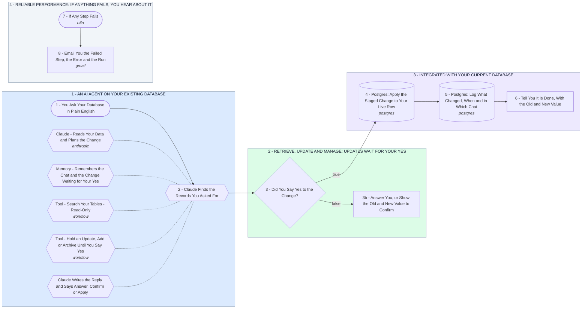

# Your AI Agent for Your Existing Database: Retrieve, Update and Manage

- **1 - AN AI AGENT ON YOUR EXISTING DATABASE** - You ask your database a question in plain English. Claude reads your tables and answers from the real rows, never from memory.
- **2 - RETRIEVE, UPDATE AND MANAGE: UPDATES WAIT FOR YOUR YES** - Your parts 2 and 3: retrieving and updating in one smooth chat. A change is shown back to you as old value and new value first, and only a yes moves it forward.
- **3 - INTEGRATED WITH YOUR CURRENT DATABASE** - The approved change is written to your own Postgres, inside one transaction, only to the tables and columns you allowed. Every change lands in a change log you can undo from.
- **4 - RELIABLE PERFORMANCE: IF ANYTHING FAILS, YOU HEAR ABOUT IT** - A failed query or a timeout never fails quietly. You get an email with the step, the error and a link to the run.
