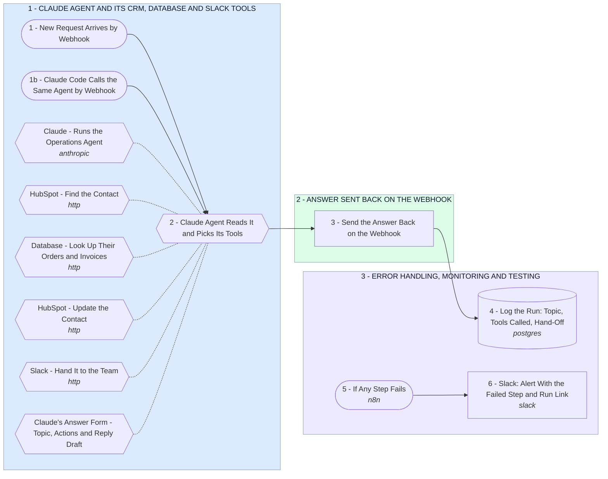

# Your Claude Agent Layer: CRM, Database and Slack From One Webhook

- **1 - CLAUDE AGENT AND ITS CRM, DATABASE AND SLACK TOOLS** - Your parts 1 to 4 and 6. A customer or team request, or a Claude Code task, hits the webhook. The Claude agent finds the contact in HubSpot, reads their records, updates HubSpot and hands off to Slack.
- **2 - ANSWER SENT BACK ON THE WEBHOOK** - Your part 5. Whatever called the webhook gets the reply draft and a list of what the agent did.
- **3 - ERROR HANDLING, MONITORING AND TESTING** - Your parts 7 to 9. Every run is logged with the tools the agent called, and any failed step posts to Slack with a link to retry it.
