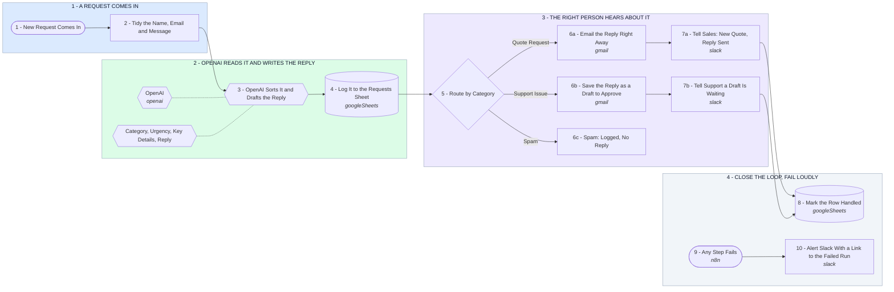

# Your AI Request Handler - From Request to Done in Seconds

- **1 - A REQUEST COMES IN** - Any website form, inbox or app that can send a webhook plugs in here. The fields get tidied first, so a messy entry never breaks a later step.
- **2 - OPENAI READS IT AND WRITES THE REPLY** - One OpenAI call returns the category, urgency, key details and a ready reply, in a fixed format. Every request is logged to the sheet before anything else happens.
- **3 - THE RIGHT PERSON HEARS ABOUT IT** - Quote requests get a reply in seconds and sales gets the summary. Support issues, and anything the AI is unsure about, wait as a Gmail draft a person approves. Spam stops here.
- **4 - CLOSE THE LOOP, FAIL LOUDLY** - The row is marked handled with the Slack link and the time it took, so the team sees status in one place. If any step fails, Slack gets an alert with a link to the failed run.
