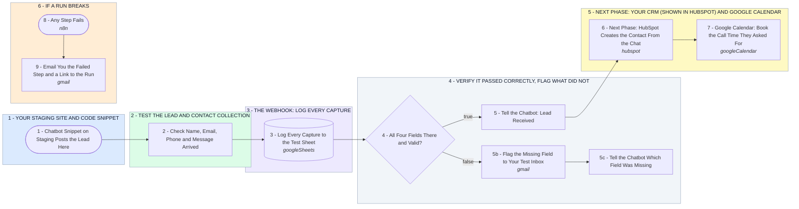

# Your Chatbot Test: Every Staging Lead Checked, Logged and Answered

- **1 - YOUR STAGING SITE AND CODE SNIPPET** - Your parts 1 and 2: the chatbot goes on staging, and its snippet posts every lead to this one webhook. If it posts through your own backend instead, that backend's webhook points here.
- **2 - TEST THE LEAD AND CONTACT COLLECTION** - Your part 3: each lead is checked for name, email, phone and message, whatever the snippet calls those fields.
- **3 - THE WEBHOOK: LOG EVERY CAPTURE** - Your part 4: every capture goes into the test sheet, good or bad, so you can see the test yourself.
- **4 - VERIFY IT PASSED CORRECTLY, FLAG WHAT DID NOT** - Your parts 5 and 6: a complete lead gets a received reply, a broken one gets flagged with the exact field so troubleshooting starts there.
- **5 - NEXT PHASE: YOUR CRM (SHOWN IN HUBSPOT) AND GOOGLE CALENDAR** - The onboarding work you named: a verified lead becomes a CRM contact and a booked call. HubSpot stands in for your CRM here. Switched on after the test passes.
- **6 - IF A RUN BREAKS** - Any failed step emails you the step, the error and a link to the run, so no test chat disappears without a trace.
