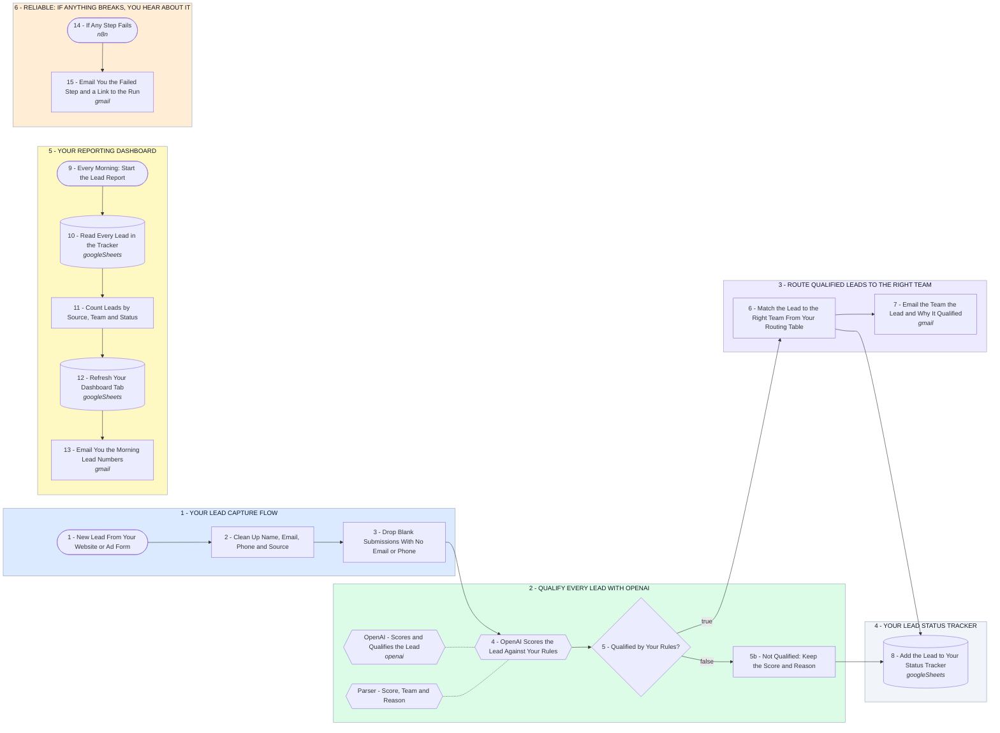

# Your Lead Intake and Qualification System: Reliable, Easy to Maintain

- **1 - YOUR LEAD CAPTURE FLOW** - Your website form, an ad lead form or anything that can send a webhook posts here. Names, emails and phones are cleaned up first, and blank submissions stop before they cost an OpenAI call.
- **2 - QUALIFY EVERY LEAD WITH OPENAI** - OpenAI scores each lead against the qualification rules you write in plain English in Config, and says why in one sentence. A missing budget or timeline lowers the score instead of being guessed.
- **3 - ROUTE QUALIFIED LEADS TO THE RIGHT TEAM** - You list your teams and their inboxes once in Config. OpenAI picks the team, this step finds its inbox, and a lead it cannot place goes to your default inbox.
- **4 - YOUR LEAD STATUS TRACKER** - Every lead lands in one Google Sheet, qualified or not, with its score, team and reason. Your team moves the Status column on to Contacted, Booked, Won or Lost.
- **5 - YOUR REPORTING DASHBOARD** - Every morning the Dashboard tab is rebuilt from the tracker: leads today, the last 7 days, the last 30 days and all time, by source, team and status, and who is still waiting for first contact. The same numbers arrive by email.
- **6 - RELIABLE: IF ANYTHING BREAKS, YOU HEAR ABOUT IT** - Nothing fails quietly. Any failed step emails you the step, the error and a link to the run, and the lead waits in that run for a retry.
