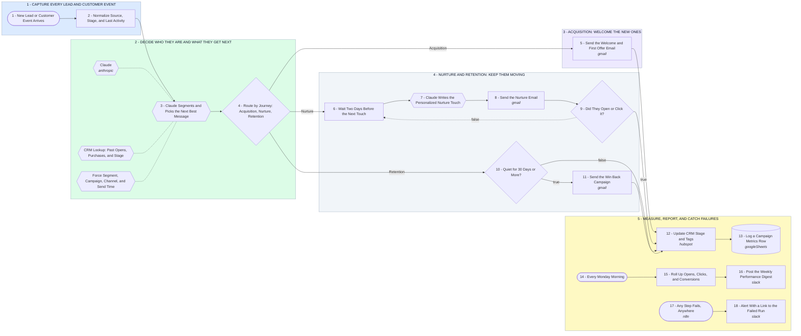

# AI Marketing Automation: Acquire, Nurture, Retain, Report

- **1 - CAPTURE EVERY LEAD AND CUSTOMER EVENT** - Form fills, purchases and signups all land in one place and get cleaned into the same shape.
- **2 - DECIDE WHO THEY ARE AND WHAT THEY GET NEXT** - Claude looks the person up in the CRM and picks the next best message instead of a fixed drip.
- **3 - ACQUISITION: WELCOME THE NEW ONES** - Brand new contacts get the welcome and the first offer straight away, while interest is highest.
- **4 - NURTURE AND RETENTION: KEEP THEM MOVING** - Nurture loops a personalized touch every two days until they engage, capped so nobody gets spammed. Quiet customers get a win back instead.
- **5 - MEASURE, REPORT, AND CATCH FAILURES** - Every send updates the CRM and logs a metrics row, and Monday morning the numbers land in Slack.
