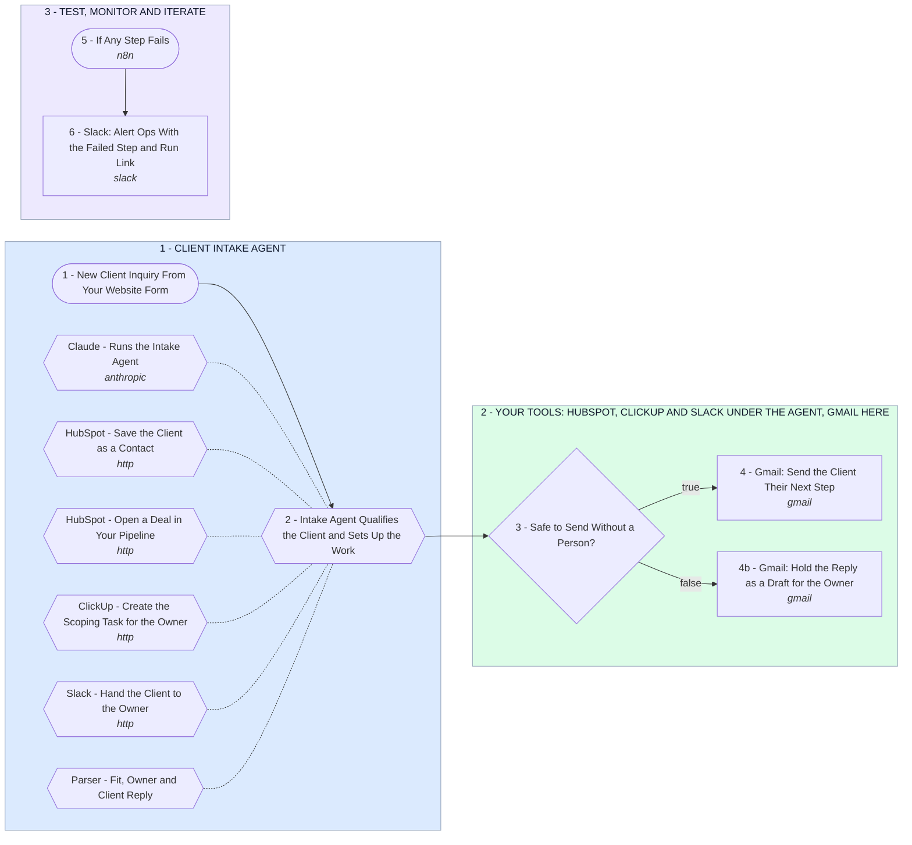

# Client Intake Agent: Every Inquiry Qualified, Logged and Handed Off

- **1 - CLIENT INTAKE AGENT** - The first task on your list. Each inquiry from your website form goes to an agent that checks it against your fit rules, then decides which of its four tools to call.
- **2 - YOUR TOOLS: HUBSPOT, CLICKUP AND SLACK UNDER THE AGENT, GMAIL HERE** - HubSpot, ClickUp and Slack are the agent's tools, hanging under it in section 1, and write while it works. Here the client's reply goes out from your Gmail, or waits as a draft when a person should read it first.
- **3 - TEST, MONITOR AND ITERATE** - Any failed step posts to Slack with a link to the run, where the inquiry waits for a retry. Every run keeps the agent's tool calls in n8n, and those are what we review each week to tune it.
