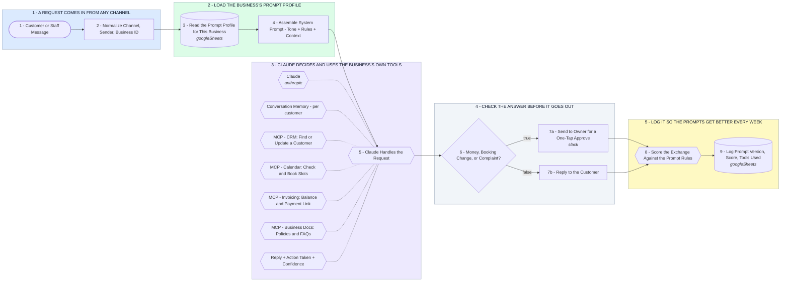

# Small Business AI Assistant - Prompt Layer + MCP Tool Connections

- **1 - A REQUEST COMES IN FROM ANY CHANNEL** - Chat widget, email, or an internal form. Every request lands in the same lane so one set of prompts serves all of them.
- **2 - LOAD THE BUSINESS'S PROMPT PROFILE** - Tone, services, pricing rules, and what the assistant is never allowed to promise live in a sheet the owner can edit. No code change to update a prompt.
- **3 - CLAUDE DECIDES AND USES THE BUSINESS'S OWN TOOLS** - Each tool is an MCP connection into software the business already pays for. Claude reads and writes real records instead of guessing.
- **4 - CHECK THE ANSWER BEFORE IT GOES OUT** - Anything touching money, bookings, or a complaint goes to a human first. Everything else replies on its own.
- **5 - LOG IT SO THE PROMPTS GET BETTER EVERY WEEK** - Every exchange is scored. Low-scoring ones become next week's prompt revisions.
