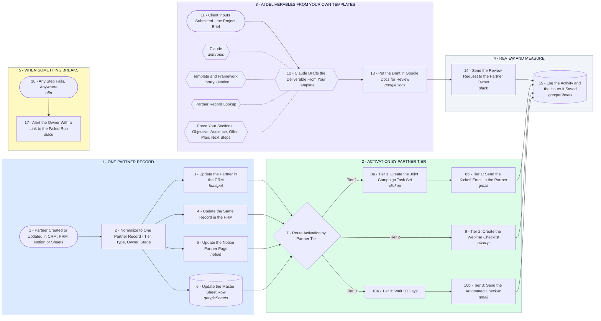

# Partner Operations Hub - One Record, Tier Activation, AI Deliverables

- **1 - ONE PARTNER RECORD** - A partner changes in any one system and the same record updates everywhere else. No more typing the same fields into four tools.
- **2 - ACTIVATION BY PARTNER TIER** - The tier decides what happens next, from a full joint campaign task set down to an automated check-in.
- **3 - AI DELIVERABLES FROM YOUR OWN TEMPLATES** - Client inputs go in, a draft built on your framework comes out. Claude writes into your structure, never its own.
- **4 - REVIEW AND MEASURE** - A person approves every draft before it leaves, and each run logs the hours it saved so the value is visible.
- **5 - WHEN SOMETHING BREAKS** - A failed run pings the partner owner with a link straight to it. Nothing fails quietly.
