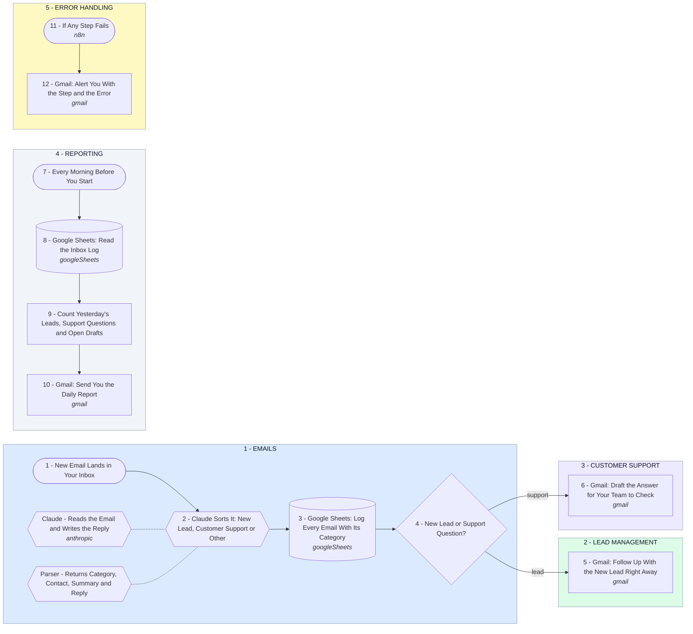

# AI for Your Emails, Leads, Customer Support and Daily Reporting

- **1 - EMAILS** - Every email that lands in your inbox is read by AI and sorted into new lead, customer support or other. Each one is logged in your Google Sheet.
- **2 - LEAD MANAGEMENT** - A new lead gets a follow-up right away, written from what they asked, with your booking link.
- **3 - CUSTOMER SUPPORT** - A support question gets a drafted answer in Gmail, and your team checks it and presses send.
- **4 - REPORTING** - Every morning you get one email with yesterday's leads, support questions and anything still waiting.
- **5 - ERROR HANDLING** - If any step fails, you get an email naming the step and the error.
