# Your Cal.com to Call Booked Pipeline System

```mermaid
flowchart LR
    subgraph sec_booked["1 - A CALL GETS BOOKED"]
        direction TB
        trigger(["1 - Zapier Tags the Contact call-booked<br/><i>ghl</i>"])
        clear_cancel["2 - Clear an Old call-cancelled Tag<br/><i>ghl</i>"]
        opp["3 - Add the Lead to Call Booked Pipeline<br/><i>ghl</i>"]
    end
    subgraph sec_owner["2 - THE OWNER HEARS FIRST"]
        direction TB
        owner_sms["4 - Text the Owner the New Booking<br/><i>ghl</i>"]
        owner_email["5 - Email the Owner the Booking Details<br/><i>ghl</i>"]
    end
    subgraph sec_before["3 - BEFORE THE CALL"]
        direction TB
        prep_email["6 - Email the Lead One Prep Question<br/><i>ghl</i>"]
        wait["7 - Wait 14 Days While the Call Is Upcoming"]
        closeout["8 - Task: Close Out the Card After the Call<br/><i>ghl</i>"]
    end
    subgraph sec_cancel["4 - IF THEY CANCEL"]
        direction TB
        goal["9 - Goal: Call Cancelled in Cal.com<br/><i>ghl</i>"]
        opp_cancel["10 - Move the Opportunity to Cancelled<br/><i>ghl</i>"]
        untag["11 - Remove the call-booked Tag<br/><i>ghl</i>"]
        rebook["12 - Email the Lead a Link to Rebook<br/><i>ghl</i>"]
        owner_cancel["13 - Text the Owner the Cancellation<br/><i>ghl</i>"]
    end
    trigger --> clear_cancel
    clear_cancel --> opp
    opp --> owner_sms
    owner_sms --> owner_email
    owner_email --> prep_email
    prep_email --> wait
    wait --> closeout
    closeout --> goal
    goal --> opp_cancel
    opp_cancel --> untag
    untag --> rebook
    rebook --> owner_cancel
    style sec_booked fill:#dbeafe,stroke:#94a3b8,color:#0f172a
    style sec_owner fill:#dcfce7,stroke:#94a3b8,color:#0f172a
    style sec_before fill:#ede9fe,stroke:#94a3b8,color:#0f172a
    style sec_cancel fill:#f1f5f9,stroke:#94a3b8,color:#0f172a
```

- **1 - A CALL GETS BOOKED** - Zapier does the handoff. When a call is booked in Cal.com, the Booking Created Zap creates or updates the contact in GoHighLevel, fills Call Time and Call Notes, and adds the call-booked tag. That tag starts everything below and puts the lead in the Call Booked Pipeline.
- **2 - THE OWNER HEARS FIRST** - You get a text the moment it lands and an email with everything from the booking form, so you walk into the call prepared.
- **3 - BEFORE THE CALL** - Cal.com already sends the confirmation and the reminders, so nothing here repeats them. One short email asks what they want from the call, then the workflow keeps watch for a cancel. The close-out task keeps cards from sitting in Call Booked; Showed and No Show are the other two stages.
- **4 - IF THEY CANCEL** - A second Zap on Cal.com Booking Cancelled adds call-cancelled. The goal pulls the contact here from wherever they are, the card moves to Cancelled, and they get one easy way to rebook. A reschedule only updates Call Time, so the card stays put.
