# Your Claude Cowork and Skills: Set Up Once, Then a New Skill a Week

```mermaid
flowchart LR
    subgraph sec_cowork["1 - SET UP CLAUDE COWORK"]
        direction TB
        account["1 - Set Up Your Claude Account on the Plan That Includes Cowork"]
        install["2 - Install Claude on Your Computer and Open Cowork"]
        folder["3 - Give Claude One Folder for Your Listings, Notes and Drafts"]
        connect["4 - Connect Your Gmail, Google Calendar and Google Drive"]
        about["5 - Tell Claude Once How You Write, Where You Sell and How You Sign Off"]
    end
    subgraph sec_skills["2 - YOUR FIRST SKILLS"]
        direction TB
        listing["6 - Skill 1: Write a Listing Description From Your Notes and Photos"]
        leads["7 - Skill 2: Draft a Reply to Each New Lead With Two Showing Times"]
        social["8 - Skill 3: Turn This Week's Listings Into Social Posts"]
        market["9 - Skill 4: Write Your Market Update Email for Past Clients"]
        test["10 - Test Each Skill on One of Your Real Listings or Leads"]
        drafts["11 - Nothing Sends on Its Own: Every Email and Post Waits for Your OK"]
    end
    subgraph sec_ongoing["3 - ADD A SKILL A WEEK, ONGOING"]
        direction TB
        weekly["12 - Each Week, the Task That Ate Your Time Becomes a New Skill"]
    end
    account --> install
    install --> folder
    folder --> connect
    connect --> about
    about --> listing
    listing --> leads
    leads --> social
    social --> market
    market --> test
    test --> drafts
    drafts --> weekly
    style sec_cowork fill:#dbeafe,stroke:#94a3b8,color:#0f172a
    style sec_skills fill:#dcfce7,stroke:#94a3b8,color:#0f172a
    style sec_ongoing fill:#ede9fe,stroke:#94a3b8,color:#0f172a
```

- **1 - SET UP CLAUDE COWORK** - Claude on your own computer, working in one folder you choose, with your email, calendar and files connected. One sitting, and you can use it the same day.
- **2 - YOUR FIRST SKILLS** - A skill is a set of saved instructions Claude reuses, so you ask once and get the same quality every time. We start with the four jobs you do every week and test each one on your real listings and leads.
- **3 - ADD A SKILL A WEEK, ONGOING** - You said ongoing, so the list keeps growing. Each week you tell me the task that ate your time and it becomes the next skill.
