# Your Claude Cowork Setup, Then a New Skill Every Week

```mermaid
flowchart LR
    subgraph sec_cowork["1 - SETTING UP CLAUDE COWORK"]
        direction TB
        account["1 - We set up your Claude account on a plan that includes Cowork"]
        install["2 - We install Claude on your computer and open Cowork"]
        folder["3 - You give Claude one folder for your notes, files and drafts"]
        connect["4 - We connect the email, calendar and files you already use"]
        about["5 - You tell Claude once how you write and how you like to sign off"]
    end
    subgraph sec_skills["2 - YOUR FIRST SKILLS"]
        direction TB
        inquiries["6 - Your first skill drafts a reply to every new inquiry"]
        docs["7 - Your second skill turns rough notes into a polished document"]
        inbox["8 - Your third skill writes you a weekly summary of your inbox"]
        posts["9 - Your fourth skill turns your notes into a social post or newsletter"]
        test["10 - We test each skill on a real example from your week"]
        drafts["11 - Nothing sends on its own, so every draft waits for your OK"]
    end
    subgraph sec_ongoing["3 - A NEW SKILL EVERY WEEK"]
        direction TB
        weekly["12 - Each week, the task that took up your time becomes a new skill"]
    end
    account --> install
    install --> folder
    folder --> connect
    connect --> about
    about --> inquiries
    inquiries --> docs
    docs --> inbox
    inbox --> posts
    posts --> test
    test --> drafts
    drafts --> weekly
    style sec_cowork fill:#dbeafe,stroke:#94a3b8,color:#0f172a
    style sec_skills fill:#dcfce7,stroke:#94a3b8,color:#0f172a
    style sec_ongoing fill:#ede9fe,stroke:#94a3b8,color:#0f172a
```

- **1 - SETTING UP CLAUDE COWORK** - Claude runs on your own computer and works in one folder you choose, with your email, calendar and files connected. You can start using it the same day.
- **2 - YOUR FIRST SKILLS** - A skill is a set of saved instructions that Claude reuses, so you explain a task once and get the same result every time. We start with four everyday tasks and test each one on a real example.
- **3 - A NEW SKILL EVERY WEEK** - You said this is ongoing, so the list keeps growing. Each week you tell me which task took up your time, and it becomes the next skill.
