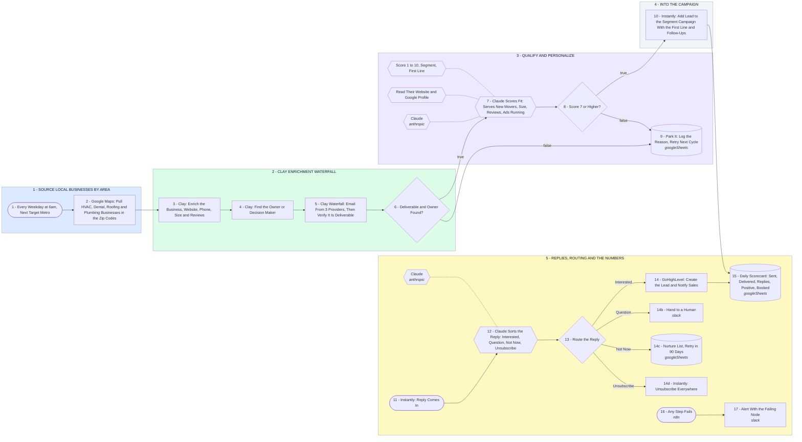

# Your Welcome Neighbors Outbound Engine

- **1 - SOURCE LOCAL BUSINESSES BY AREA** - Pick the metro, pull every HVAC, dental, roofing and plumbing business in those zip codes. Nobody uploads a CSV.
- **2 - CLAY ENRICHMENT WATERFALL** - Clay enriches the business, finds the owner, then runs three email providers in order until one returns a verified address.
- **3 - QUALIFY AND PERSONALIZE** - Claude reads their site and Google profile, scores the fit, and writes the first line off what it actually found.
- **4 - INTO THE CAMPAIGN** - The lead lands in the campaign for its segment with the variables already filled, and the follow-ups run on schedule.
- **5 - REPLIES, ROUTING AND THE NUMBERS** - Every reply is read and routed within minutes, and the day's real numbers land in one sheet you can open.
