# Your 10-30 Qualified Calls a Month With Commercial Cleaning Owners

```mermaid
flowchart LR
    subgraph sec_lists["1 - BUILDING TARGETED PROSPECT LISTS"]
        direction TB
        pull["1 - We target owners of commercial cleaning companies that clean offices and sites"]
        find["2 - We find each company on Google Maps and pull the owner's name and email"]
        verify["3 - Every owner email is verified and anyone already contacted is taken off"]
    end
    subgraph sec_deliver["2 - EMAIL DELIVERABILITY, DOMAINS AND INBOX SETUP"]
        direction TB
        domains["4 - Campaigns send from lookalike domains, so your main domain stays safe"]
        inboxes["5 - By our estimate, 5 domains and 15 warmed inboxes send about 8,250 emails a month to start"]
    end
    subgraph sec_copy["3 - COLD EMAIL COPYWRITING"]
        direction TB
        opener["6 - Each first email opens with one real detail about that owner's cleaning company"]
        pitch["7 - The offer is more commercial contracts for them, and the ask is a short call"]
        follow["8 - Three short follow-ups go out over two weeks to owners who haven't replied"]
    end
    subgraph sec_manage["4 - CAMPAIGN MANAGEMENT AND OPTIMIZATION"]
        direction TB
        unibox["9 - Every reply is answered the same day, and a not now goes back into follow-up"]
        test["10 - Every week we test two first emails and keep the one that books more calls"]
        size["11 - Month one shows the sends per booked call, then we add domains to reach 30"]
    end
    subgraph sec_book["5 - BOOKING QUALIFIED SALES CALLS"]
        direction TB
        qualify{"12 - Is this the owner of a cleaning company that fits your agency's ideal client?"}
        calendar["13 - The owner books onto your calendar, and each call counts toward your 10 to 30"]
    end
    pull --> find
    find --> verify
    verify --> domains
    domains --> inboxes
    inboxes --> opener
    opener --> pitch
    pitch --> follow
    follow --> unibox
    unibox --> test
    test --> size
    size --> qualify
    qualify -->|yes| calendar
    style sec_lists fill:#dbeafe,stroke:#94a3b8,color:#0f172a
    style sec_deliver fill:#dcfce7,stroke:#94a3b8,color:#0f172a
    style sec_copy fill:#ede9fe,stroke:#94a3b8,color:#0f172a
    style sec_manage fill:#f1f5f9,stroke:#94a3b8,color:#0f172a
    style sec_book fill:#fef9c3,stroke:#94a3b8,color:#0f172a
```

- **1 - BUILDING TARGETED PROSPECT LISTS** - The list is only owners of commercial cleaning companies, found one company at a time. Every email is checked before it is ever sent.
- **2 - EMAIL DELIVERABILITY, DOMAINS AND INBOX SETUP** - Sending runs on separate domains so your main domain is never at risk. The starting size is our estimate for your first 10 calls, and month one replaces it with real numbers.
- **3 - COLD EMAIL COPYWRITING** - Each email reads like it was written to one owner about their own company. The follow-ups stay short and never repeat the first email.
- **4 - CAMPAIGN MANAGEMENT AND OPTIMIZATION** - Replies are answered the same day and every email is tested weekly on whether it books calls. After month one we size the sending to reach 30 calls.
- **5 - BOOKING QUALIFIED SALES CALLS** - Only owners who could become your clients get onto your calendar. Every booked call is counted against your 10 to 30 a month.
