# Your Cold Email Sending Infrastructure - Setup to Handover

```mermaid
flowchart LR
    subgraph sec_scope["1 - SIZE THE SETUP"]
        direction TB
        volume["1 - Set Target Volume: Emails per Day and Campaigns Planned"]
        count["2 - Work Out Mailboxes and Domains Needed - 30 a Day per Mailbox, 3 per Domain"]
    end
    subgraph sec_provision["2 - DOMAINS AND MAILBOXES, NOT ON YOUR MAIN DOMAIN"]
        direction TB
        prewarm{"3 - Need to Send Right Away?"}
        prewarmed["3a - Use Pre-Warmed Mailboxes So Campaigns Start This Week"]
        buy["4 - Provision Lookalike Domains and Mailboxes on Your Account and Billing"]
    end
    subgraph sec_dns["3 - AUTHENTICATION THAT KEEPS YOU OUT OF SPAM"]
        direction TB
        dns["5 - Publish SPF, DKIM, DMARC, MX and a Custom Tracking Domain"]
        verify{"6 - Every Record Passes Verification?"}
        fix["6a - Fix the Failing Record and Re-Check Before Anything Sends"]
    end
    subgraph sec_instantly["4 - INSTANTLY CONFIGURED TO YOUR SPEC"]
        direction TB
        import["7 - Import Every Mailbox Into Instantly"]
        warm["8 - Warmup On, Daily Limits Ramped, Sending Schedule Set to Your Spec"]
        unibox["9 - One Unibox: Every Reply From Every Mailbox in One Place"]
    end
    subgraph sec_claude["5 - CLAUDE CONNECTED, THEN HANDOVER"]
        direction TB
        claude["10 - Connect Instantly to Claude: Replies Sorted and Drafts Written"]
        handover["11 - Handover: Your Accounts, Your Billing, One Page Runbook"]
    end
    volume --> count
    count --> prewarm
    prewarm -->|true| prewarmed
    prewarmed --> buy
    prewarm -->|false| buy
    buy --> dns
    dns --> verify
    verify -->|false| fix
    fix -.-> dns
    verify -->|true| import
    import --> warm
    warm --> unibox
    unibox --> claude
    claude --> handover
    style sec_scope fill:#dbeafe,stroke:#94a3b8,color:#0f172a
    style sec_provision fill:#dcfce7,stroke:#94a3b8,color:#0f172a
    style sec_dns fill:#ede9fe,stroke:#94a3b8,color:#0f172a
    style sec_instantly fill:#f1f5f9,stroke:#94a3b8,color:#0f172a
    style sec_claude fill:#fef9c3,stroke:#94a3b8,color:#0f172a
```

- **1 - SIZE THE SETUP** - How many emails a day you want to send decides how many mailboxes and domains you need. Roughly 30 a day per mailbox, 3 mailboxes per domain, keeps every inbox under the radar.
- **2 - DOMAINS AND MAILBOXES, NOT ON YOUR MAIN DOMAIN** - Lookalike sending domains and their mailboxes are provisioned together through a mailbox provider, on your account and your card, about $3 to $4 per mailbox a month. Your main domain never sends cold email, so it can never get burned.
- **3 - AUTHENTICATION THAT KEEPS YOU OUT OF SPAM** - SPF, DKIM, DMARC, MX and a custom tracking domain on every sending domain, verified before a single email goes out.
- **4 - INSTANTLY CONFIGURED TO YOUR SPEC** - Every mailbox imported into Instantly, warmup running, daily limits ramped, sending schedule, tracking domain, and one unibox where every reply lands.
- **5 - CLAUDE CONNECTED, THEN HANDOVER** - Instantly's API wired to Claude so replies get sorted and drafted for you. Everything sits in your accounts with a one page runbook, so you run it without me.
