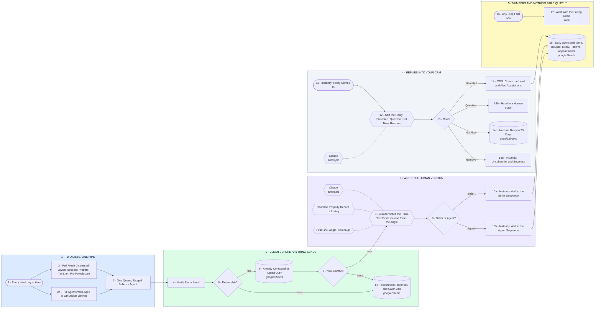

# Your Seller and Agent Outbound System

- **1 - TWO LISTS, ONE PIPE** - Fresh distressed-owner records and agents sitting on aged or off-market listings get pulled on the same schedule, then merged into one queue with a seller or agent tag. Two campaigns, one system, nobody uploads a CSV.
- **2 - CLEAN BEFORE ANYTHING SENDS** - Every address is verified, bounces and catch-alls are suppressed instead of sent, and anyone already contacted or opted out is filtered out. This is what keeps the sending domains alive.
- **3 - WRITE THE HUMAN VERSION** - Claude reads the actual property record or listing and writes the plain-text first line off what it found, picks the angle, then the lead drops into the seller or the agent sequence.
- **4 - REPLIES INTO YOUR CRM** - Every reply is read and sorted within minutes. Interested goes straight to the CRM with acquisitions alerted, questions go to a human, not now goes to nurture, remove is suppressed everywhere.
- **5 - NUMBERS AND NOTHING FAILS QUIETLY** - One scorecard row a day with sent, bounce, reply, positive and appointments, so scaling is a decision off real numbers. If any step fails you get told which node and which record.
