# Your Cold Email Acquisition Channel - Setup to Scale

```mermaid
flowchart LR
    subgraph sec_setup["1 - INFRASTRUCTURE THAT PROTECTS YOUR MAIN DOMAIN"]
        direction TB
        domains["1 - Lookalike Domains and Mailboxes on Your Card, Never the Main Domain"]
        dns["2 - SPF, DKIM, DMARC, Tracking Domain, Warmup On Day One"]
        platform["3 - Instantly Set Up, Connected to Your CRM for Replies"]
    end
    subgraph sec_data["2 - TWO LISTS, BOTH CLEANED BEFORE THEY LOAD"]
        direction TB
        sellers["4 - Seller Lists: Probate, Tax Lien, Pre-Foreclosure, Divorce, Skip Traced"]
        agents["5 - Agent Lists: Aged, Expired and Off-Market Listings"]
        verify{"6 - Verified and Not Suppressed?"}
        drop["6b - Bounces, Catch-Alls and Opt-Outs Never Load"]
    end
    subgraph sec_copy["3 - COPY THAT READS LIKE A PERSON WROTE IT"]
        direction TB
        seq["7 - Two Sequences: Seller and Agent, Plain Text, 3 to 4 Touches"]
        firstline["8 - First Line From the Record: the Property, the Listing, the Filing"]
        ab["9 - A/B on Subject and CTA, One Variable at a Time"]
    end
    subgraph sec_test["4 - TWO WEEKS AT LOW VOLUME BEFORE WE SCALE"]
        direction TB
        pilot["10 - Two Week Pilot: Sellers at Tight Volume, Agents at Full"]
        gate{"11 - Bounce Under 3 Percent, Replies Coming In?"}
        fix["11b - Pause the Losing Variant, Re-Clean the List, Retry"]
    end
    subgraph sec_scale["5 - SCALE IT, THEN YOUR TEAM RUNS IT"]
        direction TB
        grow["12 - Add Inboxes and Domains, Raise Daily Limits in Steps"]
        engine["13 - Automation Engine: Daily Pulls, Personalization, Reply Routing to CRM"]
        scorecard["14 - Scorecard and Runbook: Your Team Runs It Without Me"]
    end
    domains --> dns
    dns --> platform
    platform --> sellers
    platform --> agents
    sellers --> verify
    agents --> verify
    verify -->|true| seq
    verify -->|false| drop
    seq --> firstline
    firstline --> ab
    ab --> pilot
    pilot --> gate
    gate -->|true| grow
    gate -->|false| fix
    fix -.-> pilot
    grow --> engine
    engine --> scorecard
    style sec_setup fill:#dbeafe,stroke:#94a3b8,color:#0f172a
    style sec_data fill:#dcfce7,stroke:#94a3b8,color:#0f172a
    style sec_copy fill:#ede9fe,stroke:#94a3b8,color:#0f172a
    style sec_test fill:#f1f5f9,stroke:#94a3b8,color:#0f172a
    style sec_scale fill:#fef9c3,stroke:#94a3b8,color:#0f172a
```

- **1 - INFRASTRUCTURE THAT PROTECTS YOUR MAIN DOMAIN** - Everything sends from lookalike domains on your card. 30 a day per mailbox, 3 mailboxes per domain, warmed before a single email goes out.
- **2 - TWO LISTS, BOTH CLEANED BEFORE THEY LOAD** - Distressed-owner data and agent data come from different places and get different treatment. Nothing loads until it is verified.
- **3 - COPY THAT READS LIKE A PERSON WROTE IT** - Plain text, short, one ask. Sellers and agents get their own sequences with a first line pulled from the record.
- **4 - TWO WEEKS AT LOW VOLUME BEFORE WE SCALE** - Bounce, reply, positive reply and spam complaints decide what scales. Losers get cut, winners get more inboxes.
- **5 - SCALE IT, THEN YOUR TEAM RUNS IT** - More inboxes and domains, the automation engine doing the daily grind, a scorecard your team reads, and a runbook so it does not depend on me.
