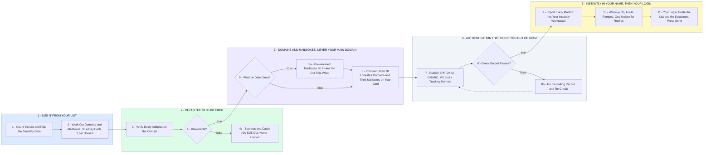

# Your Webinar Invite Sending Setup - 10 to 20 Warm Domains to Login

- **1 - SIZE IT FROM YOUR LIST** - The list size and how fast you want the invites out decide the domain and mailbox count. 30 a day per mailbox, 3 mailboxes per domain, so 10 to 20 domains is 30 to 60 mailboxes and 900 to 1,800 invites a day once warm.
- **2 - CLEAN THE OLD LIST FIRST** - An old list is the fastest way to burn 20 new domains. Every address is verified before it is loaded, bounces and catch-alls are split out, and the clean list is what goes in.
- **3 - DOMAINS AND MAILBOXES, NEVER YOUR MAIN DOMAIN** - Lookalike sending domains and their mailboxes are provisioned together through a mailbox provider on your account and your card, about $3 to $4 per mailbox a month. Pre-warmed mailboxes if the webinar date is close.
- **4 - AUTHENTICATION THAT KEEPS YOU OUT OF SPAM** - SPF, DKIM, DMARC, MX and a custom tracking domain on every sending domain, verified before a single invite goes out.
- **5 - INSTANTLY IN YOUR NAME, THEN YOUR LOGIN** - Every mailbox imported into an Instantly workspace you own, warmup running, limits ramped, one unibox for replies. You get the login, paste the list and the sequence, and press send.
