# Your Qualified Meeting Engine - 3 ICPs, 60 Inboxes, Booked Calls

```mermaid
flowchart LR
    subgraph sec_infra["1 - INBOX HEALTH ON YOUR 30 DOMAINS AND 60 INBOXES"]
        direction TB
        dns["1 - SPF, DKIM, DMARC and Blacklists Checked on All 30 Domains"]
        warmup["2 - Smartlead Warmup On, Daily Cap Set per Inbox"]
        health{"3 - Inbox Healthy? Warmup Score, Bounces, Spam Placement"}
        rotate["3b - Rotate It Out, Fix DNS or Rewarm, Then Back In"]
    end
    subgraph sec_lists["2 - CLAY LISTS FOR YOUR 3 ICPS"]
        direction TB
        source["4 - Clay Table per ICP: Source, Enrich, Find the Decision-Maker"]
        verify["5 - Verify, Drop Catch-Alls, Suppress Clients and Past Contacts"]
    end
    subgraph sec_copy["3 - COPY PER ICP, SPINTAX AND FOLLOW-UPS"]
        direction TB
        sequence["6 - One Sequence per ICP, Plain Text, Spintax on Every Line"]
        angles["7 - Two Angles per ICP, 3 Follow-Ups, First Line From Clay"]
    end
    subgraph sec_test["4 - LAUNCH AND TEST IN SMARTLEAD"]
        direction TB
        launch["8 - Launch in Smartlead: Inbox Rotation, Send Windows, Low Volume"]
        abtest["9 - A/B by ICP and Angle, Kill or Scale on Reply Rate"]
    end
    subgraph sec_book["5 - QUALIFIED BEFORE ANY CALENDLY LINK GOES OUT"]
        direction TB
        qualify{"10 - Positive Reply Meets Your Qualified-Meeting Definition?"}
        nurture["10b - Not Yet: Answer, Nurture, No Calendly Link"]
        booked["11 - Calendly Link Sent, Booked With Qualification Notes"]
        report["12 - Weekly Report per ICP: Sends, Replies, Positive, Qualified"]
    end
    dns --> warmup
    warmup --> health
    health -->|true| source
    health -->|false| rotate
    rotate -.-> warmup
    source --> verify
    verify --> sequence
    sequence --> angles
    angles --> launch
    launch --> abtest
    abtest --> qualify
    qualify -->|true| booked
    qualify -->|false| nurture
    nurture -.-> qualify
    booked --> report
    style sec_infra fill:#dbeafe,stroke:#94a3b8,color:#0f172a
    style sec_lists fill:#dcfce7,stroke:#94a3b8,color:#0f172a
    style sec_copy fill:#ede9fe,stroke:#94a3b8,color:#0f172a
    style sec_test fill:#f1f5f9,stroke:#94a3b8,color:#0f172a
    style sec_book fill:#fef9c3,stroke:#94a3b8,color:#0f172a
```

- **1 - INBOX HEALTH ON YOUR 30 DOMAINS AND 60 INBOXES** - Nothing sends from an inbox that is not healthy. Warmup stays on, every inbox has a daily cap, and an inbox that slips comes out of rotation until it recovers.
- **2 - CLAY LISTS FOR YOUR 3 ICPS** - One Clay table per ICP. Every contact is a decision-maker, verified, and suppressed against your clients and anyone already contacted.
- **3 - COPY PER ICP, SPINTAX AND FOLLOW-UPS** - Plain text, short, one ask. Each ICP gets its own sequence and two angles, with spintax so no two emails read the same to a spam filter.
- **4 - LAUNCH AND TEST IN SMARTLEAD** - Low volume first, then A/B by ICP and angle. Reply rate decides what gets cut and what gets more inboxes.
- **5 - QUALIFIED BEFORE ANY CALENDLY LINK GOES OUT** - Every positive reply is checked against your qualified-meeting definition. Only a match gets the link, every booking carries its notes, and you get a report every week.
