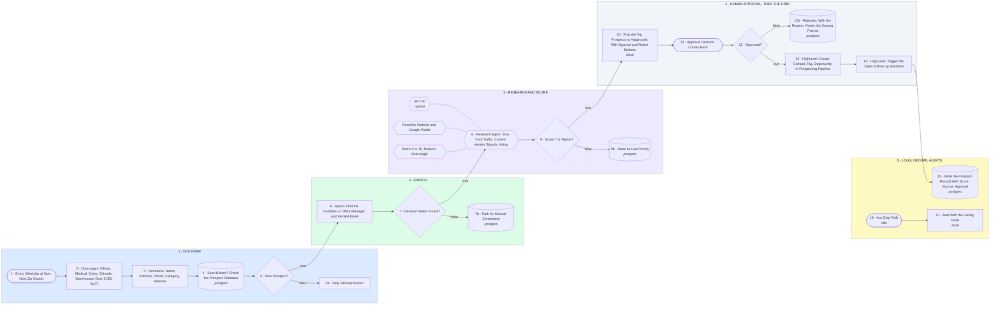

# Your Commercial Cleaning Prospecting Engine

- **1 - DISCOVER** - Outscraper works one zip cluster a morning and pulls the buildings that actually buy cleaning. Nobody uploads a list.
- **2 - ENRICH** - Apollo turns a building into a named facilities or office manager with a verified email. No name, no guessing, it parks.
- **3 - RESEARCH AND SCORE** - The agent reads the site and the Google profile, then scores the account on size, foot traffic, vendor signals and hiring.
- **4 - HUMAN APPROVAL, THEN THE CRM** - Nothing reaches HighLevel until a human says yes. The morning list posts to Slack, one tap approves, one tap rejects with a reason.
- **5 - LOGS, DEDUPE, ALERTS** - Postgres is the dedupe key, by place id and normalized phone, so the same building never shows up twice. Every failure names its node.
