# Your CRM Sync and AI Automation Hub

```mermaid
flowchart LR
    subgraph sec_intake["1 - CATCH THE CRM EVENT, PARK BAD DATA"]
        direction TB
        hook(["1 - HubSpot or Your CRM: Deal Moved to Closed Won"])
        normalize["2 - Normalize and Validate Into One Standard Record"]
        valid{"3 - Record Passes Validation?"}
        park[("3b - Park It in Needs Review With the Failing Field<br/><i>airtable</i>")]
    end
    subgraph sec_once["2 - RUN EACH EVENT ONCE, ANSWER THE CRM FAST"]
        direction TB
        claim[("4 - Sync Ledger: Claim This Event Id Once<br/><i>postgres</i>")]
        fresh["5 - Only New Events Continue"]
        ack["6 - Acknowledge the CRM Right Away"]
    end
    subgraph sec_sync["3 - CLAUDE SHAPES IT, EVERY SYSTEM GETS ITS COPY"]
        direction TB
        agent{{"7 - Claude Maps and Enriches the Record"}}
        claude{{"Claude<br/><i>anthropic</i>"}}
        schema{{"Target Schema: Ops Record, Invoice Terms, Team Summary"}}
        ops[("8 - Airtable: Create the Ops Project Record<br/><i>airtable</i>")]
        invoice["9 - QuickBooks: Create the First Invoice<br/><i>quickbooks</i>"]
        accepted{"10 - QuickBooks Accepted It?"}
        backoff["10b - Back Off 30 Seconds, Then Retry"]
        team["11 - Slack: Tell the Team the Deal Is Live<br/><i>slack</i>"]
    end
    subgraph sec_close["4 - WRITE IT BACK TO THE CRM, CLOSE THE LOOP"]
        direction TB
        writeback["12 - HubSpot or Your CRM: Write Ids and Sync Status to the Deal"]
        done[("13 - Sync Ledger: Mark Done With Every Id<br/><i>postgres</i>")]
    end
    subgraph sec_errors["5 - NOTHING FAILS QUIETLY"]
        direction TB
        err(["14 - Any Node Fails, Anywhere<br/><i>n8n</i>"])
        failed[("15 - Sync Ledger: Mark Failed, Ready to Replay<br/><i>postgres</i>")]
        alert["16 - Alert With the Deal, the Failed Step and a Run Link<br/><i>slack</i>"]
    end
    hook --> normalize
    normalize --> valid
    valid -->|true| claim
    valid -->|false| park
    claim --> fresh
    fresh --> ack
    ack --> agent
    agent --> ops
    ops --> invoice
    invoice --> accepted
    accepted -->|true| team
    accepted -->|false| backoff
    backoff -.-> invoice
    team --> writeback
    writeback --> done
    err --> failed
    failed --> alert
    claude -.- agent
    schema -.- agent
    style sec_intake fill:#dbeafe,stroke:#94a3b8,color:#0f172a
    style sec_once fill:#dcfce7,stroke:#94a3b8,color:#0f172a
    style sec_sync fill:#ede9fe,stroke:#94a3b8,color:#0f172a
    style sec_close fill:#f1f5f9,stroke:#94a3b8,color:#0f172a
    style sec_errors fill:#fef9c3,stroke:#94a3b8,color:#0f172a
```

- **1 - CATCH THE CRM EVENT, PARK BAD DATA** - HubSpot is shown as the example CRM, any CRM swaps in at the first node and the write-back. Every event is mapped into one standard record, and anything missing or malformed waits in a review table with the exact field named.
- **2 - RUN EACH EVENT ONCE, ANSWER THE CRM FAST** - CRMs resend webhooks, so every event id is claimed once in a ledger and a repeat stops cold. The CRM gets its answer in milliseconds while the real work carries on behind it.
- **3 - CLAUDE SHAPES IT, EVERY SYSTEM GETS ITS COPY** - Claude cleans the names, maps the plan to invoice terms and writes the team summary, into a fixed schema. Ids and amounts come straight from the CRM, never from the model. A throttled call backs off and tries again.
- **4 - WRITE IT BACK TO THE CRM, CLOSE THE LOOP** - The rep sees the invoice number, ops record and sync time on the deal itself. The ledger row holds every id that was created, so any sync can be traced in one lookup.
- **5 - NOTHING FAILS QUIETLY** - One error trigger covers every step. The event is marked failed with its payload kept, and the team gets the deal, the step that broke and a link to the run, ready to replay.
