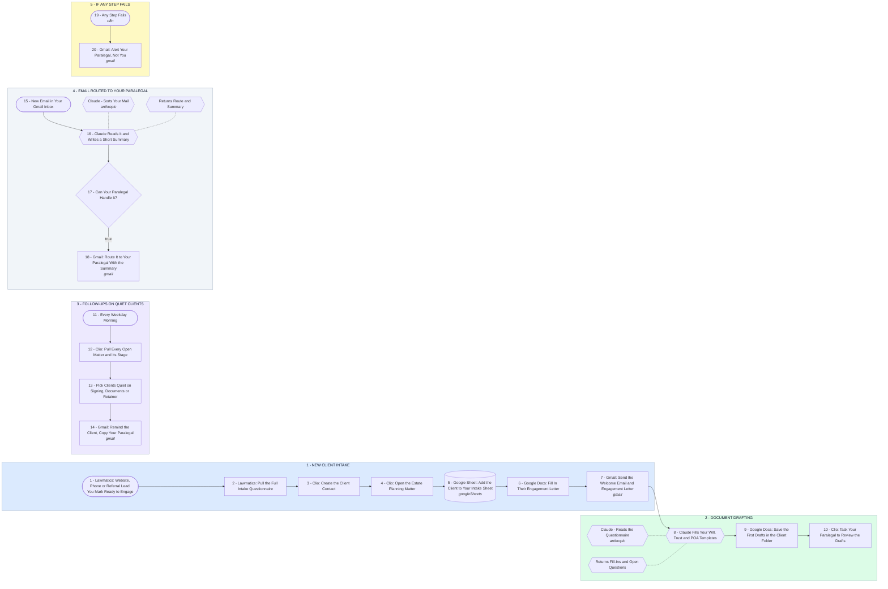

# Intake to First Draft, Follow-Ups and Email Your Paralegal Can Run

- **1 - NEW CLIENT INTAKE** - Website form, phone and referral leads all go into Lawmatics once. After the consult and conflict check, the attorney moves the prospect to the engage stage in Lawmatics, and then Clio, your Google Sheet, the welcome email and the engagement letter follow without anyone retyping or remembering.
- **2 - DOCUMENT DRAFTING** - Claude reads the intake questionnaire and fills the blanks in your own will, trust and POA templates. Your paralegal is editing, not typing, and anything unclear is flagged for her.
- **3 - FOLLOW-UPS ON QUIET CLIENTS** - Every weekday morning, clients quiet on signing appointments, missing documents or unpaid retainers get a reminder. Your paralegal is copied, so you hear before the client calls annoyed.
- **4 - EMAIL ROUTED TO YOUR PARALEGAL** - Claude reads new mail in your inbox and writes a short summary. What your paralegal can handle goes to her; legal advice and anything sensitive stays with you.
- **5 - IF ANY STEP FAILS** - Your paralegal gets the failed step and a link to fix it, never client details in the alert.
