# Fine Tuning Your Medical Report Classifier: Data to Adapter

```mermaid
flowchart LR
    subgraph sec_data["1 - PREPARE THE TRAINING DATA"]
        direction TB
        clean["1 - Clean the CSV: Dedupe, Normalize Formatting, Drop Unusable Rows"]
        labels{"2 - Any Labels Look Inconsistent or Mislabeled?"}
        confirm["2a - Return Suspect Rows to You to Confirm or Relabel"]
        split["3 - Hold Out a Stratified Validation and Test Set"]
    end
    subgraph sec_model["2 - SELECT THE MODEL AND TRAINING FORMAT"]
        direction TB
        select["4 - Select a Lightweight Open Source Model for Your Categories"]
        format["5 - Convert Rows to the Model's Fine Tuning Format"]
    end
    subgraph sec_train["3 - BASELINE, FINE TUNE, ITERATE"]
        direction TB
        baseline["6 - Score the Base Model on the Test Set - Before Number"]
        tune["7 - Train a LoRA Adapter, a Few Epochs, on Your Hardware or Cloud"]
        eval["8 - Evaluate: Accuracy, per Category Precision and Recall, Confusion Matrix"]
        gate{"9 - Beats Baseline, Including Recall on Urgent?"}
        iterate["9a - Iterate: Fix Labels, Reweight Classes, Adjust Epochs, Retrain"]
    end
    subgraph sec_deliver["4 - DELIVERABLES YOU CAN REUSE"]
        direction TB
        save["10 - Save the Adapter Files and Inference Script"]
        handoff["11 - Reproducible Code, Setup Instructions, Results Summary and Limitations"]
    end
    clean --> labels
    labels -->|true| confirm
    confirm --> split
    labels -->|false| split
    split --> select
    select --> format
    format --> baseline
    baseline --> tune
    tune --> eval
    eval --> gate
    gate -->|false| iterate
    iterate -.-> tune
    gate -->|true| save
    save --> handoff
    style sec_data fill:#dbeafe,stroke:#94a3b8,color:#0f172a
    style sec_model fill:#dcfce7,stroke:#94a3b8,color:#0f172a
    style sec_train fill:#ede9fe,stroke:#94a3b8,color:#0f172a
    style sec_deliver fill:#f1f5f9,stroke:#94a3b8,color:#0f172a
```

- **1 - PREPARE THE TRAINING DATA** - Your CSV in, a clean labeled dataset out. Duplicates and unusable rows removed, suspect labels returned to you, then a stratified validation and test split held out before any training so the eval is honest.
- **2 - SELECT THE MODEL AND TRAINING FORMAT** - An existing lightweight open source model, not trained from scratch. Classifier head on a small encoder if you only need the label, LoRA on a small instruct model if you also want a written reason. Rows converted to that model's fine tuning format.
- **3 - BASELINE, FINE TUNE, ITERATE** - The untouched model is scored on the held out set first, so the before number is measured. Then a LoRA adapter is trained for a few epochs on your hardware or cloud, evaluated per category, and the loop repeats until it beats the baseline where it matters.
- **4 - DELIVERABLES YOU CAN REUSE** - Adapter files, an inference script for new reports, the full training and inference code with setup instructions, and a short summary of dataset, model, approach, results, and limitations.
