# Within Your Agency and for Your Clients: A GHL Starting Plan

```mermaid
flowchart LR
    subgraph sec_automate["1 - AUTOMATE PROCESSES WITHIN YOUR AGENCY AND FOR YOUR CLIENTS"]
        direction TB
        lead_in["1 - New Lead Follow-Up in Your Agency: Instant Text, Team Alert"]
        every_client["2 - Same Workflow in Every Client Sub-Account via Custom Values"]
    end
    subgraph sec_potential["2 - UNCOVER THE FULL POTENTIAL OF GHL'S AUTOMATION"]
        direction TB
        reply_check{"3 - Did the Lead Reply? Checked Before Every Follow-Up"}
        replied["3a - Yes: No More Chasing, the Pipeline Moves to Replied"]
        no_response["3b - No: Next Follow-Up, Then the Pipeline Moves to No Response"]
    end
    subgraph sec_strategy["3 - STRATEGIES FOR WORKFLOW EFFICIENCY AND CLIENT SATISFACTION"]
        direction TB
        onboarding["4 - Deal Won: Your Team Adds One new-client Tag, Welcome and Setup Tasks Follow"]
        checkin{"5 - Day-3 Check-In: Did the Client Reply?"}
        am_answers["5a - Yes: The Account Manager Answers the Same Day"]
        call_task["5b - No: Silence Becomes a Call Task"]
    end
    subgraph sec_team["4 - GUIDE YOUR TEAM IN IMPLEMENTING BEST PRACTICES"]
        direction TB
        snapshot["6 - Both Workflows in Your Agency Snapshot: Fix Once, Push to Every Client"]
        conventions["7 - Naming and Tag Conventions Your Team Follows"]
        test_contacts["8 - Test Contacts Through Every Branch Before Go-Live"]
        delivered["9 - Delivered: First Two Workflows and Team Playbook"]
    end
    lead_in --> every_client
    every_client --> reply_check
    reply_check -->|true| replied
    reply_check -->|false| no_response
    replied --> onboarding
    onboarding --> checkin
    checkin -->|true| am_answers
    checkin -->|false| call_task
    am_answers --> snapshot
    call_task --> snapshot
    snapshot --> conventions
    conventions --> test_contacts
    test_contacts --> delivered
    style sec_automate fill:#dbeafe,stroke:#94a3b8,color:#0f172a
    style sec_potential fill:#dcfce7,stroke:#94a3b8,color:#0f172a
    style sec_strategy fill:#ede9fe,stroke:#94a3b8,color:#0f172a
    style sec_team fill:#f1f5f9,stroke:#94a3b8,color:#0f172a
```

- **1 - AUTOMATE PROCESSES WITHIN YOUR AGENCY AND FOR YOUR CLIENTS** - Your post names no automation yet, so this is a starting plan built on two workflows; we swap in your own processes once you list them. The first runs on your own enquiries and inside every client sub-account.
- **2 - UNCOVER THE FULL POTENTIAL OF GHL'S AUTOMATION** - Your team knows GHL, so no tour of the builder. The full potential is the same rules running everywhere: a reply check before every follow-up and pipeline stages that move themselves, built once and loaded into your account and every client's.
- **3 - STRATEGIES FOR WORKFLOW EFFICIENCY AND CLIENT SATISFACTION** - Efficiency: one new-client tag does the onboarding nobody should copy by hand. Client satisfaction: a day-3 check-in, so you hear about a problem before it becomes a complaint.
- **4 - GUIDE YOUR TEAM IN IMPLEMENTING BEST PRACTICES** - How your team rolls out these two workflows and every one after them: saved in the snapshot, named and tagged one way, and tested on every branch before a client sees it.
