# Your GHL Follow-Up That Never Double-Texts or Chases a Booked Lead

```mermaid
flowchart LR
    subgraph sec_entry["1 - A NEW LEAD COMES IN"]
        direction TB
        in["1 - A new lead fills out a form or survey, or calls while you're busy"]
        mctb["2 - If you missed their call, they get a text back from your number right away"]
    end
    subgraph sec_followup["2 - FOLLOW-UP THAT STOPS AT THE RIGHT TIME"]
        direction TB
        seq["3 - One follow-up workflow sends their texts and emails, so they never get two at once"]
        gate{"4 - Before each message, has the lead replied, booked, or asked not to be contacted?"}
        stop["5 - If they have, their follow-up stops in every workflow, not just this one"]
    end
    subgraph sec_booked["3 - BOOKINGS, REMINDERS AND YOUR PIPELINE"]
        direction TB
        remind["6 - When they book, they get a confirmation right away and reminders before the visit"]
        after["7 - After the appointment they get a follow-up text, or a rebook link if they missed it"]
        pipe["8 - Their opportunity moves down your pipeline on its own at each step"]
    end
    subgraph sec_routing["4 - YOUR TEAM GETS TOLD"]
        direction TB
        route["9 - The right person on your team gets a text and a task for the lead"]
    end
    subgraph sec_review["5 - CLEANING UP AND TESTING"]
        direction TB
        audit["10 - I review your existing workflows for conflicts, like two on the same trigger"]
        test["11 - Then I run a test lead from form to booking to make sure each message sends once"]
    end
    in --> mctb
    mctb --> seq
    seq --> gate
    gate -->|Yes| stop
    gate -.->|No| seq
    stop --> remind
    remind --> after
    after --> pipe
    pipe --> route
    route --> audit
    audit --> test
    style sec_entry fill:#dbeafe,stroke:#94a3b8,color:#0f172a
    style sec_followup fill:#dcfce7,stroke:#94a3b8,color:#0f172a
    style sec_booked fill:#ede9fe,stroke:#94a3b8,color:#0f172a
    style sec_routing fill:#f1f5f9,stroke:#94a3b8,color:#0f172a
    style sec_review fill:#fef9c3,stroke:#94a3b8,color:#0f172a
```

- **1 - A NEW LEAD COMES IN** - Whether someone fills out a form or you miss their call, they end up as one contact in GHL with a tag that says where they came from.
- **2 - FOLLOW-UP THAT STOPS AT THE RIGHT TIME** - Duplicate texts usually happen when two workflows start from the same trigger. So one workflow handles each lead, and it stops the moment they reply, book, become an opportunity or ask not to be contacted.
- **3 - BOOKINGS, REMINDERS AND YOUR PIPELINE** - Once someone books, the follow-up is already off and only their appointment messages go out.
- **4 - YOUR TEAM GETS TOLD** - Every lead has one owner on your team, and that person hears about it the moment something needs them.
- **5 - CLEANING UP AND TESTING** - I go through your existing workflows for conflicts and extra steps, then run a test lead through the whole journey and fix anything that misbehaves.
