# Your Outdoor Living Lead Engine: 60-Minute GHL and Claude Review

```mermaid
flowchart LR
    subgraph sec_review["1 - WORKFLOW REVIEW (20 MIN)"]
        direction TB
        meet["1 - We meet for 60 minutes on Zoom or Google Meet, with your GHL on screen"]
        trace["2 - We follow one new lead through your intake and lead-routing workflow"]
        followups["3 - We check the triggers, branching, timing and routing of your 8 follow-ups"]
        collide["4 - Does an older workflow fire on the same trigger? We mark which one stays"]
    end
    subgraph sec_strategy["2 - CLAUDE STRATEGY (15 MIN)"]
        direction TB
        native["5 - Anything instant or timed stays in GHL, like speed-to-lead and consult reminders"]
        decide["6 - A webhook sends each reply to Claude, and Claude's tag starts proposal chase or nurture"]
        entrytag["7 - Each workflow adds an entry tag in its first step, so Claude can see who entered it"]
    end
    subgraph sec_testing["3 - TESTING AND REPORTING (15 MIN)"]
        direction TB
        check["8 - An If/Else step before each message checks that its merge fields are filled in"]
        hold["9 - A field is blank? The message waits and you get a task to fill it in"]
        filter["10 - Claude looks only for new leads with no entry tag, not through all ~2,400 contacts"]
        report["11 - Claude sends you one report: blank fields, missed leads, anyone stuck in a pipeline"]
    end
    subgraph sec_next["4 - NEXT STEPS (10 MIN)"]
        direction TB
        list["12 - After the call, you get your prioritized list in writing, leads at risk first"]
    end
    meet --> trace
    trace --> followups
    followups --> collide
    collide --> native
    native --> decide
    decide --> entrytag
    entrytag --> check
    check --> hold
    hold --> filter
    filter --> report
    report --> list
    style sec_review fill:#dbeafe,stroke:#94a3b8,color:#0f172a
    style sec_strategy fill:#dcfce7,stroke:#94a3b8,color:#0f172a
    style sec_testing fill:#ede9fe,stroke:#94a3b8,color:#0f172a
    style sec_next fill:#f1f5f9,stroke:#94a3b8,color:#0f172a
```

- **1 - WORKFLOW REVIEW (20 MIN)** - Your intake/lead-routing workflow first, then the 8 follow-ups: speed-to-lead, consult reminders, proposal chase, nurture, reactivation, reviews and referrals. Anything that overlaps an older workflow goes on your list.
- **2 - CLAUDE STRATEGY (15 MIN)** - Claude already reads and writes your contacts, tags and opportunities through the connector. Timed messages stay in GHL, judgment calls go to Claude, and tags pass the work between them.
- **3 - TESTING AND REPORTING (15 MIN)** - Your two silent failures: empty merge fields and leads that never enter a workflow. GHL catches the first before the send, and Claude finds the second by the missing tag.
- **4 - NEXT STEPS (10 MIN)** - Your prioritized list of improvements, in writing after the call. The fixes that protect the most leads come first.
