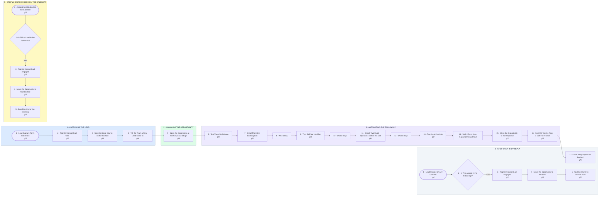

# From Capturing a Lead to the Opportunity and the Follow-Up

- **1 - CAPTURING THE LEAD** - This covers your forms, surveys, calendars and lead capture, and your tags, custom fields, triggers and actions. A form or survey starts everything, the lead gets a source tag and field, and the team is told.
- **2 - MANAGING THE OPPORTUNITY** - This covers your pipelines and opportunity stages and connecting leads to the right pipeline. Every lead opens at New Lead so the stage always shows where it stands.
- **3 - AUTOMATING THE FOLLOW-UP** - This covers your workflows, automated follow-ups and email and SMS automation.
- **4 - STOP WHEN THEY REPLY** - A small second workflow catches any reply, moves the opportunity to Replied and tags the lead so the follow-up stops wherever it is.
- **5 - STOP WHEN THEY BOOK ON THE CALENDAR** - A third workflow fires on the calendar booking, moves the opportunity to Call Booked and stops the follow-up the same way.
