# Your GHL CRM: From Manual Follow-Ups to Leads That Move on Their Own

```mermaid
flowchart LR
    subgraph sec_capture["1 - CAPTURE AND ORGANIZE EVERY LEAD"]
        direction TB
        form["1 - A new lead fills in your GHL form and lands in the CRM without anyone typing it"]
        tags["2 - GHL tags the lead by source and fills in your custom fields automatically"]
        dedupe["3 - If that email or phone is already in GHL, the existing contact gets updated instead"]
    end
    subgraph sec_pipeline["2 - KEEP THE PIPELINE UP TO DATE"]
        direction TB
        opp["4 - The lead is added to the first stage of your pipeline as a new opportunity"]
        stage["5 - When the lead replies, books or goes quiet, the stage changes on its own"]
    end
    subgraph sec_followup["3 - FOLLOW UP AND NURTURE AUTOMATICALLY"]
        direction TB
        first["6 - GHL sends the lead a text and an email right away from your business"]
        nurture["7 - If the lead has not replied, a nurture sequence keeps in touch until they do"]
    end
    subgraph sec_team["4 - TASKS AND ALERTS FOR YOUR TEAM"]
        direction TB
        task["8 - When a lead replies or books, GHL assigns a call task to the right person"]
        notify["9 - Your team gets a notification when a lead changes stage or needs attention"]
    end
    subgraph sec_handoff["5 - TEST IT AND HAND IT TO YOUR TEAM"]
        direction TB
        test["10 - We run test leads through every form, stage and message before going live"]
        folders["11 - Each workflow is named and filed in folders so your team can find and edit it"]
        done["12 - Your team works every lead from the pipeline instead of tracking it by hand"]
    end
    form --> tags
    tags --> dedupe
    dedupe --> opp
    opp --> stage
    stage --> first
    first --> nurture
    nurture --> task
    task --> notify
    notify --> test
    test --> folders
    folders --> done
    style sec_capture fill:#dbeafe,stroke:#94a3b8,color:#0f172a
    style sec_pipeline fill:#dcfce7,stroke:#94a3b8,color:#0f172a
    style sec_followup fill:#ede9fe,stroke:#94a3b8,color:#0f172a
    style sec_team fill:#f1f5f9,stroke:#94a3b8,color:#0f172a
    style sec_handoff fill:#fef9c3,stroke:#94a3b8,color:#0f172a
```

- **1 - CAPTURE AND ORGANIZE EVERY LEAD** - Lead capture and contact management share this section. Your forms feed GHL directly, and tags and custom fields sort each contact as it arrives.
- **2 - KEEP THE PIPELINE UP TO DATE** - Each lead becomes an opportunity in your pipeline, and what the lead does moves it between stages. We map the stages from how your team sells today.
- **3 - FOLLOW UP AND NURTURE AUTOMATICALLY** - Every message depends on what the lead has done, and a reply or a booking stops the automated ones. Texts only deliver once your GHL number is registered for business texting.
- **4 - TASKS AND ALERTS FOR YOUR TEAM** - Task assignments and notifications share this section. Your team is told who to call and when, based on lead activity and pipeline stage.
- **5 - TEST IT AND HAND IT TO YOUR TEAM** - Every workflow is tested with test leads before it touches a real one. Everything is named and organized so your team can manage it.
