# Your GHL Leads: Captured, Followed Up and Assigned Automatically

```mermaid
flowchart LR
    subgraph sec_capture["1 - LEAD CAPTURE AND CONTACT MANAGEMENT"]
        direction TB
        form(["1 - A lead fills out your website form<br/><i>ghl</i>"])
        tag_src["2 - Tag the contact website-lead so you know where they came from<br/><i>ghl</i>"]
        field_src["3 - Save Website form in the contact's Lead Source field<br/><i>ghl</i>"]
    end
    subgraph sec_pipe["2 - PIPELINE UPDATES"]
        direction TB
        opp["4 - Open the lead in your pipeline at the New Lead stage<br/><i>ghl</i>"]
    end
    subgraph sec_follow["3 - AUTOMATED FOLLOW-UPS"]
        direction TB
        sms1["5 - Text the lead right away so they hear from you first<br/><i>ghl</i>"]
        email1["6 - Email the lead the same details plus a link to book a call<br/><i>ghl</i>"]
        w1["7 - Wait one day to give the lead time to answer"]
    end
    subgraph sec_active["4 - ACTIONS BASED ON LEAD ACTIVITY"]
        direction TB
        gate{"8 - Did they reply or book a call?"}
        opp_hot["8a - Move the opportunity to the Engaged stage<br/><i>ghl</i>"]
        task_hot["8b - Give the owner a task to follow up today<br/><i>ghl</i>"]
        notify_hot["8c - Text the owner that a hot lead is waiting<br/><i>ghl</i>"]
    end
    subgraph sec_nurture["5 - LEAD NURTURING"]
        direction TB
        sms2["8d - Send a second text to a lead who has not answered yet<br/><i>ghl</i>"]
        w2["8e - Wait two more days before the next follow-up"]
        email2["8f - Email a short check-in that keeps the door open<br/><i>ghl</i>"]
        task_cold["8g - Give the owner a task to call the lead who went quiet<br/><i>ghl</i>"]
    end
    form --> tag_src
    tag_src --> field_src
    field_src --> opp
    opp --> sms1
    sms1 --> email1
    email1 --> w1
    w1 --> gate
    gate -->|yes| opp_hot
    opp_hot --> task_hot
    task_hot --> notify_hot
    gate -->|no| sms2
    sms2 --> w2
    w2 --> email2
    email2 --> task_cold
    style sec_capture fill:#dbeafe,stroke:#94a3b8,color:#0f172a
    style sec_pipe fill:#dcfce7,stroke:#94a3b8,color:#0f172a
    style sec_follow fill:#ede9fe,stroke:#94a3b8,color:#0f172a
    style sec_active fill:#f1f5f9,stroke:#94a3b8,color:#0f172a
    style sec_nurture fill:#fef9c3,stroke:#94a3b8,color:#0f172a
```

- **1 - LEAD CAPTURE AND CONTACT MANAGEMENT** - Your parts one and two. A form fill becomes a tagged contact with its source saved.
- **2 - PIPELINE UPDATES** - Every new lead opens as an opportunity in the first stage of your pipeline.
- **3 - AUTOMATED FOLLOW-UPS** - The lead gets a text and an email within a minute, then the workflow waits one day.
- **4 - ACTIONS BASED ON LEAD ACTIVITY** - Your parts five to seven. A lead who replied or booked moves stage, and the owner gets a task and an alert.
- **5 - LEAD NURTURING** - A lead who went quiet gets a second text and an email, then the owner gets a call task.
