# Pembroke Pines, Boynton Beach, Royal Palm Beach: Ad to Actual Patient

```mermaid
flowchart LR
    subgraph sec_setup["1 - YOUR ACCOUNT AND PATIENT PIPELINE"]
        direction TB
        account["1 - Your Own GHL Account, One Pipeline per Location, No Generic Snapshot"]
        services["2 - Every Lead Tagged: General Dental, Orthodontics, Invisalign or Braces"]
    end
    subgraph sec_sources["2 - EVERY CALL, CLICK AND FORM KEEPS ITS SOURCE"]
        direction TB
        source["3 - Google Ads, Meta Ads, Website or Phone Call: Original Source Retained"]
        calls["4 - Tracking Numbers per Location Log Campaign, Source and Call Outcome"]
        scheduled{"5 - Did the Caller or Form Lead Schedule?"}
        gads["6 - Google Ads Gets Scheduled, Showed, Became Patient, Treatment Started"]
    end
    subgraph sec_followup["3 - FOLLOW-UP THAT STOPS WHEN STATUS CHANGES"]
        direction TB
        noschedule["7 - Missed Call or Did Not Schedule: Text-Back, Then Follow-Up Until Booked"]
        stagecheck{"8 - Status Changed Before the Next Message?"}
        recall["9 - Recall and Reactivation: Hygiene Due, Unscheduled Treatment, Orthodontic Consults"]
        booked["10 - Confirmation and Reminders, No Show or Cancelled Moves to Rescheduled"]
    end
    subgraph sec_pms["4 - YOUR PRACTICE MANAGEMENT SYSTEM"]
        direction TB
        pms["11 - Your PMS Moves the Stage: Showed, Became Patient, Treatment Started"]
    end
    subgraph sec_reporting["5 - DASHBOARD BY LOCATION, READY FOR AI CALLING"]
        direction TB
        dashboard["12 - Dashboard: Show Rate and Lead-to-Patient Rate by Location and Campaign"]
        ai["13 - Built So AI Calling Plugs In Later Without Rebuilding the CRM"]
    end
    account --> services
    services --> source
    source --> calls
    calls --> scheduled
    scheduled -->|yes| gads
    scheduled -->|no| noschedule
    noschedule --> stagecheck
    stagecheck -->|yes, booked| booked
    stagecheck -->|never replied| recall
    gads --> booked
    recall -->|books| booked
    booked --> pms
    pms --> dashboard
    dashboard --> ai
    style sec_setup fill:#dbeafe,stroke:#94a3b8,color:#0f172a
    style sec_sources fill:#dcfce7,stroke:#94a3b8,color:#0f172a
    style sec_followup fill:#ede9fe,stroke:#94a3b8,color:#0f172a
    style sec_pms fill:#f1f5f9,stroke:#94a3b8,color:#0f172a
    style sec_reporting fill:#fef9c3,stroke:#94a3b8,color:#0f172a
```

- **1 - YOUR ACCOUNT AND PATIENT PIPELINE** - Your parts 1 and 2, milestone 1. Each location's pipeline carries your stages: New Lead, Attempted Contact, Contacted, Appointment Scheduled, Confirmed, Showed, No Show, Rescheduled, Treatment Presented, Became Patient, Treatment Started.
- **2 - EVERY CALL, CLICK AND FORM KEEPS ITS SOURCE** - Your parts 3, 4 and 5, milestone 2, plus milestone 4's offline conversions; Google takes each stage up to 90 days after the click, so later ortho starts count on your dashboard only. Google gets the click ID, stage and time, never a treatment detail, and hashed contact data for enhanced conversions only if your compliance advisor signs off.
- **3 - FOLLOW-UP THAT STOPS WHEN STATUS CHANGES** - Your parts 6 and 7, milestone 3. Your 12 follow-up situations, missed calls through treatment follow-up and review requests, are 12 workflows for all 3 locations, not 36 copies, and each checks the stage before it sends.
- **4 - YOUR PRACTICE MANAGEMENT SYSTEM** - Your part 8, milestone 4. A sync (your PMS's own, or an n8n or Make bridge) or the front desk moves the stage, each move reaches Google Ads, and clinical notes stay in the PMS.
- **5 - DASHBOARD BY LOCATION, READY FOR AI CALLING** - Your parts 9 and 10, milestone 5. Pembroke Pines, Boynton Beach and Royal Palm Beach side by side from leads and calls to became patient, with revenue by campaign where your PMS gives a case value.
