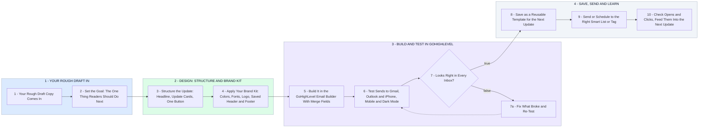

# Your Product and Service Update Email System in GoHighLevel

- **1 - YOUR ROUGH DRAFT IN** - You send the copy the way it comes out, plus the one thing the update should get people to do. Nothing in your draft gets lost on the way to the finished email.
- **2 - DESIGN: STRUCTURE AND BRAND KIT** - The update is broken into sections people can scan in seconds, then dressed in your colors, fonts and logo. The header and footer are saved once in GoHighLevel, so every future update starts on brand.
- **3 - BUILD AND TEST IN GOHIGHLEVEL** - Built in the GoHighLevel email builder with your merge fields, then test sends to Gmail, Outlook and an iPhone, checked on mobile and in dark mode. Nothing goes out until it looks right everywhere.
- **4 - SAVE, SEND AND LEARN** - Saved as a reusable template, sent or scheduled to the right smart list or tag, and the opens and clicks shape the next update.
