# Your 2-Step Funnel Cloned From ClickFunnels/WordPress Into GHL

```mermaid
flowchart LR
    subgraph sec_design["1 - DESIGN CLONING"]
        direction TB
        landing["1 - I rebuild your landing page in the GHL page builder, section by section"]
        thanks["2 - I rebuild your thank you page the same way, so both funnel steps match"]
        sidebyside["3 - I match every color, font and spacing side by side with the original"]
        fonts["4 - If a font isn't built into GHL, I upload it so your text still matches"]
    end
    subgraph sec_assets["2 - ASSET MIGRATION"]
        direction TB
        download["5 - I download every image, graphic and line of copy from your current funnel"]
        upload["6 - I upload them to your GHL media library and place each one in the same spot"]
    end
    subgraph sec_form["3 - FORM CREATION"]
        direction TB
        optin["7 - I recreate your opt-in form in GHL with the same fields in the same order"]
        embed["8 - I embed it on the landing page so every opt-in lands in your GHL contacts"]
    end
    subgraph sec_mobile["4 - MOBILE OPTIMIZATION"]
        direction TB
        devices["9 - I check both pages on desktop, tablet and phone, side by side with the original"]
        phonefix["10 - I fix text sizes and image stacking on phones so nothing gets cut off"]
    end
    subgraph sec_qa["5 - LINK & BUTTON QA"]
        direction TB
        links["11 - I click every button and link, then send a test opt-in to the thank you page"]
        live["12 - Your funnel goes live on your domain in GHL, and a test lead lands in your contacts"]
    end
    landing --> thanks
    thanks --> sidebyside
    sidebyside --> fonts
    fonts --> download
    download --> upload
    upload --> optin
    optin --> embed
    embed --> devices
    devices --> phonefix
    phonefix --> links
    links --> live
    style sec_design fill:#dbeafe,stroke:#94a3b8,color:#0f172a
    style sec_assets fill:#dcfce7,stroke:#94a3b8,color:#0f172a
    style sec_form fill:#ede9fe,stroke:#94a3b8,color:#0f172a
    style sec_mobile fill:#f1f5f9,stroke:#94a3b8,color:#0f172a
    style sec_qa fill:#fef9c3,stroke:#94a3b8,color:#0f172a
```

- **1 - DESIGN CLONING** - I rebuild your Landing Page and Thank You Page in the Go High Level page builder. I check colors, fonts and layout side by side until they match the original exactly.
- **2 - ASSET MIGRATION** - Every image, graphic and piece of copy moves into your GHL media library. Each one goes back in the same spot on the new pages, so nothing links back to the old platform.
- **3 - FORM CREATION** - Your opt-in form is rebuilt inside Go High Level with the same fields and embedded on the new funnel page. Every lead it captures lands in your GHL contacts. If your old funnel sent an email after each opt-in, I'll flag it so it doesn't quietly stop.
- **4 - MOBILE OPTIMIZATION** - Both pages get checked on desktop, tablet and phone against the original.
- **5 - LINK & BUTTON QA** - Every button and link gets clicked, then a test opt-in runs start to finish. Each one has to take the visitor to the correct next step in your GHL funnel.
