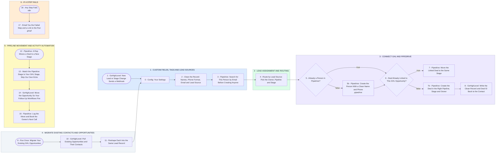

# Your GHL and Pipedrive, Connected: Leads Routed, Stages Synced

- **1 - CUSTOM FIELDS, TAGS AND LEAD SOURCES** - Your part on custom fields, tags and lead sources, with the CRM data quality you asked for. Names, phone format and lead source are cleaned, and Pipedrive is searched by email before anyone is created.
- **2 - LEAD ASSIGNMENT AND ROUTING** - Lead source decides which rep owns the lead and which stage the deal opens in. A person already in Pipedrive stays with their rep.
- **3 - CONNECT GHL AND PIPEDRIVE** - One person and one deal per lead in Pipedrive, linked both ways. The Pipedrive deal id goes back onto the GHL contact, and the clean record replaces the messy one.
- **4 - MIGRATE EXISTING CONTACTS AND OPPORTUNITIES** - Run once before launch. Your existing GHL opportunities and their contacts go through the same cleaner, dedupe and routing as a new lead.
- **5 - PIPELINE MOVEMENT AND ACTIVITY AUTOMATION** - When a rep moves a deal in Pipedrive, the GHL opportunity moves to the same stage and your GHL follow-up workflows fire. The rep's next call is booked on the deal.
- **6 - IF A STEP FAILS** - Any failure emails you the step that stopped and a link to the run, so you can fix it and retry.
