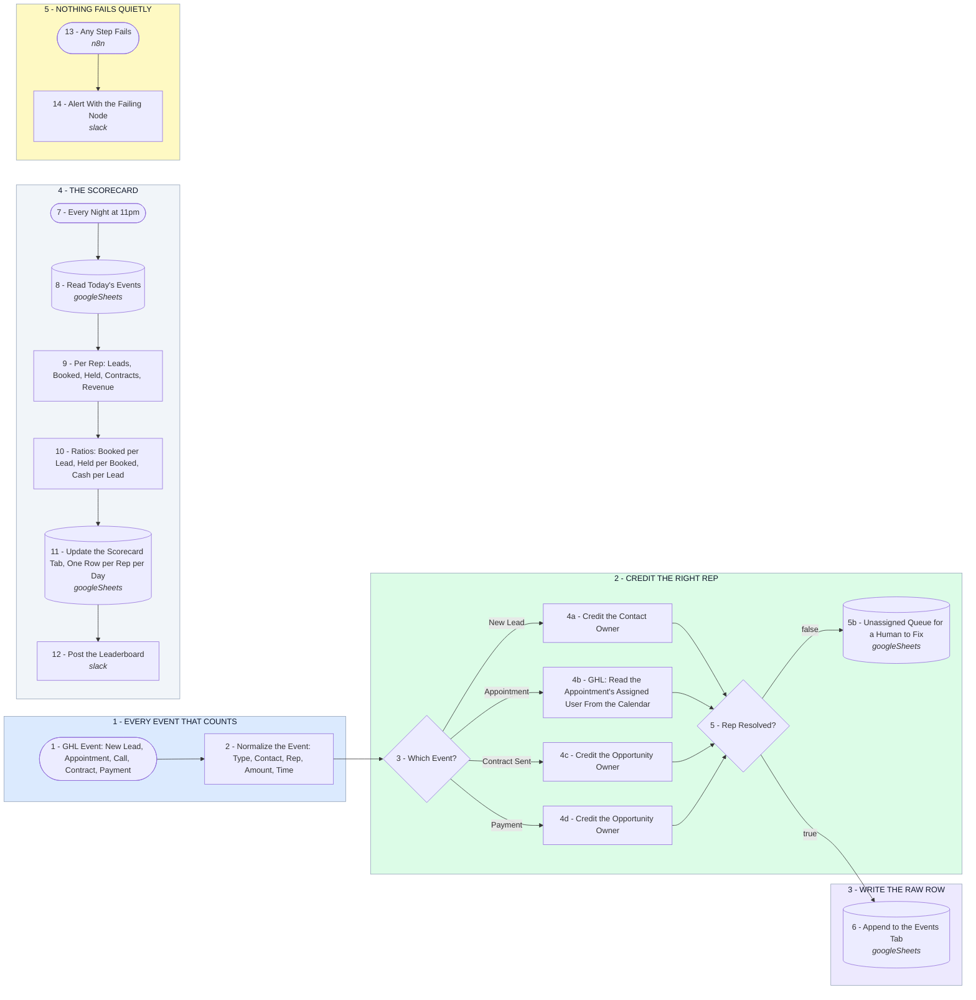

# Your Sales Rep Scorecard

- **1 - EVERY EVENT THAT COUNTS** - One webhook, fed by a GHL workflow per event type. New lead, appointment booked or updated, call outcome, contract sent, payment received. Every one arrives in the same shape.
- **2 - CREDIT THE RIGHT REP** - This is the part that gets scorecards wrong. A booked call is credited to the assigned user on the calendar event, not to whoever owns the contact. Nothing gets counted until a rep is resolved.
- **3 - WRITE THE RAW ROW** - Every event lands on an Events tab, one row, timestamped. The scorecard is always rebuildable from it, so a bad number can be traced to the event that caused it.
- **4 - THE SCORECARD** - Once a night the events roll up per rep into leads, booked, held, contracts, revenue, and the ratios that actually get coached on. One row per rep per day, plus a leaderboard in Slack.
- **5 - NOTHING FAILS QUIETLY** - If a step breaks, you hear about it the same day with the failing node named. A silent scorecard is worse than no scorecard.
