# Qualified Appointments From US Clinicians and Medical Practices

```mermaid
flowchart LR
    subgraph sec_build["1 - BUILD AND SEGMENT THE DATABASE"]
        direction TB
        db["1 - We build a database of US physicians, clinicians, practices and decision-makers"]
        seg["2 - Each contact is tagged by specialty, practice type, size and likely use case"]
    end
    subgraph sec_safe["2 - CLEAN LISTS AND SAFE SENDING"]
        direction TB
        verify["3 - Every email address is verified, and bad or duplicate contacts are removed"]
        domains["4 - Emails go out from separate lookalike domains, so your main domain stays safe"]
        warm["5 - New Zapmail mailboxes warm up in Instantly before they send any cold email"]
        volume["6 - Your monthly volume target, which you give us, sets how many mailboxes we buy"]
        canspam["7 - Each email has your postal address and a working opt-out, and uses business data only"]
    end
    subgraph sec_sequences["3 - SEQUENCES WITH TWO GOALS"]
        direction TB
        research["8 - Claude researches each practice so every email opens with something true about it"]
        test["9 - We test subject lines, messages and calls to action across a short follow-up sequence"]
        goal["10 - Each campaign asks for one thing, either a booked meeting or an online sign-up"]
    end
    subgraph sec_track["4 - TRACKING AND HAND-OFF"]
        direction TB
        unibox["11 - Replies land in one unibox, and clicks, appointments and sign-ups are all tracked"]
        handoff["12 - Qualified leads go to your Technical Sales Executive or founders with full context"]
    end
    subgraph sec_optimise["5 - OPTIMISE FROM THE RESULTS"]
        direction TB
        improve["13 - The weakest subject line or message is replaced once the numbers show a winner"]
    end
    db --> seg
    seg --> verify
    verify --> domains
    domains --> warm
    warm --> volume
    volume --> canspam
    canspam --> research
    research --> test
    test --> goal
    goal --> unibox
    unibox --> handoff
    handoff --> improve
    style sec_build fill:#dbeafe,stroke:#94a3b8,color:#0f172a
    style sec_safe fill:#dcfce7,stroke:#94a3b8,color:#0f172a
    style sec_sequences fill:#ede9fe,stroke:#94a3b8,color:#0f172a
    style sec_track fill:#f1f5f9,stroke:#94a3b8,color:#0f172a
    style sec_optimise fill:#fef9c3,stroke:#94a3b8,color:#0f172a
```

- **1 - BUILD AND SEGMENT THE DATABASE** - This covers the first two parts of your post. Every contact is a US physician, clinician, practice or healthcare decision-maker, sorted the way your campaigns will be split.
- **2 - CLEAN LISTS AND SAFE SENDING** - This covers list hygiene, sender reputation and deliverability. It is the same setup Lorenzo uses to send over 100,000 cold emails a month on Instantly.
- **3 - SEQUENCES WITH TWO GOALS** - This covers the campaigns, the testing and the two goals in your post. Each campaign either books a meeting or sends people to subscribe online.
- **4 - TRACKING AND HAND-OFF** - This covers tracking and the hand-off to your team. Your Technical Sales Executive or founders only get the conversations that need a product discussion.
- **5 - OPTIMISE FROM THE RESULTS** - Changes are made from real replies, bookings and sign-ups, not guesses.
