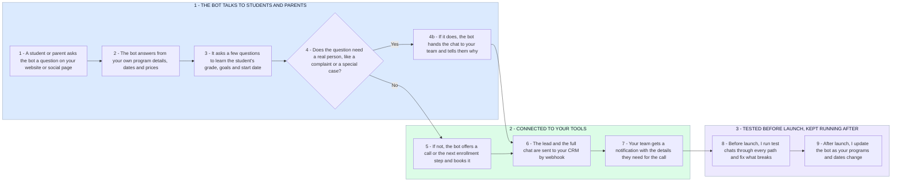

# Your First Hermes Bot: Questions Answered, Calls Booked, CRM Updated

- **1 - THE BOT TALKS TO STUDENTS AND PARENTS** - The bot answers from your own information and learns what each family needs. Anything sensitive goes straight to a person.
- **2 - CONNECTED TO YOUR TOOLS** - Every conversation ends in a booked next step, and the lead lands in your CRM so nobody retypes it.
- **3 - TESTED BEFORE LAUNCH, KEPT RUNNING AFTER** - You asked for someone who tests their own work, so every path gets tested first, and the bot is kept up to date as things change.
