# How My Own Email Bots Run: Leads In, Replies Handled, Calls Booked

```mermaid
flowchart LR
    subgraph sec_leads["1 - FINDING AND RESEARCHING LEADS"]
        direction TB
        find["1 - A bot pulls new businesses for each niche and verifies every email address"]
        write["2 - Claude researches each business and writes a personal first line for them"]
    end
    subgraph sec_send["2 - SENDING SAFELY"]
        direction TB
        send["3 - Instantly sends the campaigns from about 45 warmed inboxes on 15 domains"]
        health["4 - A bot checks every inbox's health each day and flags anything that's slipping"]
    end
    subgraph sec_replies["3 - HANDLING EVERY REPLY"]
        direction TB
        reply["5 - When someone replies, a bot reads it and sorts it into one of 11 types"]
        approved{"6 - Is the right answer one of the replies I've already approved?"}
        card["6b - If not, the bot drafts a reply and sends it to me to approve first"]
    end
    subgraph sec_booked["4 - BOOKING AND FOLLOWING UP"]
        direction TB
        book["7 - If it is, it goes out and offers two open call times from my calendar"]
        follow["8 - If the lead goes quiet, a follow-up bot keeps checking in on a set schedule"]
        crm["9 - Booked calls land in my GHL pipeline and get reminders before the call"]
    end
    subgraph sec_report["5 - REPORTING"]
        direction TB
        report["10 - Every morning and evening, a reporting bot sends me the numbers"]
    end
    find --> write
    write --> send
    send --> health
    health --> reply
    reply --> approved
    approved -->|Yes| book
    approved -->|No| card
    card --> book
    book --> follow
    follow --> crm
    crm --> report
    style sec_leads fill:#dbeafe,stroke:#94a3b8,color:#0f172a
    style sec_send fill:#dcfce7,stroke:#94a3b8,color:#0f172a
    style sec_replies fill:#ede9fe,stroke:#94a3b8,color:#0f172a
    style sec_booked fill:#f1f5f9,stroke:#94a3b8,color:#0f172a
    style sec_report fill:#fef9c3,stroke:#94a3b8,color:#0f172a
```

- **1 - FINDING AND RESEARCHING LEADS** - Every lead is verified before anything is sent, and every email opens with something true about that business.
- **2 - SENDING SAFELY** - Cold email never touches my main domain, and a bot watches inbox health every day.
- **3 - HANDLING EVERY REPLY** - A bot sorts each reply. Anything I haven't approved waits for me instead of going out on its own.
- **4 - BOOKING AND FOLLOWING UP** - Interested leads get call times right away, and quiet ones get followed up on a schedule.
- **5 - REPORTING** - I get the numbers twice a day without opening a single dashboard.
