# High Caliber Karting: Stack Audit and Automation Architecture

```mermaid
flowchart LR
    subgraph sec_stack["1 - YOUR STACK TODAY: INVENTORY AND HOW IT IS USED"]
        direction TB
        inventory["1 - Validate the Inventory: Dozens of Platforms, 10-20 Hours, Deep Where Money Moves"]
        venue_day["2 - Trace One Venue Day: BMI Leisure, Toast, Deputy Shifts, MaintainX Work Orders"]
    end
    subgraph sec_access["2 - ACCESS, THEN THE SIMPLEST TOOL THAT WORKS"]
        direction TB
        access_check["3 - APIs, Webhooks, Native Integrations: Toast and BMI Leisure Access Checked First"]
        direct{"4 - Can These Systems Communicate Directly?"}
        native["4a - Yes: Native First, Like Stripe and PayPal Into QuickBooks, Else n8n or Make"]
        custom["4b - No: Browser Automation, or Custom Code Only When It Is Simpler"]
    end
    subgraph sec_manual["3 - TYPED TWICE, AND WHAT REMAINS HUMAN-CONTROLLED"]
        direction TB
        typed_twice["5 - Typed Twice? BMI Leisure Prices on WordPress/Elementor, Jotform Entries in HubSpot"]
        human_gate{"6 - Money, Safety or a Guest's Event at Stake?"}
        human["6a - Remains Human-Controlled: Event Deposits, Refunds, UniFi, Google Admin, Lighting"]
    end
    subgraph sec_flow["4 - HOW INFORMATION FLOWS, AND WHAT HAPPENS WHEN IT FAILS"]
        direction TB
        truth["7 - Source of Truth: BMI Leisure Bookings, QuickBooks Money, Guests in BMI or HubSpot?"]
        failure["8 - When an Automation Fails: Logged, Retried, Then a Twilio Text to Its Owner"]
    end
    subgraph sec_roadmap["5 - A VERDICT PER PLATFORM, THEN A PHASED ROADMAP"]
        direction TB
        verdict["9 - One Verdict Each: Retain, Integrate, Automate, Consolidate, Replace, Supplement"]
        roadmap_steps["10 - Phased Roadmap by Value, Complexity and Risk: Pricing Sync as Phase 1 Candidate"]
    end
    inventory --> venue_day
    venue_day --> access_check
    access_check --> direct
    direct -->|yes| native
    direct -->|no| custom
    native --> typed_twice
    custom --> typed_twice
    typed_twice --> human_gate
    human_gate -->|yes| human
    human_gate -->|no: automate| truth
    human --> truth
    truth --> failure
    failure --> verdict
    verdict --> roadmap_steps
    style sec_stack fill:#dbeafe,stroke:#94a3b8,color:#0f172a
    style sec_access fill:#dcfce7,stroke:#94a3b8,color:#0f172a
    style sec_manual fill:#ede9fe,stroke:#94a3b8,color:#0f172a
    style sec_flow fill:#f1f5f9,stroke:#94a3b8,color:#0f172a
    style sec_roadmap fill:#fef9c3,stroke:#94a3b8,color:#0f172a
```

- **1 - YOUR STACK TODAY: INVENTORY AND HOW IT IS USED** - Your parts 1 and 2: validate the inventory, then see how each platform is really used on a venue day. This first pass is built from your post and your public site; the paid audit confirms it with your team.
- **2 - ACCESS, THEN THE SIMPLEST TOOL THAT WORKS** - Your parts 3 and 4: APIs, webhooks and native integrations for each platform, then where n8n, Make, custom code, browser automation or AI agents belong. Native first, custom only when it is the simplest reliable answer, and AI only where it actually belongs in the workflow. Whether Stripe and PayPal flow into QuickBooks natively depends on your edition: QuickBooks Online or Desktop?
- **3 - TYPED TWICE, AND WHAT REMAINS HUMAN-CONTROLLED** - Your parts 5 and 6: duplicate data entry and repetitive manual processes, then the systems that should remain human-controlled. Every manual task gets your question: why is this task being done manually?
- **4 - HOW INFORMATION FLOWS, AND WHAT HAPPENS WHEN IT FAILS** - Your parts 7 and 8: one source of truth for each kind of record, then security, permissions, logging, retry and failure handling. Each automation gets its own login with only the access it needs.
- **5 - A VERDICT PER PLATFORM, THEN A PHASED ROADMAP** - Your parts 9 and 10: retain, integrate, automate, consolidate, replace or supplement with custom software, then phases ranked by value, complexity and risk. Every platform gets an answer to: should we integrate this system or eventually replace it?
