# Your Custom Product Options Into HubSpot Deals, Line Items, Contacts

```mermaid
flowchart LR
    subgraph sec_capture["1 - CAPTURE LINE-ITEM PROPERTIES AND METAFIELDS"]
        direction TB
        hook(["1 - Shopify Order Created or Updated: Webhook Fires"])
        shop["2 - Shopify: Pull Line-Item Properties and Metafields"]
    end
    subgraph sec_dedup["2 - NO DUPLICATE CONTACTS OR CORRUPTED DEALS"]
        direction TB
        finddeal["3 - HubSpot: Search Deals for This Shopify Order ID"]
        gate{"4 - New Order or Already a Deal?"}
        contact["4a - HubSpot: Upsert the Contact by Email"]
        upddeal["4b - HubSpot: Update That Deal's Amount and Status"]
    end
    subgraph sec_tokens["3 - OPTIONS FOR YOUR EMAIL TOKENS AND ABANDONED CHECKOUT"]
        direction TB
        deal["5 - HubSpot: Create the Deal With Its Options"]
        writeback["6 - Shopify: Save the HubSpot Deal ID on the Order"]
        cart_hook(["9 - Shopify Checkout Created or Updated: Webhook Fires"])
        cart_contact["10 - HubSpot: Save the Cart's Options and Recovery Link on the Contact"]
    end
    subgraph sec_report["4 - EVERY OPTION ON ITS LINE ITEM FOR REPORTING"]
        direction TB
        split["7 - Split the Order Into Its Line Items"]
        lineitem["8 - HubSpot: Create Each Line Item With Its Options"]
    end
    hook --> shop
    shop --> finddeal
    finddeal --> gate
    gate -->|New Order| contact
    gate -->|Already Synced| upddeal
    contact --> deal
    deal --> writeback
    writeback --> split
    split --> lineitem
    cart_hook --> cart_contact
    style sec_capture fill:#dbeafe,stroke:#94a3b8,color:#0f172a
    style sec_dedup fill:#dcfce7,stroke:#94a3b8,color:#0f172a
    style sec_tokens fill:#ede9fe,stroke:#94a3b8,color:#0f172a
    style sec_report fill:#f1f5f9,stroke:#94a3b8,color:#0f172a
```

- **1 - CAPTURE LINE-ITEM PROPERTIES AND METAFIELDS** - Your Custom Integration & Data Architecture, the sync and the mapping: Shopify's order webhooks feed Make directly, so the native integration's limits never apply. One Shopify call pulls every line-item property and metafield, which steps 4a, 5 and 8 map onto your Contact, Deal and Line Item properties. Engraving Text, Font and Gift Wrap stand in for your own line-item property names until you send the real list.
- **2 - NO DUPLICATE CONTACTS OR CORRUPTED DEALS** - Your clean data handling: step 3 looks up the Shopify order ID before any deal is made, step 4a matches the contact on email, and shopify_order_id is set to unique values in HubSpot. If the native HubSpot app stays installed, its deal sync needs to be off, or orders can land as two deals.
- **3 - OPTIONS FOR YOUR EMAIL TOKENS AND ABANDONED CHECKOUT** - Your Automated HubSpot Workflows & Personalization and Email Template Setup: the deal carries the order's options and the contact its last-order tokens and product image, which your post-purchase, upsell and re-engagement sequences and drag-and-drop templates pull in. Abandoned checkout runs as its own scenario on Shopify's checkout webhook, and only checkouts with an email that were never completed get through: the cart's options and recovery link land on the contact, so your abandoned cart sequence shows the options they picked, and a completed order clears the link. Step 6 sends the deal ID back to the order for the two-way sync.
- **4 - EVERY OPTION ON ITS LINE ITEM FOR REPORTING** - Your Analytics & Custom Reporting: each line item keeps its own option and metafield values beside the deal's revenue and the contact's lifetime spend, the fields your dashboards group by for revenue, CLV and sales by product option variation. Line items with custom properties do this without HubSpot custom objects.
