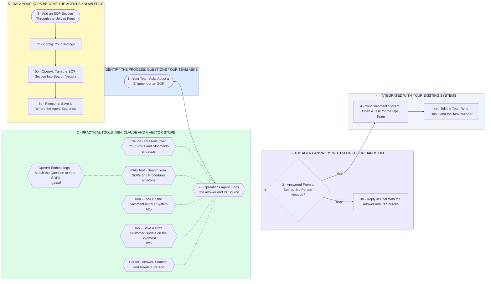

# Your Logistics Ops Agent: Shipment Answers With Sources, Built on RAG

- **1 - IDENTIFY THE PROCESS: QUESTIONS YOUR TEAM ASKS** - Discovery starts by ranking the work your team does by hand today: shipment status questions, customer ETA updates, CMR and POD paperwork, quoting and invoicing. This canvas builds the first of those so you can see where discovery leads.
- **2 - PRACTICAL TOOLS: N8N, CLAUDE AND A VECTOR STORE** - Practical means tools your team can run and change. n8n runs the flow, Claude does the reasoning, and a vector store holds your documents.
- **3 - THE AGENT ANSWERS WITH SOURCES OR HANDS OFF** - The agent replies only when a tool gave it a source. Anything it cannot source, or anything that needs a decision like a claim or a credit, goes to a person.
- **4 - INTEGRATED WITH YOUR EXISTING SYSTEMS** - The agent reads and writes your existing shipment system through its API. When it cannot answer, it opens a task there for your ops team.
- **5 - RAG: YOUR SOPS BECOME THE AGENT'S KNOWLEDGE** - This is the RAG part of your post. Each SOP added here is turned into search vectors so the agent can find the right section and quote it.
