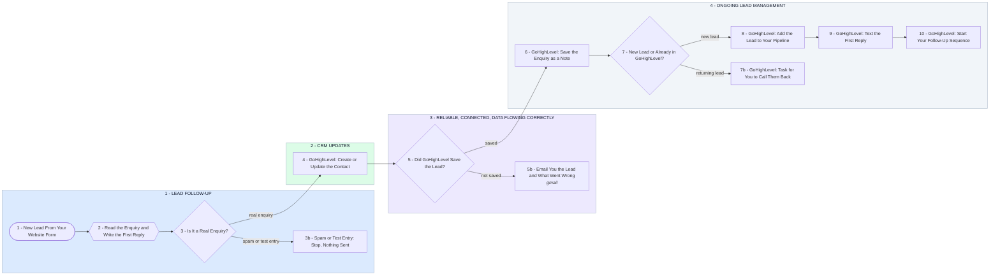

# Your Make.com Lead Follow-Up and CRM Updates Into GoHighLevel

- **1 - LEAD FOLLOW-UP** - A new enquiry from your website form is read the moment it arrives and a first reply is written from what they actually asked. Spam and test entries stop at step 3, before anything is sent. If your form tool cannot send to a webhook, step 1 becomes a Make mailhook on the form's notification email and nothing after it changes.
- **2 - CRM UPDATES** - The lead is created in GoHighLevel, or updated if they are already there, matched on email and phone so each person is one contact, with UK mobiles saved as +44 so GoHighLevel can text them.
- **3 - RELIABLE, CONNECTED, DATA FLOWING CORRECTLY** - Your reliable process, connected systems and data flowing correctly between platforms, grouped here: form, Make and GoHighLevel in one scenario, and a lead GoHighLevel refuses comes to your inbox with the reason. Failed runs nobody sees are the first gap I check in your current setup.
- **4 - ONGOING LEAD MANAGEMENT** - What they asked is saved on the contact as a note for whoever calls them back. New leads then get a card in your pipeline, the first text and your follow-up sequence, and someone already in GoHighLevel who enquires again becomes a task for you. Room to add a booking step next, so the card moves when they book.
