# Money Merch: Instantly Outbound to Businesses That Buy Uniforms

```mermaid
flowchart LR
    subgraph sec_research["1 - RESEARCH AND LISTS"]
        direction TB
        research["1 - Research Each Industry You Give: Google Maps, Apollo, Sales Navigator"]
        fit{"2 - Buys Uniforms or Branded Workwear?"}
        buyer["3 - Find Who Orders the Uniforms: Owner, Operations or Office Manager"]
    end
    subgraph sec_verify["2 - VERIFY AND CLEAN"]
        direction TB
        verify["4 - Find Every Email With Hunter, Verify With MillionVerifier or NeverBounce"]
        clean["5 - Clean the List: Remove Duplicates, Risky Emails and Current Customers"]
    end
    subgraph sec_instantly["3 - INSTANTLY CAMPAIGNS AND DELIVERABILITY"]
        direction TB
        import["6 - Into Instantly: One Campaign Per Industry, 3 Emails With Follow-Ups"]
        domains["7 - Separate Sending Domains Protect Your Main One: 1 Mailbox Per 175 Companies a Month"]
        monitor["8 - Watch Deliverability, Bounce and Reply Rates Every Day"]
    end
    subgraph sec_optimize["4 - A/B TESTS AND POSITIVE-REPLY HANDOFF"]
        direction TB
        abtest["9 - A/B Test Subject Lines, Messaging, Offers and Sequences"]
        baddata["10 - Remove Bad Data: Bounces, Wrong Contacts, Closed Businesses"]
        positive{"11 - Positive Reply?"}
        handoff["12 - Hand It to Your Sales Team: Contact, Company, Uniform Need"]
    end
    subgraph sec_report["5 - REPORTING"]
        direction TB
        weekly["13 - Weekly Report: Volume, Replies, Interested Leads, Meetings, Quotes"]
    end
    research --> fit
    fit -->|yes| buyer
    fit -.->|no| research
    buyer --> verify
    verify --> clean
    clean --> import
    import --> domains
    domains --> monitor
    monitor --> abtest
    abtest --> baddata
    baddata --> positive
    positive -->|yes| handoff
    positive -->|no| weekly
    handoff --> weekly
    style sec_research fill:#dbeafe,stroke:#94a3b8,color:#0f172a
    style sec_verify fill:#dcfce7,stroke:#94a3b8,color:#0f172a
    style sec_instantly fill:#ede9fe,stroke:#94a3b8,color:#0f172a
    style sec_optimize fill:#f1f5f9,stroke:#94a3b8,color:#0f172a
    style sec_report fill:#fef9c3,stroke:#94a3b8,color:#0f172a
```

- **1 - RESEARCH AND LISTS** - Your parts 1 to 3, one list per industry you give: construction, HVAC, plumbing, electrical, landscaping, automotive, property management, restaurants and hospitality, gyms and fitness, warehouses and logistics, home services, multi-location businesses and companies with large employee teams. A company that doesn't buy uniforms or branded workwear never gets an email. Apollo, Sales Navigator, Clay or ZoomInfo: whichever you already pay for.
- **2 - VERIFY AND CLEAN** - Your parts 4 and 5. Every address is verified before it reaches Instantly, and anyone already buying from you comes off the list.
- **3 - INSTANTLY CAMPAIGNS AND DELIVERABILITY** - Your parts 6 to 9. Cold email never sends from your main domain, and your monthly company target sets how many mailboxes.
- **4 - A/B TESTS AND POSITIVE-REPLY HANDOFF** - Your parts 10 to 12. One change tested at a time, bad data removed as it shows up, and only positive replies go to your sales team.
- **5 - REPORTING** - Your part 13, scored on your measures: list quality, valid email and bounce rate, positive reply rate, qualified leads, meetings or quote opportunities, and improvement over time.
