# Your Two-Voice News Desk - 6 Sources to Google Sheets

```mermaid
flowchart LR
    subgraph sec_pull["1 - EVERY MORNING, PULL THE SIX SOURCES"]
        direction TB
        sched(["1 - Every Morning at 6am"])
        sources["2 - Load the 6 Source Feeds"]
        fetch["3 - Fetch the RSS Feed"]
        reach{"4 - Feed Reachable?"}
        deadlog[("5 - Log the Dead Source<br/><i>googleSheets</i>")]
    end
    subgraph sec_screen["2 - KEEP ONLY WHAT IS NEW AND ON TOPIC"]
        direction TB
        split["6 - Split Into One Story per Item"]
        relevant["7 - Keep Only Topic Relevant Stories"]
        published[("8 - Look Up What We Already Published<br/><i>googleSheets</i>")]
        isnew{"9 - New Story?"}
    end
    subgraph sec_voices["3 - REWRITE EVERY STORY IN BOTH VOICES"]
        direction TB
        stylea{{"10 - Rewrite in Style A, Newsroom"}}
        modela{{"GPT-4o<br/><i>openai</i>"}}
        styleb{{"11 - Rewrite in Style B, Editorial Column"}}
        modelb{{"GPT-4o<br/><i>openai</i>"}}
        sheetnews[("12 - Write Both Versions to the Review Sheet<br/><i>googleSheets</i>")]
    end
    subgraph sec_topics["4 - WRITE THE 20 ORIGINAL TOPICS"]
        direction TB
        topicload[("13 - Load the 20 Topic Prompts<br/><i>googleSheets</i>")]
        topicwrite{{"14 - Write the Topic Article"}}
        modelt{{"GPT-4o<br/><i>openai</i>"}}
        topicappend[("15 - Add the Originals to the Same Sheet<br/><i>googleSheets</i>")]
    end
    subgraph sec_watch["5 - NOTHING FAILS QUIETLY"]
        direction TB
        err(["16 - Any Node Fails, Anywhere<br/><i>n8n</i>"])
        alert["17 - Alert: Pipeline Failed<br/><i>telegram</i>"]
    end
    sched --> sources
    sources --> fetch
    fetch --> reach
    reach -->|true| split
    reach -->|false| deadlog
    split --> relevant
    relevant --> published
    published --> isnew
    isnew -->|true| stylea
    isnew -.->|false| split
    stylea --> styleb
    styleb --> sheetnews
    sheetnews --> topicload
    topicload --> topicwrite
    topicwrite --> topicappend
    err --> alert
    modela -.- stylea
    modelb -.- styleb
    modelt -.- topicwrite
    style sec_pull fill:#dbeafe,stroke:#94a3b8,color:#0f172a
    style sec_screen fill:#dcfce7,stroke:#94a3b8,color:#0f172a
    style sec_voices fill:#ede9fe,stroke:#94a3b8,color:#0f172a
    style sec_topics fill:#f1f5f9,stroke:#94a3b8,color:#0f172a
    style sec_watch fill:#fef9c3,stroke:#94a3b8,color:#0f172a
```

- **1 - EVERY MORNING, PULL THE SIX SOURCES** - One trigger for the whole pipeline. The six urls live in one node, so swapping a source is a one line edit, not a rebuild.
- **2 - KEEP ONLY WHAT IS NEW AND ON TOPIC** - Keyword screen first, then a lookup against what the sheet already holds. The same story never gets written or paid for twice.
- **3 - REWRITE EVERY STORY IN BOTH VOICES** - Two separate nodes, two separate prompts. Style A reads like a newsroom wire, style B like a signed column, and you can tune one without touching the other.
- **4 - WRITE THE 20 ORIGINAL TOPICS** - Your own topic list, written by the same model, landing in the same review sheet with the source marked original so editors can sort them apart.
- **5 - NOTHING FAILS QUIETLY** - A dead source gets logged and the other five keep running. A real failure pings you before anyone opens the sheet and finds it empty.
