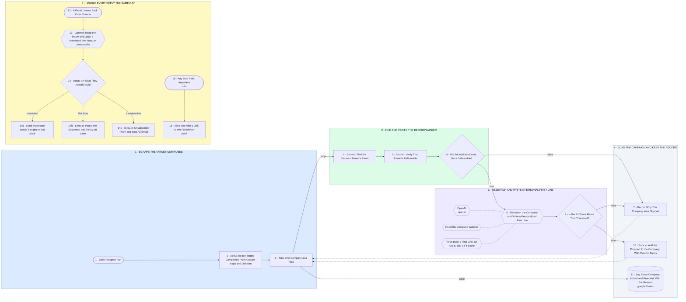

# Full Cold Email Funnel - Scrape, Enrich, Personalize, Send, Reply

- **1 - SCRAPE THE TARGET COMPANIES** - Apify pulls the company list on a schedule. Nothing is typed in by hand.
- **2 - FIND AND VERIFY THE DECISION MAKER** - Snov.io finds the person and checks the address before a single email is queued.
- **3 - RESEARCH AND WRITE A PERSONAL FIRST LINE** - The agent reads their website and writes one line about them, plus a fit score.
- **4 - LOAD THE CAMPAIGN AND KEEP THE RECORD** - Only prospects that passed both checks get added. Everything else is logged with a reason.
- **5 - HANDLE EVERY REPLY THE SAME DAY** - Interested reaches you in Slack. Not now and unsubscribe are handled without you touching them.
