# Freight Quoting: Inquiry, Agent Rates, Negotiation, Quote, Invoice

```mermaid
flowchart LR
    subgraph sec_intake["1 - READ THE INQUIRY AND PULL THE SHIPMENT DETAILS"]
        direction TB
        inbox(["1 - New Inquiry Lands in the Outlook Inbox"])
        extract{{"2 - Claude Reads the Email and Pulls the Shipment Details"}}
        extract_model{{"Claude<br/><i>anthropic</i>"}}
        extract_parser{{"Force Origin Port, Destination Port, Weight, Volume, Cargo Type, Dangerous Goods Class, Incoterms"}}
        complete{"3 - Did the Email Contain Every Field We Need to Quote?"}
        askback["3b - Outlook: Ask the Client for the Missing Details"]
        log_inquiry[("4 - Log the Inquiry as a New Quote Reference<br/><i>googleSheets</i>")]
    end
    subgraph sec_rates["2 - SOURCE RATES FROM THE AGENT NETWORK"]
        direction TB
        lane{"5 - Route the Rate Request by Trade Lane"}
        ask_agents["6 - Outlook: Email the Rate Request to Agents in That Country"]
        window["7 - Hold the Lane Open for 24 Hours While Agents Reply"]
        collect["8 - Outlook: Collect the Agent Rate Replies for This Quote"]
    end
    subgraph sec_negotiate["3 - COMPARE, NEGOTIATE, GET HUMAN APPROVAL"]
        direction TB
        compare{{"9 - Claude Normalizes Every Rate and Ranks Them Side by Side"}}
        compare_model{{"Claude<br/><i>anthropic</i>"}}
        compare_parser{{"Force One All In Cost Per Agent in a Single Currency"}}
        margin{"10 - Is the Best Rate Inside Our Target Margin?"}
        counter["10b - Outlook: Send the Agent a Counter Offer, Two Rounds Maximum"]
        approve["11 - Ask a Human to Approve the Rate Before Anything Is Quoted<br/><i>slack</i>"]
    end
    subgraph sec_quote["4 - QUOTE THE CLIENT AND FOLLOW UP"]
        direction TB
        draft{{"12 - Claude Writes the Quote From Your Template and Terms"}}
        draft_model{{"Claude<br/><i>anthropic</i>"}}
        send_quote["13 - Outlook: Send the Quote to the Client"]
        timer["14 - Wait Out the Follow Up Timer"]
        replied{"15 - Has the Client Replied or Accepted the Quote?"}
        followup["15b - Outlook: Send the Next Follow Up, Three Maximum, Then Stop"]
    end
    subgraph sec_close["5 - INVOICE, ARCHIVE, CATCH FAILURES"]
        direction TB
        invoice["16 - Wafeq: Raise the Invoice for the Accepted Quote"]
        archive["17 - Archive the Quote PDF in the Client's Drive Folder<br/><i>googleDrive</i>"]
        outcome[("18 - Log the Outcome, Won or Lost, Against the Quote Reference<br/><i>googleSheets</i>")]
        err(["19 - Any Step Fails, Anywhere in the Workflow<br/><i>n8n</i>"])
        alert["20 - Alert the Team With the Quote Reference and a Link to the Run<br/><i>slack</i>"]
    end
    inbox --> extract
    extract --> complete
    complete -->|false| askback
    complete -->|true| log_inquiry
    log_inquiry --> lane
    lane -->|China and Southeast Asia| ask_agents
    lane -->|Europe and Mediterranean| ask_agents
    lane -->|Middle East and Gulf| ask_agents
    ask_agents --> window
    window --> collect
    collect --> compare
    compare --> margin
    margin -->|false| counter
    counter -.-> compare
    margin -->|true| approve
    approve --> draft
    draft --> send_quote
    send_quote --> timer
    timer --> replied
    replied -->|false| followup
    followup -.-> timer
    replied -->|true| invoice
    invoice --> archive
    archive --> outcome
    err --> alert
    extract_model -.- extract
    extract_parser -.- extract
    compare_model -.- compare
    compare_parser -.- compare
    draft_model -.- draft
    style sec_intake fill:#dbeafe,stroke:#94a3b8,color:#0f172a
    style sec_rates fill:#dcfce7,stroke:#94a3b8,color:#0f172a
    style sec_negotiate fill:#ede9fe,stroke:#94a3b8,color:#0f172a
    style sec_quote fill:#f1f5f9,stroke:#94a3b8,color:#0f172a
    style sec_close fill:#fef9c3,stroke:#94a3b8,color:#0f172a
```

- **1 - READ THE INQUIRY AND PULL THE SHIPMENT DETAILS** - Claude reads the inbound email and fills a fixed shipment schema. Anything missing goes back to the client before the lane is worked.
- **2 - SOURCE RATES FROM THE AGENT NETWORK** - One rate request per country, sent from Outlook. The workflow holds the lane open for a day and then collects whatever came back.
- **3 - COMPARE, NEGOTIATE, GET HUMAN APPROVAL** - Rates arrive in different currencies and units. Claude normalizes them, and no quote leaves without a person approving the number.
- **4 - QUOTE THE CLIENT AND FOLLOW UP** - The quote is written from your template and terms, then chased on a timer until the client answers.
- **5 - INVOICE, ARCHIVE, CATCH FAILURES** - Accepted quotes become a Wafeq invoice. Every quote is archived and every outcome is logged, win or lose.
